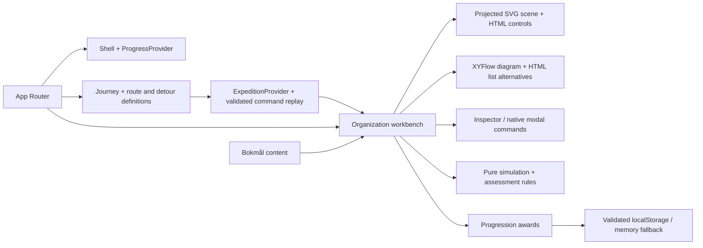

# Architecture

## Current 3.2.1 technical continuation

Ordinary course and Portal consumers now use SandboxProvider. Historical ChapterProvider remains unchanged for archived gameplay. SandboxStore owns one World containing existing groups/Web resources plus infrastructure and app-settings partitions. It captures the validated old event snapshot without writing the old key, replays that prefix with organization-web@1, then executes the new versioned tail with sandbox@2. Receipt verification is model-aware across the boundary. Only shared TypeScript receipt vocabulary adds `updated`; old reducer behavior/limits are unchanged. New capacity is explicitly eight groups/eight VMs/96 objects, not an Azure quota.

SaasProvider owns an independent fictional product account ledger; PracticalProvider owns only context, observations and evidence references. Existing module stores and XP are untouched. Both operational stores validate/replay commands, detect stale tabs, warn on failed storage and retain one prior attempt on explicit reset. No dependencies were added. [Detailed contract](INTEGRATED_LABS_ARCHITECTURE.md) and [QA](PRACTICAL_LABS_QA.md) supersede historical normal-Portal ChapterProvider statements below.

## 3.2 bounded educational expansion

The existing Course owns routing, navigation and course/lab session; no new shell. `domain/curriculum/expansion-models.ts` contains finite runtime-validated conceptual experiments. Only the governance experiment calls the existing execute function, on a discarded fresh engine; shared technical state/receipts are unchanged. `expansion.ts` validates/replays observations and classifies first/help/retry/abandon. `expansion-store.ts` isolates each version, quarantines unknown/corrupt data, prevents stale-tab writes and warns on memory-only operation. ExpansionProvider reuses the root provider tree.

`ExpandedModule` presents original localized content with distinct flow, incident, matrix, schedule, VM-component, platform-gate and SaaS access representations plus semantic controls. ServicesWorkspace retains the original manuscript; its operational extension replaces duplicated per-page responsibility matrices, not the original technical prose. ResponsibilityRecap uses the same pure responsibility rule in Module 1 without another module's evidence. `expansion-content.ts` binds sources, stable competency/objective IDs and independent criteria. See [content contracts](CONTENT_ARCHITECTURE.md) and [implemented models](CLOUD_BENEFITS_CONTENT.md).

The Portal and architecture still share the Chapter01 inventory. Allowlisted lab origins now distinguish computing-v2, services-v1 and services-v2 for exact return. Explicit opt-in may reuse accepted prior resources in the same replayable attempt; inspection predicates remain required. Navigation origins never create evidence.

## 3.1B — actual course, isolated evidence

`Course` selects in-place `FoundationsV2` for current topics; `FoundationsWorkspace` remains labelled v1 compatibility. One root `FoundationsV2Provider` owns the separate record; no second shell or simulator. Stable SSR snapshots and explicit client restoration remain. A finite manifest binds S01–S13, V01–V06 and FC01–FC07.

Original server/capacity graphics are shared with the archive. Pure RAM/provisioning/capacity rules and replay are independent of React. Later investigations reuse presentation through an explicit evidence port; events replay into a fresh v1 **rule evaluator inside v2**, never the v1 key. Its semantics stay pinned; changes require a new model version. Assessment2 preserves first/help/retry.

Optional allowlisted `LabSession.origin: computing-v2` changes return context only. Old shapes/service returns remain accepted. All findings derive from the Chapter ledger. Portal returns to `resource-bridge&activity=lab|debrief`. Server-rendered build details expose only Vercel branch/SHA, absent in production; no configuration/protection change. [Handoff](FOUNDATIONS_31B_HANDOFF.md) owns exact contracts.

## 3.1A isolated instructional proof — 2026-10-25

The isolated `noindex` route `/design/foundations-31a` has a visible branch-review entry on the course landing and its own lightweight shell. `FoundationsReviewEntry` is a stateless native link presentation, not a new provider or activity; remove it before any production release. A feature-local HTML/SVG presenter consumes a pure bounded calculator in `domain/design-proof`, localized through nb.ts. It does not import store hooks, duplicate the inventory or issue learning/technical commands. Existing root providers stay singular and unchanged. No new persistence, schema migration, dependencies, backend or renderer. Production course/Portal behavior is preserved. [Visual system](VISUAL_LEARNING_SYSTEM.md) and [3.1B handoff](FOUNDATIONS_31B_HANDOFF.md) separate implemented proof from future production design.

## Course-first refinement — 2026-10-25

The primary course and shared Portal are connected by [course/lab orchestration](COURSE_LAB_ORCHESTRATION.md). One root ServiceStore serves both; a separate CourseStore tracks validated preference/session context. Four external stores expose stable initial server snapshots, avoiding late streamed hydration mismatch while retaining live client state. The coach observes forms and deterministic receipts; it cannot configure resources. No new dependency, backend or game renderer is introduced.

## Current Portal-first architecture — 2026-10-24

The owner supersedes the historical RPG-first direction. `/portal` composes native operational controls, focused Learn content, a guided companion pane and XYFlow/semantic projections. The existing root ChapterProvider remains the only technical inventory/receipt owner; original progression, curriculum and archived game stores are retained. Pure portal adapters, URL allowlists, source/objective bindings and a separate versioned service-types evidence log live in `src/domain/portal`; presentation lives in `src/features/portal`. No rendering engine controls learning truth. Read [PORTAL_SANDBOX_ARCHITECTURE](PORTAL_SANDBOX_ARCHITECTURE.md) for implemented boundaries and [reference fidelity](PORTAL_REFERENCE_FIDELITY.md) for approximations. The sections below record the preserved historical architecture.

## G1.3 instructional presentation

domain/instruction contains only finite beat/cue/pacing and presentation-preference contracts. content/instruction binds the original nb manuscript to stable sequence/beat/objective/source IDs. The shared playback hook owns a transient cursor, cancellation and history; the existing cinematic director and pure teaching model project its cues. There are no learning/quest writes in playback or scene frames. Domain engines and six prior stores remain. Game owns a single PresentationProvider/audio lifecycle and an isolated seventh UI preference, cleared by the existing all-data action. [Instructional engine](INSTRUCTIONAL_SEQUENCE_ENGINE.md) owns lifecycle, official metadata and review limits.

## G1.2 canonical entry and read-only journey projection

The server root redirects once to /expedition-3d; /legacy-expedition retains historical route state and regression logic. Existing providers/renderers are not duplicated. domain/rpg/expedition derives log/recommendations from the five validated stores; OrientationStore persists only versioned introduction/goal preferences. Arrival shots, waypoint/distance cues and assisted walking remain presentation, never evidence. [Progression contracts](EXPEDITION_PROGRESSION.md) define prioritization, goal handoff and six-key deletion; [onboarding](PLAYER_ONBOARDING.md) defines agency/fallback. No new dependency or Azure rule.

## L1 local content subsystem

The root LearningProvider owns an isolated validated module store and contextual journal. Pure curriculum manifest/evaluators/replay/store live in src/domain/curriculum; semantic session, journal, diagrams and changed-task presentation live in src/features/learning. Original copy remains in nb.ts. Game/scene consume only a read-only unit/probe projection; camera frames and numeric animations cannot create evidence. The existing Azure command engine, four older persistence schemas and award IDs are unchanged. See [content architecture](CONTENT_ARCHITECTURE.md) for the typed hierarchy, event validation, assistance classification and extension boundaries. No new dependency or external runtime service.

## G1.1 bounded shot director

A pure cinematic plan in features/rpg/cinematics.ts separates shot intent/composition from the existing imperative Director. CinematicDialogue owns speech, choices, transient field notes and native focus/inert semantics. CommandDialog continues handling settings/reset. The renderer consumes story/simulation facts; it still cannot mutate technical outcomes. No dependency, provider, persisted key, route or cloud integration is added. Detailed contracts live in [GAMEPLAY_ARCHITECTURE.md](GAMEPLAY_ARCHITECTURE.md).

## G1 addition — separate game route

`/expedition-3d` adds a client-loaded Fiber/Three world, a bare game shell and a fourth root provider (`GameProvider`). Other routes and Azure rules remain intact. Pure player/proximity/dialogue/quest contracts live in `domain/rpg`; imperative rendering/control and semantic alternatives in `features/rpg`. [GAMEPLAY_ARCHITECTURE.md](GAMEPLAY_ARCHITECTURE.md) owns the detailed implemented interfaces, rendering versions, lifetime, persistence and portal return. `/explore?chapter=01&from=rpg-g1` selects a game return link; it does not change technical validation or legacy expedition state. Explicit all-data deletion now clears four local categories. The projected SVG workbenches described below retain their non-WebGL rendering.

## Implemented

Next.js App Router serves the preserved routes `/`, `/explore`, `/missions`, `/progress`. The root layout supplies `ProgressProvider`, `ExpeditionProvider`, `ChapterProvider` and the shared dark shell. Root is the perspective journey; Explore loads either the legacy workbench or the guided chapter (`?chapter=01`) through separate `next/dynamic` boundaries. [JOURNEY_EXPERIENCE.md](JOURNEY_EXPERIENCE.md) owns the route/world transition; [CHAPTER_01_GUIDED.md](CHAPTER_01_GUIDED.md) owns the implemented technical workspace. No route handlers, server actions, databases, credentials or network adapters exist.

- `domain/simulation.ts`: immutable scope records, stable IDs, bounded commands, error codes and mission predicate. No clock, randomness or network effects.
- `domain/assessment.ts`: stable answer IDs and an all-three-correct rule.
- `domain/progression.ts`: allowed award IDs, fixed XP and versioned parsing. XP derives from unique IDs, never stored numeric input.
- `scene-layout.ts` owns schematic x/y/z coordinates, projection and related-branch selection. `spatial-scene.tsx` owns geometry/camera state. The projected SVG renderer has no WebGL, GPU dependency or frame loop. Layout never derives from region. Solid edges show containment; dashed tenant-root links show identity association. Neither shows traffic or physical Azure placement.
- `Workbench` composes scene, XYFlow/list alternatives, contextual inspector, mission HUD and brief/create/check/reset overlays. Only validated commands mutate the existing simulation. Native dialogs manage modal focus; successful creation focuses the new node. Assessment presents the original questions sequentially with unchanged scoring.
- `ProgressProvider`: hydrates after mount, gates awards until ready, catches storage errors, listens for storage events and re-reads before awarding. It is best-effort, not transactional multi-tab persistence.
- Accepted resources, mission activation, submitted guided answers, route position/visits and completion IDs survive reload/navigation. Camera frames, selection/current-attempt HUD and incomplete legacy check answers remain transient. Scenario reset clears current commands/steps and retains XP. Previous awards do not imply successful current attempts. Explicit data deletion clears all four local categories, including guided chapter work and G1.
- `domain/expedition.ts` owns typed route edges, versioned detour contracts/evaluators and runtime snapshot parsing. `route-geometry.ts` owns perspective coordinates and interruptible curve/side-route camera interpolation. Commands replay through existing rules; arbitrary persisted scopes/XP are ignored. Storage is best-effort, not transactional multi-tab editing.

Rendering alternatives, motion and responsive composition are described once in [EXPERIENCE_DESIGN.md](EXPERIENCE_DESIGN.md). The original simulation/assessment/XP rules remain unchanged; Phase 1A.5 adds a separate validated expedition snapshot and command replay.

## Guided Chapter 01 boundary

`domain/chapter01/model.ts` owns the frozen organization/Web fixture, four registered command handlers, runtime validation, immutable transitions, delivery deduplication and deterministic receipts. `scenario.ts` owns versioned objectives, explicit role bindings, prediction/inspection/explanation events and six registered guided evaluators. It imports no React, storage, prose or progression ledger. `persistence.ts` pins schema/scenario/model versions and reconstructs an attempt by replay; stored completion/world/XP is never trusted.

`features/chapter01/store.ts` coordinates bounded local snapshots, revision checks, quarantine, export and explicit restart. Its injected storage port enables denied-read/write tests. `ChapterProvider` shares this store between journey and world; the gateway derives guided status from the same findings. Legacy keys and awards remain separate. A detected stale tab stops mutation until explicit reload; compare-before-write is best-effort, not an atomic cross-tab transaction.

`projectWorld` is a read-only adapter into the existing SVG/XYFlow/HTML controls. It supplies semantic resource shapes, typed relationships and locations; coordinates never determine a rule or score. Contextual command, learning, receipt and inspection components emit intents into the store. Policy/rejection annotations are presentation objects, not resources. Chapter camera framing includes the selected app's plan and actual viewport aspect; legacy camera defaults remain intact. No general scenario interpreter or WebGL dependency is introduced.

Only guided local observations are implemented. The broader assessment, immutable submission/history and explicit checkpoint-promotion boxes below remain proposed, as do backend migration and organizations.

## Documentation gate

`scripts/docs-check.mjs` checks required documents and ordinary inline/reference repository-local links, images and Markdown heading targets. It ignores fenced code and external URLs, prohibits links escaping the checkout and makes no network requests. Three Node fixture tests verify valid links and failure cases. `npm run check` includes this gate, so existing CI runs it before production builds/browser tests. It validates structure/links, not factual accuracy or every Markdown extension; source review remains necessary.

## Localization

UI and learning copy live in `content/nb.ts`; `<html lang="nb">` identifies the locale. Domain/answer IDs are language neutral. A future English dictionary can share the Bokmål shape with locale selection at the routing boundary. No translation selector is advertised. Example names and service names remain technical identifiers.

## Broader Phase 1A evolution — remaining proposal

The [product blueprint](PRODUCT_BLUEPRINT.md) selects a competency journey, persistent reference world and isolated scenario workspaces. [SIMULATION_PLATFORM.md](SIMULATION_PLATFORM.md) is now the canonical proposed contract for domain models, scenario orchestration, content, rendering, assessment, progression and local-to-account migration. It supersedes the generic Phase 0 schema sketches previously here; Git history retains them. No engine, storage format or runtime behavior was changed in Phase 1A.

Phase 1B should prove only the [first chapter](CHAPTER_01_BLUEPRINT.md): typed plan/app resources, a filtered policy subset, responsibility decisions, causal receipts, independent transfer and explicit local checkpoint promotion. Preserve legacy creation/progression behavior through an adapter. Phase 1C extracts registries/authoring validation after a working chapter and a second authored case demonstrate the actual reuse. Avoid a speculative generic platform rewrite.

Competencies and evidence have stable IDs/revisions; credential mappings are a separate overlay in [LEARNING_JOURNEY.md](LEARNING_JOURNEY.md). A completed local task is not an authenticated credential, a trusted performance record or a readiness calculation. Future account/organization storage requires per-request membership authorization, isolation tests, export/deletion and transactional unique awards; an Entra tenant ID never grants product organization membership. No backend is introduced by this proposal.

## Integrations and deployment

[MICROSOFT_LEARN.md](MICROSOFT_LEARN.md) defines a disabled future metadata adapter and source model. Supabase is not connected. A pre-existing Vercel/GitHub integration publishes branch previews; the owner explicitly approved automatic previews during delivery. Local development is independent of that hosting and requires no credentials. Production deployment and merge are not authorized. Provider-free domain rules preserve portability; enterprise deployment requires a separate security design.

## 3.1B.1 presentation boundaries

No store/schema or domain rule changes. The course navigation observer manages viewport clearance and heading focus. The coach adds typed action/inspection semantics and route eligibility before resolving DOM bounds; target selection remains read-only. `CloudDeployment` is a bounded explanatory SVG, not an additional simulator inventory. It retains classification on offsite private-cloud moves and labels hybrid lines as requirements, never configured connectivity. Detailed contracts live in [guided engine](GUIDED_SANDBOX_ENGINE.md) and [handoff](FOUNDATIONS_31B_HANDOFF.md#31b1-implemented-refinement).
