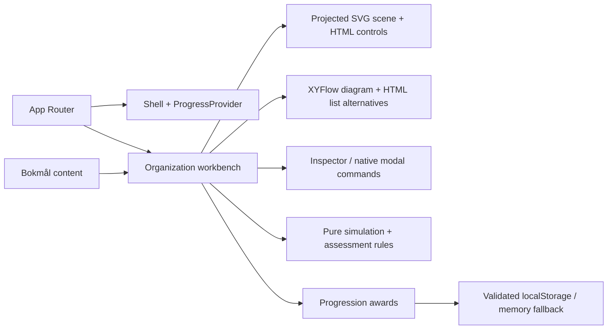

# Architecture

## Implemented

Next.js App Router serves the preserved routes `/`, `/explore`, `/missions`, `/progress`. The root layout supplies the unchanged client `ProgressProvider` and shared dark shell. The client control room derives milestones from that provider; Explore composes a client workbench. No route handlers, server actions, databases, credentials or adapters exist.



- `domain/simulation.ts`: immutable scope records, stable IDs, bounded commands, error codes and mission predicate. No clock, randomness or network effects.
- `domain/assessment.ts`: stable answer IDs and an all-three-correct rule.
- `domain/progression.ts`: allowed award IDs, fixed XP and versioned parsing. XP derives from unique IDs, never stored numeric input.
- `scene-layout.ts` owns schematic x/y/z coordinates, projection and related-branch selection. `spatial-scene.tsx` owns geometry/camera state. No WebGL, GPU dependency or frame loop. Layout never derives from region. Solid edges show containment; dashed tenant-root links show identity association. Neither shows traffic or physical Azure placement.
- `Workbench` composes scene, XYFlow/list alternatives, contextual inspector, mission HUD and brief/create/check/reset overlays. Only validated commands mutate the existing simulation. Native dialogs manage modal focus; successful creation focuses the new node. Assessment presents the original questions sequentially with unchanged scoring.
- `ProgressProvider`: hydrates after mount, gates awards until ready, catches storage errors, listens for storage events and re-reads before awarding. It is best-effort, not transactional multi-tab persistence.
- Simulation, selection, camera, current-attempt HUD and answers reset on reload/navigation. Completion IDs persist. Scenario reset clears current steps/camera and retains XP. Previous awards do not imply successful current attempts. Explicit data deletion clears awards.

Rendering alternatives, motion and responsive composition are described once in [EXPERIENCE_DESIGN.md](EXPERIENCE_DESIGN.md). The original pure domain/persistence implementation remains unchanged.

## Documentation gate

`scripts/docs-check.mjs` checks required documents and ordinary inline/reference repository-local links, images and Markdown heading targets. It ignores fenced code and external URLs, prohibits links escaping the checkout and makes no network requests. Three Node fixture tests verify valid links and failure cases. `npm run check` includes this gate, so existing CI runs it before production builds/browser tests. It validates structure/links, not factual accuracy or every Markdown extension; source review remains necessary.

## Localization

UI and learning copy live in `content/nb.ts`; `<html lang="nb">` identifies the locale. Domain/answer IDs are language neutral. A future English dictionary can share the Bokmål shape with locale selection at the routing boundary. No translation selector is advertised. Example names and service names remain technical identifiers.

## Proposed contracts — design only

These sketches are not implemented tables. Future API boundaries validate IDs and payloads; assessment rules run on trusted server state.

```ts
type LearningModule = {
  id: string;
  version: string;
  locale: 'nb' | 'en';
  objectiveIds: string[];
  missionIds: string[];
  sourceIds: string[];
  reviewedAt: string;
};
type Mission = {
  id: string;
  version: string;
  moduleId: string;
  context: string;
  objectiveIds: string[];
  initialScenarioId: string;
  tasks: { id: string; instruction: string; ruleIds: string[]; hints: string[] }[];
  successRuleIds: string[];
  feedback: { pass: string; fail: string };
  reflection: string;
  awardId: string;
  repeatable: boolean;
};
type SimulationResource = {
  id: string;
  type: string;
  parentScopeId: string;
  location: { kind: 'regional'; region: string } | { kind: 'global' };
  configuration: Record<string, unknown>;
  dependencyIds: string[];
};
type ScenarioState = {
  version: string;
  scopes: { id: string; kind: string; parentId?: string }[];
  resources: SimulationResource[];
  failures: { id: string; active: boolean }[];
  sequence: number;
};
type ValidationRule = {
  id: string;
  version: string;
  evaluate: (state: Readonly<ScenarioState>) => {
    passed: boolean;
    code: string;
    affectedIds: string[];
    explanationKey: string;
  };
};
type ProgressionEvent = {
  id: string;
  userId: string;
  organizationId: string | null;
  missionVersion: string;
  awardId: string;
  eventType: 'mission-completed' | 'assessment-passed';
  verifiedAttemptId: string;
  occurredAt: string;
};
type MasteryEvidence = {
  id: string;
  userId: string;
  topicId: string;
  attemptId: string;
  assessmentVersion: string;
  outcome: number;
  hintsUsed: number;
  independence: 'guided' | 'independent';
  collectedAt: string;
  retentionReviewDue: string;
};
type UserAccount = {
  id: string;
  locale: 'nb' | 'en';
  identityProviderSubject: string;
  profileVisibility: 'private' | 'organization';
};
type Organization = { id: string; name: string; retentionPolicyId: string };
type Membership = {
  organizationId: string;
  userId: string;
  role: 'learner' | 'instructor' | 'admin';
};
type LeaderboardEntry = {
  organizationId: string;
  userId: string;
  optedInAt: string;
  pseudonym: string;
  cohortId: string;
  scoringPolicyVersion: string;
  verifiedScore: number;
};
```

Never use an Entra tenant ID to infer product organization authorization. Future persistence needs membership-scoped access, isolation tests, export/deletion and opt-in rankings. The server award ledger needs a unique `(userId, organizationId, awardId)` constraint with transactional attempt verification. Updating module versions must not silently issue the same reward again. Offline progress imports remain untrusted.

Readiness must consider objective coverage, varied independent performance, retention and uncertainty. It is not an XP conversion; no readiness algorithm is implemented.

## Integrations and deployment

[MICROSOFT_LEARN.md](MICROSOFT_LEARN.md) defines a disabled future metadata adapter and source model. Supabase is not connected. A pre-existing Vercel/GitHub integration publishes branch previews; the owner explicitly approved automatic previews during delivery. Local development is independent of that hosting and requires no credentials. Production deployment and merge are not authorized. Provider-free domain rules preserve portability; enterprise deployment requires a separate security design.
