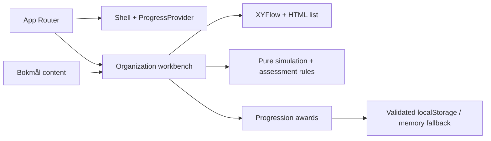

# Architecture

## Implemented

Next.js App Router serves `/`, `/explore`, `/missions`, `/progress`. The root layout supplies a client `ProgressProvider` and shell. Dashboard/Explore route composition remains server-rendered; the workbench owns simulation state. No route handlers, server actions, databases, credentials or adapters exist.



- `domain/simulation.ts`: immutable scope records, stable IDs, bounded commands, error codes and mission predicate. No clock, randomness or network effects.
- `domain/assessment.ts`: stable answer IDs and an all-three-correct rule.
- `domain/progression.ts`: allowed award IDs, fixed XP and versioned parsing. XP derives from unique IDs, never stored numeric input.
- Graph layout is presentation state. Solid edges show containment; the dashed tenant-root link shows identity association. Neither shows network traffic.
- `ProgressProvider`: hydrates after mount, gates awards until ready, catches storage errors, listens for storage events and re-reads before awarding. It is best-effort, not transactional multi-tab persistence.
- Simulation, selection and answers reset on reload/navigation. Completion IDs persist. Scenario reset retains XP; explicit progress deletion clears awards.

## Localization

UI and learning copy live in `content/nb.ts`; `<html lang="nb">` identifies the locale. Domain/answer IDs are language neutral. A future English dictionary can share the Bokmål shape with locale selection at the routing boundary. No translation selector is advertised. Example names and service names remain technical identifiers.

## Proposed contracts — design only

These sketches are not implemented tables. Future API boundaries validate IDs and payloads; assessment rules run on trusted server state.

```ts
type LearningModule = {
  id: string;
  version: string;
  locale: 'nb' | 'en';
  objectiveIds: string[];
  missionIds: string[];
  sourceIds: string[];
  reviewedAt: string;
};
type Mission = {
  id: string;
  version: string;
  moduleId: string;
  context: string;
  objectiveIds: string[];
  initialScenarioId: string;
  tasks: { id: string; instruction: string; ruleIds: string[]; hints: string[] }[];
  successRuleIds: string[];
  feedback: { pass: string; fail: string };
  reflection: string;
  awardId: string;
  repeatable: boolean;
};
type SimulationResource = {
  id: string;
  type: string;
  parentScopeId: string;
  location: { kind: 'regional'; region: string } | { kind: 'global' };
  configuration: Record<string, unknown>;
  dependencyIds: string[];
};
type ScenarioState = {
  version: string;
  scopes: { id: string; kind: string; parentId?: string }[];
  resources: SimulationResource[];
  failures: { id: string; active: boolean }[];
  sequence: number;
};
type ValidationRule = {
  id: string;
  version: string;
  evaluate: (state: Readonly<ScenarioState>) => {
    passed: boolean;
    code: string;
    affectedIds: string[];
    explanationKey: string;
  };
};
type ProgressionEvent = {
  id: string;
  userId: string;
  organizationId: string | null;
  missionVersion: string;
  awardId: string;
  eventType: 'mission-completed' | 'assessment-passed';
  verifiedAttemptId: string;
  occurredAt: string;
};
type MasteryEvidence = {
  id: string;
  userId: string;
  topicId: string;
  attemptId: string;
  assessmentVersion: string;
  outcome: number;
  hintsUsed: number;
  independence: 'guided' | 'independent';
  collectedAt: string;
  retentionReviewDue: string;
};
type UserAccount = {
  id: string;
  locale: 'nb' | 'en';
  identityProviderSubject: string;
  profileVisibility: 'private' | 'organization';
};
type Organization = { id: string; name: string; retentionPolicyId: string };
type Membership = {
  organizationId: string;
  userId: string;
  role: 'learner' | 'instructor' | 'admin';
};
type LeaderboardEntry = {
  organizationId: string;
  userId: string;
  optedInAt: string;
  pseudonym: string;
  cohortId: string;
  scoringPolicyVersion: string;
  verifiedScore: number;
};
```

Never use an Entra tenant ID to infer product organization authorization. Future persistence needs membership-scoped access, isolation tests, export/deletion and opt-in rankings. The server award ledger needs a unique `(userId, organizationId, awardId)` constraint with transactional attempt verification. Updating module versions must not silently issue the same reward again. Offline progress imports remain untrusted.

Readiness must consider objective coverage, varied independent performance, retention and uncertainty. It is not an XP conversion; no readiness algorithm is implemented.

## Integrations and deployment

[MICROSOFT_LEARN.md](MICROSOFT_LEARN.md) defines a disabled future metadata adapter and source model. Supabase could later supply auth/data; Vercel could host the app. Neither is connected. Provider-free domain rules preserve portability. Enterprise deployment requires a separate security design.
