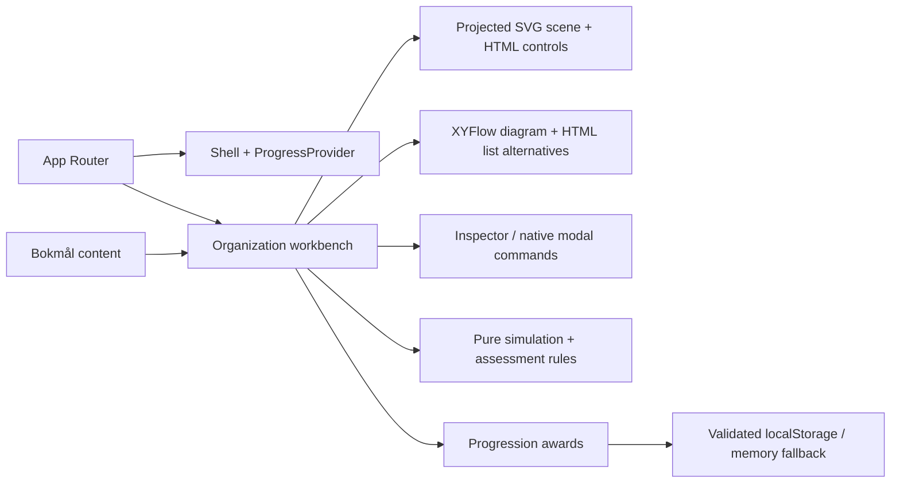

# Architecture

## Implemented

Next.js App Router serves the preserved routes `/`, `/explore`, `/missions`, `/progress`. The root layout supplies the unchanged client `ProgressProvider` and shared dark shell. The client control room derives milestones from that provider; Explore composes a client workbench. No route handlers, server actions, databases, credentials or adapters exist.

- `domain/simulation.ts`: immutable scope records, stable IDs, bounded commands, error codes and mission predicate. No clock, randomness or network effects.
- `domain/assessment.ts`: stable answer IDs and an all-three-correct rule.
- `domain/progression.ts`: allowed award IDs, fixed XP and versioned parsing. XP derives from unique IDs, never stored numeric input.
- `scene-layout.ts` owns schematic x/y/z coordinates, projection and related-branch selection. `spatial-scene.tsx` owns geometry/camera state. No WebGL, GPU dependency or frame loop. Layout never derives from region. Solid edges show containment; dashed tenant-root links show identity association. Neither shows traffic or physical Azure placement.
- `Workbench` composes scene, XYFlow/list alternatives, contextual inspector, mission HUD and brief/create/check/reset overlays. Only validated commands mutate the existing simulation. Native dialogs manage modal focus; successful creation focuses the new node. Assessment presents the original questions sequentially with unchanged scoring.
- `ProgressProvider`: hydrates after mount, gates awards until ready, catches storage errors, listens for storage events and re-reads before awarding. It is best-effort, not transactional multi-tab persistence.
- Simulation, selection, camera, current-attempt HUD and answers reset on reload/navigation. Completion IDs persist. Scenario reset clears current steps/camera and retains XP. Previous awards do not imply successful current attempts. Explicit data deletion clears awards.

Rendering alternatives, motion and responsive composition are described once in [EXPERIENCE_DESIGN.md](EXPERIENCE_DESIGN.md). The original pure domain/persistence implementation remains unchanged.

## Documentation gate

`scripts/docs-check.mjs` checks required documents and ordinary inline/reference repository-local links, images and Markdown heading targets. It ignores fenced code and external URLs, prohibits links escaping the checkout and makes no network requests. Three Node fixture tests verify valid links and failure cases. `npm run check` includes this gate, so existing CI runs it before production builds/browser tests. It validates structure/links, not factual accuracy or every Markdown extension; source review remains necessary.

## Localization

UI and learning copy live in `content/nb.ts`; `<html lang="nb">` identifies the locale. Domain/answer IDs are language neutral. A future English dictionary can share the Bokmål shape with locale selection at the routing boundary. No translation selector is advertised. Example names and service names remain technical identifiers.

## Phase 1A proposed evolution — not implemented

The [product blueprint](PRODUCT_BLUEPRINT.md) selects a competency journey, persistent reference world and isolated scenario workspaces. [SIMULATION_PLATFORM.md](SIMULATION_PLATFORM.md) is now the canonical proposed contract for domain models, scenario orchestration, content, rendering, assessment, progression and local-to-account migration. It supersedes the generic Phase 0 schema sketches previously here; Git history retains them. No engine, storage format or runtime behavior was changed in Phase 1A.

Phase 1B should prove only the [first chapter](CHAPTER_01_BLUEPRINT.md): typed plan/app resources, a filtered policy subset, responsibility decisions, causal receipts, independent transfer and explicit local checkpoint promotion. Preserve legacy creation/progression behavior through an adapter. Phase 1C extracts registries/authoring validation after a working chapter and a second authored case demonstrate the actual reuse. Avoid a speculative generic platform rewrite.

Competencies and evidence have stable IDs/revisions; credential mappings are a separate overlay in [LEARNING_JOURNEY.md](LEARNING_JOURNEY.md). A completed local task is not an authenticated credential, a trusted performance record or a readiness calculation. Future account/organization storage requires per-request membership authorization, isolation tests, export/deletion and transactional unique awards; an Entra tenant ID never grants product organization membership. No backend is introduced by this proposal.

## Integrations and deployment

[MICROSOFT_LEARN.md](MICROSOFT_LEARN.md) defines a disabled future metadata adapter and source model. Supabase is not connected. A pre-existing Vercel/GitHub integration publishes branch previews; the owner explicitly approved automatic previews during delivery. Local development is independent of that hosting and requires no credentials. Production deployment and merge are not authorized. Provider-free domain rules preserve portability; enterprise deployment requires a separate security design.
