# Cloud Computing — pedagogical consolidation

## Final learning-navigation cleanup — 3 November 2026

The owner retains the six sessions, flat sidebar, original part headings and compact framing. This final correction removes three competing detours rather than changing the curriculum or creating a new menu:

- ResponsibilityRecap's link to later Service Types overview is removed. Its existing note already says that the full comparison follows in module3. The complete original state, controls, responsibility calculation and explanations remain; only the Link import and that Link line differ.
- The shared teaching-page `related-transfer`/TransferEntry wrapper is removed. It repeated the same bank on ordinary Computing, Benefits and Services pages. All three already end in their own canonical transfer activity; those sequences and Hub discovery are unchanged.
- The six composed Cloud Computing sessions no longer append RelatedActivities. The original single disclosure at the closing `resource-bridge` activity remains: optional independent assessment and previous observations, each with its original purpose text. The footer owns recommended Next/Fortsett; the global Journal remains available. No replacement submenu or large panel is added.

| Preserved destination                                 | Intended discovery and behavior                                                                                                                                               |
| ----------------------------------------------------- | ----------------------------------------------------------------------------------------------------------------------------------------------------------------------------- |
| `/learn/computing?topic=v2-assessment`                | Optional local knowledge/application check from closing Portal-practice activity; opens its existing explicit Start, never begins by link.                                    |
| `/learn/computing?topic=v2-summary`                   | Previous observations from that same closing choice; original versioned evidence and teaching boundary.                                                                       |
| `/learn/computing?topic=transfer`                     | Last recommended Cloud Computing activity after Serverless and Portal practice; existing sidebar/footer and optional Hub discovery. Original cases and explicit Start remain. |
| `/learn/benefits?topic=transfer`                      | Existing Benefits Summary→transfer ending and explicit Hub discovery.                                                                                                         |
| `/learn/services?topic=transfer`                      | Existing modern Services Summary→transfer ending, Hub discovery and all old direct/version routes.                                                                            |
| `/learn/services?topic=overview`                      | Normal later Service Types module entry and free catalogue navigation; no longer an unsolicited Cloud Computing recap shortcut.                                               |
| All original topics/anchors/resume and global Journal | Unchanged parsers/stores/guards; direct access remains voluntary and does not grant credit.                                                                                   |

Targeted inspection found the exact shared TransferEntry repetition in Benefits/Services, so its removal is included. Their own same-module assessment/history links, teaching, practical missions, TransferPreparation explanations, summaries and recommended module boundaries are untouched. No broader module consolidation is inferred.

Actual7ef public baseline and candidate screenshots at1440×900/1024×500 show both repeated secondary disclosure rows gone from ordinary session endings; the recap's premature cross-module link is gone. Source disclosure and original synthesis remain. These are navigation-noise observations, not measured learning improvements.

| Before7ef                                                                                                                               | Final navigation candidate                                                                                                                             |
| --------------------------------------------------------------------------------------------------------------------------------------- | ------------------------------------------------------------------------------------------------------------------------------------------------------ |
|       | 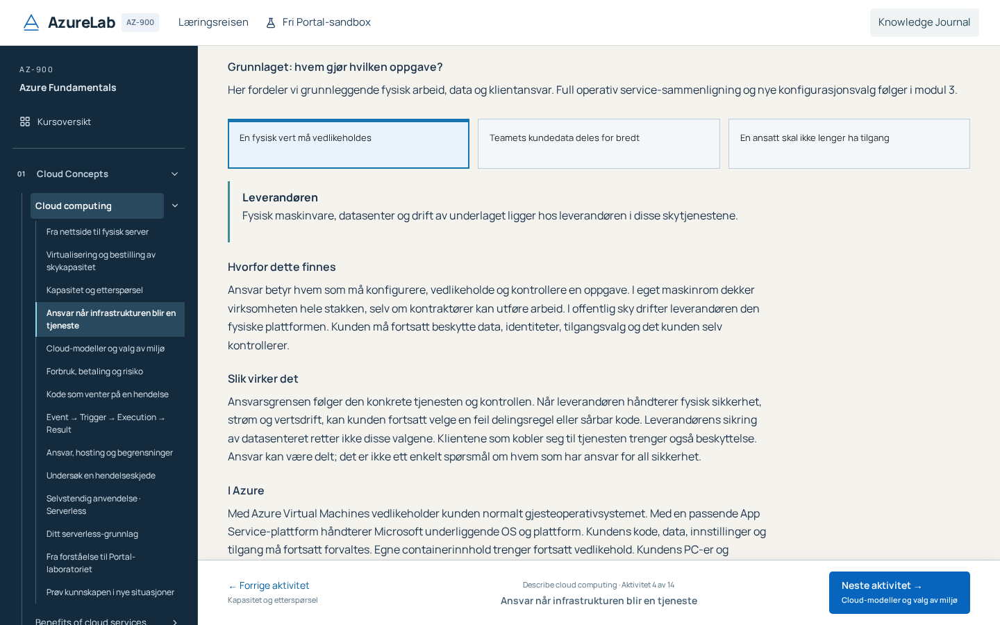 |
| 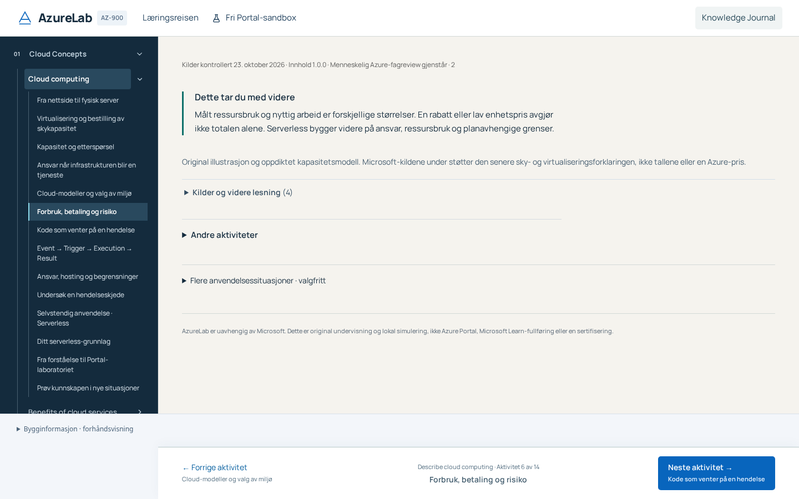 | 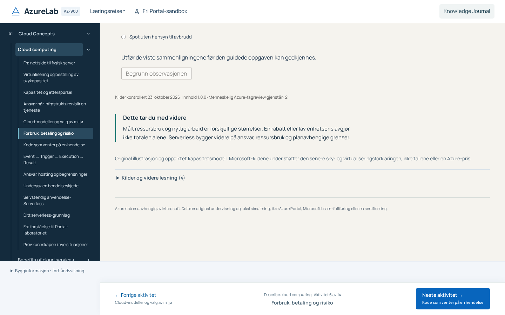              |
| 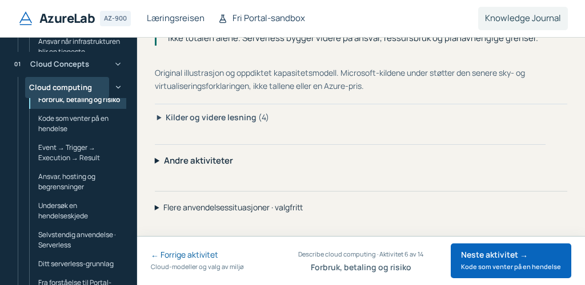                | 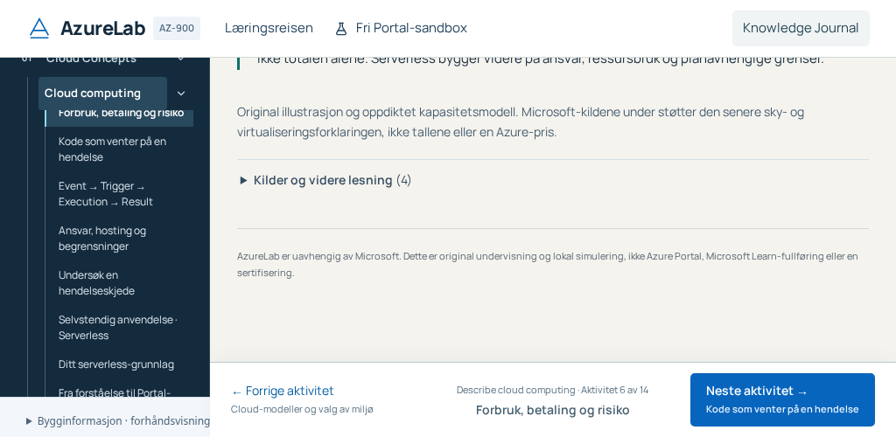                              |

Preservation: all162 original domain files, entire locale, Foundations presenter, chapter metadata, course navigation, transfer presenter/bank, expanded modules and Hub remain byte-identical. The previous354 protected paths become353 only because the explicitly authorized recap Link removal changes that presenter; an exact normalized whole-file comparison proves its model/body unchanged. Original source IDs/URLs, schema2/3, first/help/retry/abandon, guided observations, World/commands/receipts/XP and sequence remain frozen.

Tests retain all349 prior executions and every old first/assistance/history assertion. Historical Back tests now reach the assessment through the real closing entry and additionally return to their original provisioning address; no deleted shortcut is recreated. The original full journey visits the closing practical activity before its optional observations link. One new closing-choice case, run on desktop and distinct compact viewport, gives351(318/33), optional legacy636. Full check, renewed stamp/separate review, exact-head complete CI/strict and actual anonymous new-SHA Gate7 are pending for this correction. Earlier7ef success is dated evidence only. Known Compute help/Back assertion310 instability remains open unless actually diagnosed; no timeout/retry/skip change. Broader stages, PR53, P17/P18 and human validation remain outside scope.

## Owner acceptance refinement — 3 November 2026

The owner approved the six-session structure and rejected both extra part-navigation layers. Current ordinary CourseSidebar shows six main foundational sessions, followed by the unchanged Serverless/resource-bridge/transfer sequence (14 entries). It has no “Deler i økten”, nested topic list or singleton self-menu. The horizontal old-title link row is also removed. Original subsection headings/IDs, source unions, mechanisms/checks and all old direct/resume URLs remain. The earlier audit's part-menu observation below is dated evidence, superseded by this explicit owner correction.

Module number and module title share a compact context row on these six reading sessions; the complete module introduction and session objective remain. Other modules, v1, Serverless, assessments and Portal retain their framing. At1440×900 the measured first paragraph moves from627.27px to420.06px (207.20px earlier); module-header height196.75→103px. At1024×500 layout alone moves the first paragraph603.86→407.27px. The existing authorized-mount focus policy now also notices when the real paragraph starts below the short-window reading area; its ordinary instant heading scroll places the paragraph at251.27px above the407.42px footer. No text is removed or hidden by overflow. These are geometry observations, not learning-effect measurements.

| Before1239                                                                                                | Refined candidate                                                                                                       |
| --------------------------------------------------------------------------------------------------------- | ----------------------------------------------------------------------------------------------------------------------- |
|  | 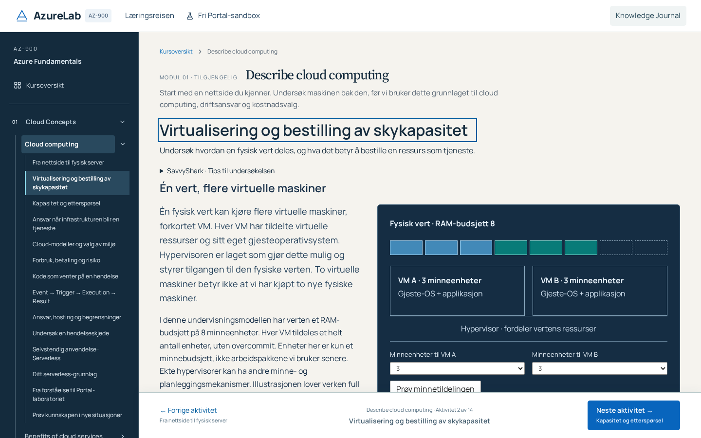            |
| 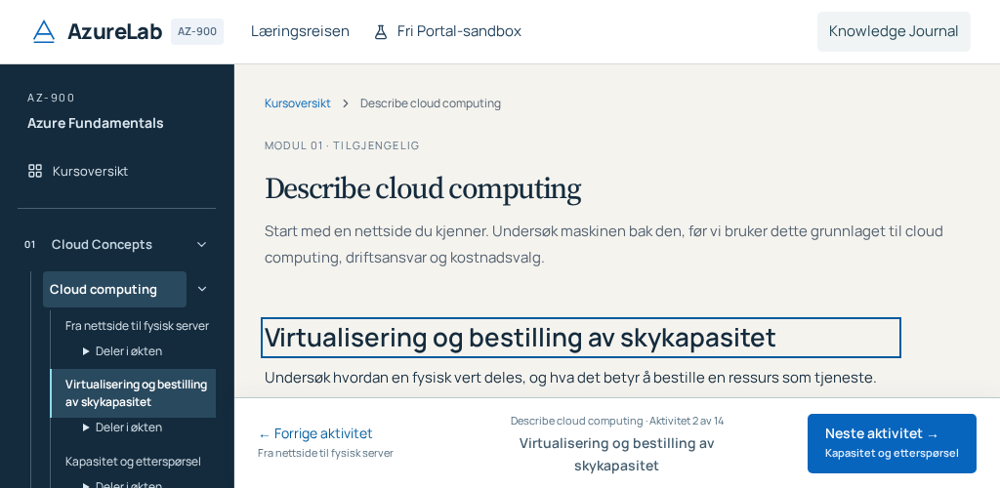 | 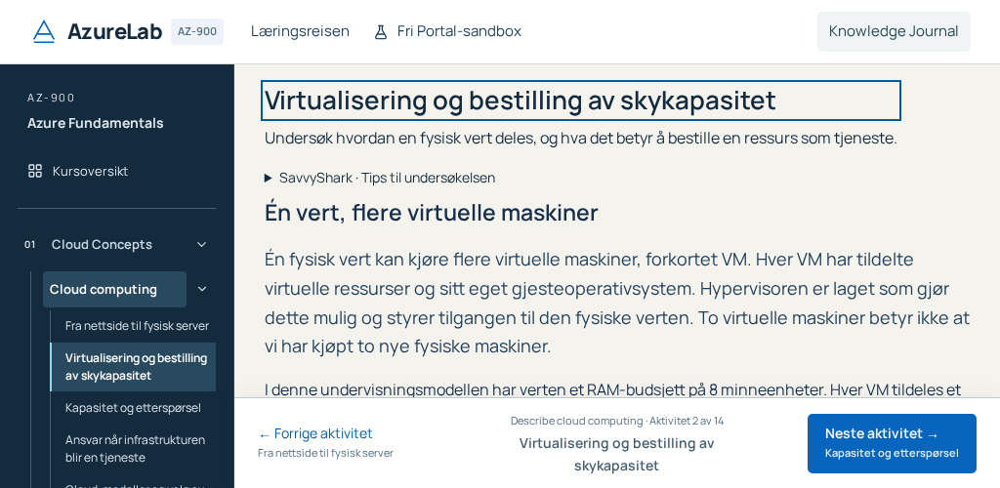 |

Normal tests now use the actual main-session links and scroll to original teaching, rather than recreating deleted menus. The historical same-document test explicitly uses the browser's supported native history API; direct URL/reload/Back/Forward tests retain their original technical addresses. Intentional assessment-exit/denied-write assertions still use real visible main-session clicks. Old browser history must retain its exact original topic, not be recanonicalized by the test. No test weakens scoring, first/help/retry, technical byte equality or assistance.

Targeted regression also exposed a pre-existing authorized-mount focus race on the real Portal debrief. An effect could run while the teaching boundary still withheld its DOM. A deterministic probe used state produced by actual RG/Policy/Plan/App UI actions, deliberately corrupted only an empty Networking history, then used native scoped recovery: the debrief mounted with BODY focused. Focus now follows the actual authorized debrief ref mount using the same two-frame instant-scroll policy and cleanup; lab focus/teaching guards remain unchanged. The inherited full Foundations journey adds that recovery regression and exact World/receipt/XP equality, without removing its original first/help/retry/return checks. No technical operation, bank/rubric or persistent field changes.

The fresh independent review additionally caught a regression in that focus split: an old debrief URL for an unfinished lab must still fall back to the practical-lab section. Stable mount callbacks now share the same narrow two-frame focus helper for lab/incomplete-debrief and completed debrief; the original target selection and teaching boundary remain. A direct empty-context regression preserves the unfinished fallback and raw technical equality.

The new owner viewport witness is bounded to requested desktop1440×900 and1024×500; the compact witness tests its distinct initial800×700. It does not repeat near-identical default desktop heights. Every original346 test, including the original sequential six-size case, remains. The independent earlier new-test aggregate reached30s after22.454s initial navigation (precise cause unconfirmed), then its unchanged isolated rerun passed11.8s. The initial failure is retained rather than relabelled as a pass.

All346 earlier executions remain. Two new desktop cases and one distinct initial compact witness validate absence of both menu layers, actual first-reading visibility, native keyboard/Axe/reduced motion, known/foreign fragment focus and exact historical resume:349(317desktop/32compact), optional legacy634. Actual owner fullcheck passed638Vitest/503curriculum subset/24Node/build. Targeted runs retained their failures: an incorrect historical test expectation was corrected; a true late debrief-focus race was fixed; a later long run timed out during an unchanged VM click without script errors, with precise cause unconfirmed. The original full UI journey passed isolated under the original180s/action15s limits, including new scoped-recovery/World-byte equality. A late Previous-href assertion passed targeted ESLint/typecheck and actual14-entry navigation. Native125%/200% zoom passed actual control/footer geometry and Axe. Fresh independent review/stamp, complete final-headCI/strict and actual new-SHA Gate7 remain pending separately. Historical1239 success does not approve changed code. The two long sessions remain intact at the owner's direction; broaderPD01 and human validation remain open.

## Initial consolidation decision and boundaries — 3 November 2026

Verified base `eefbcd3bc7f140b690829bad6542d800c57b7f74`, Draft51. Actual anonymous base screenshots and rendered SHA confirm19 recommended entries. The provisioning page combines two paragraphs, one small two-lane model and a check with a full page of repeated framing/navigation. It is useful content, but belongs beside virtualization rather than in a separate session. This is an owner-authorized pedagogical composition change, not a new content/rubric/store version.

Six foundational sessions replace eleven short recommended entries. Responsibility retains a full session: its service-by-service recap, manuscript, terms and causal investigation already support a substantial distinct learning goal. Combining it with both deployment models and placement would make one very long session with three different investigations. The remaining Serverless6, resource bridge and transfer entries remain independently useful. **19→14 recommended entries;18→13 internal forward page transitions.** These are navigation counts, not measured time, cognitive load or learning benefit. Voluntary assessments, per-model actions, part anchors, Portal work and returning to earlier work are not counted as completed teaching or interchangeable clicks.

1. **Fra nettside til fysisk server:** request/browser/application → physical components.
2. **Virtualisering og bestilling av skykapasitet:** finite host/RAM → administration provisioning versus application requests.
3. **Kapasitet og etterspørsel:** unit/worked example → prediction, two runs and causal check.
4. **Ansvar når infrastrukturen blir en tjeneste:** shared-responsibility comparison and investigation.
5. **Cloud-modeller og valg av miljø:** public/private/hybrid → requirement-driven placement.
6. **Forbruk, betaling og risiko:** allocated usage → pricing/commitment/interruption tradeoffs.
   7–12. Existing Serverless concept → mechanism → hosting/limits → explorer → independent assessment → summary.
7. Existing real local resource bridge/lab and debrief.
8. Existing Cloud Transfer and optional StageA new application. Then the unchanged Benefits module boundary.

## All19 inspected entries

“2 paragraphs” describes the original introductory copy, not the full rendered interactive lesson. Later units also contain the complete six-part manuscript, definitions and VersionedInvestigation. No word threshold decides quality. Observations below refer to the original evidence IDs and require their existing actual actions; a page visit is never completion. Every old route remains accepted.

| Historical topic      | Concept / expected understanding                            | Prerequisite and relation                                  | Actual material / mechanism / check                                                                    | Historical observation                                            | Disposition / new place                                                 |
| --------------------- | ----------------------------------------------------------- | ---------------------------------------------------------- | ------------------------------------------------------------------------------------------------------ | ----------------------------------------------------------------- | ----------------------------------------------------------------------- |
| intro-request         | client asks; server application answers                     | first entry; leads to hardware behind the program          | 2 paragraphs; request trace, optional database; browser/server check                                   | visit; explicit request; check                                    | Consolidate into1; retain trace/check                                   |
| physical-server       | CPU/RAM/storage/network/OS/application have distinct roles  | request/application; leads to virtual backing              | 2 paragraphs; selectable server components with explanations; storage/RAM check                        | visit; explicit inspect(part); check                              | Consolidate into1; useful interaction without separate top-level page   |
| virtualization        | VM guests share finite physical backing                     | physical components; precedes provisioning                 | 2 paragraphs;8-unit RAM allocation, accepted/rejected requests; finite-budget check                    | visit; memory(requested); check                                   | Consolidate into2; limits remain next to model                          |
| provisioning          | administration request differs from application traffic     | physical/virtual resource; leads to assigned capacity      | 2 paragraphs; owned/cloud lanes, supported/unavailable request; control/traffic check                  | visit; provision(supported); check                                | Consolidate into2; no longer recommended separate page                  |
| capacity-basics       | declared unit; served/unused/unmet within one hour          | assigned capacity; prepares prediction                     | 2 paragraphs; worked CapacityBoard; unused/unmet check                                                 | visit; check                                                      | Consolidate into3; worked example remains before action                 |
| v2-capacity           | predict under changed demand; compare allocations           | worked example; leads to responsibility                    | 2 paragraphs; prediction+capacity run, prior-run comparison; same-hour check requires6/10 runs         | visit; capacity; check                                            | Retain interaction inside3; original prerequisites unchanged            |
| v2-responsibility     | customer's remaining duties vary by service                 | provisioning/capacity; distinct from deployment model      | 2 paragraphs+6 manuscript sections+terms; service comparison and original investigation/causal answers | visit; practice visit/probe/answer                                | Keep independent session4; already substantive                          |
| v2-models             | public/private/hybrid use/integration, not building address | responsibility axis; precedes requirement placement        | 2 paragraphs+6 manuscript sections+terms; topology and original investigation                          | visit; practice visit/probe/answer                                | Consolidate into5; all counterexamples remain required visible teaching |
| v2-placement          | select environment from exclusive/integration needs         | deployment models; leads to economic dimension             | 2 paragraphs+6 manuscript sections+terms; changed requirements/three placements and explanations       | visit; practice visit/probe/answer                                | Consolidate into5; applied continuation, not optional                   |
| v2-metering           | allocated time differs from useful traffic                  | capacity+responsibility; prepares payment comparison       | 2 paragraphs+6 manuscript sections+terms; usage/idle/release investigation                             | visit; practice visit/probe/answer                                | Consolidate into6; units and fictitious prices remain explicit          |
| v2-pricing            | commitment/Spot/cost risk depends on workload               | metering; prepares plan-dependent Serverless               | 2 paragraphs+6 manuscript sections+terms; original pricing experiment/causal answer                    | visit; practice visit/probe/answer                                | Consolidate into6; no new universal cost ranking                        |
| serverless-concept    | event-driven code does not remove servers/responsibility    | provisioning, responsibility, metering/pricing             | original conceptual manuscript/flow and limitations                                                    | original Serverless visit                                         | Keep independent; introduces new concept with substantive content       |
| serverless-mechanism  | event→trigger→execution→result                              | Serverless concept                                         | original mechanism/visual explanation and failure limits                                               | original Serverless visit                                         | Keep independent; mechanism prepares actual explorer                    |
| serverless-hosting    | hosting plan changes scaling, cost and limits               | mechanism and shared responsibility                        | original hosting comparison, cold-start/cost/security qualifications                                   | original Serverless visit                                         | Keep independent; not made optional by consolidation                    |
| serverless-explorer   | predict/run causal execution under assumptions              | mechanism/hosting                                          | original input/prediction/run, result and causal explanation; existing milestone                       | original stored inputs/runs/causal witnesses                      | Keep independent application; original guide/shielding                  |
| serverless-assessment | apply under a new execution situation                       | Serverless understanding; direct access allowed            | original explicit begin, independent fields/submit and feedback                                        | original first/help/retry/abandon                                 | Keep independent; separate rubric/store; never infer from Foundations   |
| serverless-summary    | distinguish taught/guided/independent evidence              | any available Serverless history                           | original actual observations, precise revisit/feedback                                                 | no new automatic assessment credit                                | Keep independent evidence review; no invented mastery                   |
| resource-bridge       | relate configuration/scope/plan/app/receipt to lesson       | provisioning+responsibility and Serverless boundary        | original naming/scope explanation; actual local Web-platform lab, policy denial, dependencies/debrief  | original explicit lab session/technical receipts/reflection       | Keep independent practical application; no new engine or start-on-visit |
| transfer              | use learned principles in changed requirements              | complete Cloud Concepts foundations; direct access allowed | original independent changed decision/reason cases and StageA optional entry                           | original transfer/versioned application first/help/retry/exposure | Keep independent application; no key/family changes                     |

Optional detail: existing in-model technical details remain in their existing disclosures. No original essential teaching was reclassified as optional. Only the repeated generic mascot statement is removed; it asserted guided/noXP status, not an Azure mechanism. The same distinction remains in assessment rules, Summary, footer and course contracts. Local finite-memory/no-overcommit, per-hour/no-queue, synthetic prices, plan dependencies, configuration≠runtime and actual Portal evidence limits remain visible at their mechanisms.

## Implementation and historical continuity

`features/course/cloud-computing-chapters.ts` is read-only pedagogical metadata over the original topic IDs. Course's existing sidebar/Previous/Next uses the owning session. It does not modify route validation, persistent resume, recommended module order, guide priorities or any domain/store. A direct `topic=provisioning`, for example, opens session2 and focuses its original provisioning heading; its URL remains unchanged. Previous/Next goes to the adjacent session, not back to its own earlier part. Historical topic IDs and section IDs remain valid without visible per-part menus. Original headings stay in the continuous lesson. Known fragment targets focus their original section; unknown/foreign fragment IDs cannot select another session.

`CloudComputingChapter` composes the original FoundationsV2 parts and original models. All substantive paragraphs, six manuscript sections, definitions, checks and investigations remain in order. Each session has one objective, a short causal synthesis/onward bridge, one union of original source IDs/URLs (deduplicated by original ID), and one secondary activity disclosure. No source title/date/claim bank is invented. Serverless, transfer, assessment and Journal components remain unchanged. SVG definitions receive an optional local prefix only when two original server figures are composed together; no diagram/model rule changes.

The original standalone Journal renderer never creates visit evidence. Composed teaching observes the original explanation paragraph within the actual reading viewport (at least64px of the paragraph visible, or its full height when shorter, below the header and above footer reserve, visible document). Offscreen mounted parts do not get visit/practice-visit merely from opening a session. Explicit focus on an original model/check control also exposes that particular part before its action; keyboard or pointer users may go directly to a model without being required to scroll through the opening paragraph first. If IntersectionObserver is unavailable, automatic exposure is omitted rather than fabricated. No timer/animation/click creates completion. All inspect/request/provision/memory/capacity/probe/check/answer observations still require the existing explicit actions and durable store. Existing visited/guided/first records keep their original interpretation; sidebar dots refer to their original topic evidence, not entire-session completion.

PR51's intentional exit lifecycle, schema2/schema3 bounded replay, immutable firsts, assisted practice inheritance, denied-write and stale-state fail-closed behavior are unchanged. Course and global teaching/Journal boundaries remain outside the composed teaching. Assessment query/hash/reload rules are unchanged. No World/command/receipt/XP, mascot, AZ-900 matrix, version1 teaching, Serverless store or transfer rubric changes.

SavvyShark has two optional, closed investigation tips (host/provisioning and capacity) with actual prediction/comparison actions. It does not repeat a generic legal note on six pages or show automatic popups. Required model instructions and results remain visible outside the tip. Resource Bridge retains its original real guide and explicit Start/Cancel/return.

## Scoped follow-up candidates, not implementation

Based on audit42's documented repetition and targeted component reading:

- **Benefits:** reliability/governance repeat teaching+mission+optional-transfer framing. Review whether the framing can be shared; retain distinct mechanisms and frozen assessments. No consolidation assumed.
- **Core Architecture A/B:** introductions/summary and repeated geographic/admin bridges may benefit from tighter connection; do not merge physical geography with management hierarchy.
- **Networking A/B:** similar guided prediction/run/cause format can feel repetitive, but path, DNS, encryption and authorization are different mechanisms. First inspect actual novice use before combining technical lessons.
- **Other modern Studios:** shared framing is a possible later presentation improvement, not permission to remove technical limits or independent decisions. Security/Migration are substantive capstone applications, not candidates for shortening based on name/count.

Human novice pilot, qualified Azure-SME, screen-reader review and measured learning/transfer remain unperformed. Shorter navigation does not establish better learning. Broader PD-01, AS-02 and PR-01B/C remain open. No Stage2–5, P17/P18, merge or production.

## Verification status

Candidate implementation is being checked with targeted domain/replay/preservation and real production-browser journeys. Final check, stamped fresh pedagogical/technical independent audit, complete exact-head CI/strict release and actual anonymous SHA-bound Gate7 are required before Stage A is marked delivered. Baseline337 executions are retained; any updated selectors must retain their behavioral assertions under the authorized session grouping. Actual results and before/after evidence follow in this document and the Draft PR.

## Source and preservation review

The unchanged original source banks, review dates and full Norwegian manuscript are retained. Scoped public bodies L02/L03/L04/L05/BL01 were retrieved and read on3November2026; [actual titles/hashes and claim boundaries](reviews/evidence/pr52-source-check.json). Broad Learn consumption language does not supersede the retained allocated-time/idle/release distinction, and the eight-unit finite host is our declared model. No new factual coverage or re-audit of all57 objectives is claimed.

The old hybrid byte guard correctly caught the two additionally authorized presentation files: CourseSidebar and scoped SVG IDs. [Narrow exceptions](reviews/evidence/pr52-preservation.json) preserve the old PR51 evidence rather than rewriting it. The original PR51 eight lifecycle exceptions stay unchanged; all other pinned files remain protected. New domain-preservation tests additionally compare every domain file and the entire old locale directly with EEF, including the PR51 lifecycle/replay and original rubrics. Behavioral old tests now address their same original control within the composed part; their assertions, case titles, worker/retry/timeout/skip settings remain.

## Actual author verification and visual comparison

Full `npm run check` exited0 (638Vitest/503curriculum/20Node plus production build). The final targeted production profile passed12 desktop cases, including the original entire Foundations→actual Portal→debrief→independent journey, v1 compatibility and all4 Serverless recovery/guide/independent cases. The distinct initial compact chapter witness passed. Earlier owner lifecycle/PaaS/Journal denial and three old UX desktop comparisons passed; final authoritative346CI is separate. No retry/timeouts/workers/skips changed. New visit-control fallback also works without IntersectionObserver; only that interacted part is introduced.

[Exact author geometry/zoom/check metadata](reviews/evidence/pr52-author-checks.json) records six actual desktop/compact sizes and native Chrome125%/200%, with no horizontal document overflow or Axe findings. The200% viewport uses the existing responsive, naturally scrolling footer rather than a fixed overlay; model controls remain reachable. These are engineering observations, not a human accessibility or learning study. npm audit:0production;12 unchanged moderate development advisories remain separate maintenance.

| Earlier separate page                                                                                              | New composed session / continued reading                                                                                              |
| ------------------------------------------------------------------------------------------------------------------ | ------------------------------------------------------------------------------------------------------------------------------------- |
| 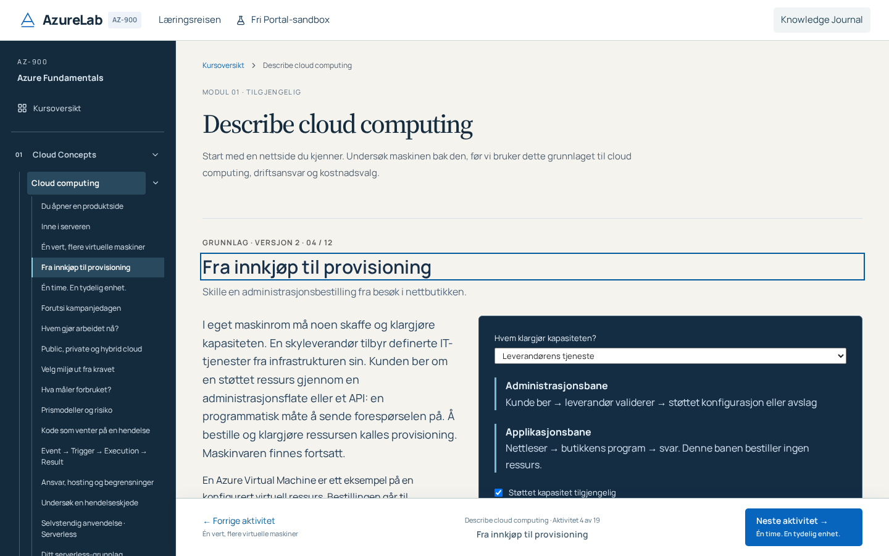 | 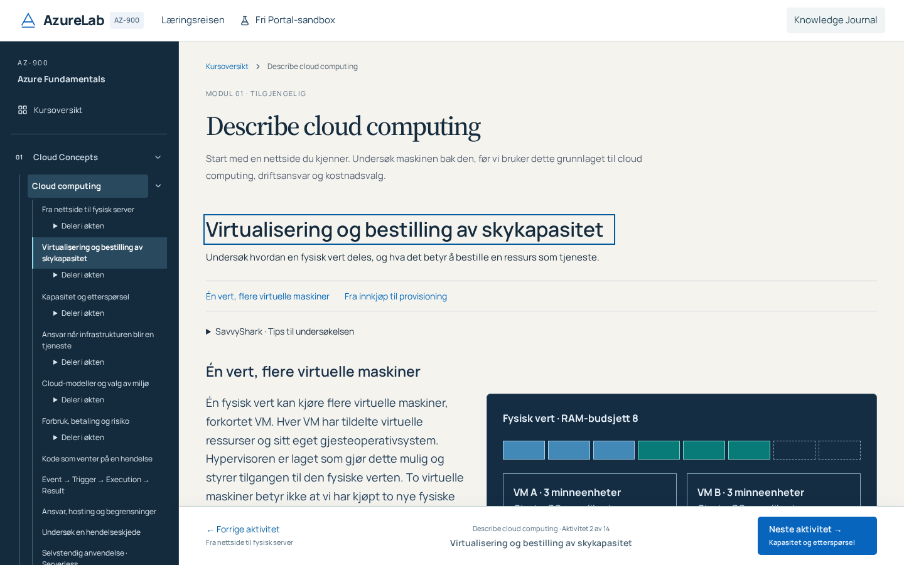               |
| Original administration/application distinction retained                                                           | 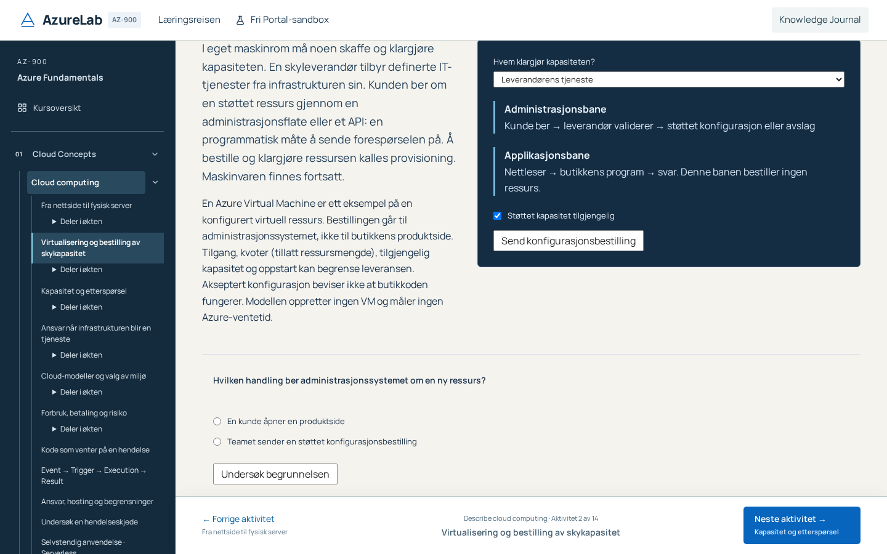 |

The visual improvement is fewer repeated page shells and generic guide blocks, continuous original examples/actions, and one synthesis/source/secondary section per session. No claim of reduced learning time follows. The combined models+placement and metering+pricing sessions remain long because essential mechanisms/counterexamples are retained. In-page part links, secondary historical sidebar parts and normal scrolling support deliberate reading. [Short window](screenshots/cloud-consolidation/after-virtualization-1024x500-continued.png) · [Capacity example](screenshots/cloud-consolidation/after-capacity-basics-1366x768.png) · [Metering](screenshots/cloud-consolidation/after-v2-metering-1024x768.png).

Stage A delivery remains conditional on the fresh independent audit, complete final-head346CI/strict and real anonymous SHA-bound Gate7 recorded on Draft PR52. Broader PD-01 remains open; all historical audit findings remain dated evidence.

## External058 finding and corrected continuity

The first published candidate058 was **not delivery-accepted**. Actual anonymous Gate7 exposed loss of the selected server component after following a historical part link within the same composed session. The entire session had been keyed and teaching-scoped by the old technical topic, so a new part address remounted its controls. A deterministic regression on058 reproduced RAM returning to CPU after the correct destination heading was focused.

The correction uses the pedagogical session as the existing Course teaching identity and component key **only within current Cloud Computing teaching**. All its parts were already mounted behind that same teaching boundary. Original part URLs and persisted resume remain; no history changes. Moving among those parts/Back/Forward now keeps the live model view. Assessment identities remain distinct. The unchanged readiness/issue/active/assisted authorization token still withholds already-open teaching when an independent context or conflict changes; this is not permission to bypass durable assistance.

The external19-document+resume test also reached its total30-second test budget. Direct historical Foundations routes and saved-resume/live-continuity are now separate focused cases, with unchanged per-test/action/assertion limits. This adds two focused desktop cases:346(315/31), retaining all337 base executions and the compact witness. No retry/worker/timeout/skip increase. The unchanged Serverless source test additionally detected the preview host's injected `vercel.live/_next-live/feedback/feedback.js`; external verification records that infrastructure separately rather than weakening the application's zero-external-dependency test.

All058 failures and the original fullCI remain historical candidate evidence; they do not pass the corrected final head. Targeted correction tests, renewed fingerprint/independent review, full successor346CI/strict and actual new-SHA anonymous Gate7 are required. The original three MINOR limitations remain.

## CI focus correction and explicit historical review fixture

The first complete058 CI found a genuine out-of-scope focus regression: marker-first selection changed which heading received focus in Services. Marker priority now applies only to the new composed Computing sessions. Other modules retain their exact original first matching heading; the original sequencing assertion remains unchanged.

The inherited Designlab tests also failed because their intentionally branch-gated route accepts only the historical PR50/51 review refs, whereas this is PR52. We retain that runtime guard and every original browser assertion. After the ordinary `npm run check` production build, CI explicitly runs `npm run build:e2e:review`: a second, nonhosted browser-fixture build of the same actual Git revision with only its child process `GITHUB_HEAD_REF` set to the frozen PR51 review label. The parent environment, actual Git ref/revision and GITHUB_SHA remain unchanged. Any VERCEL/VERCEL_* key, including empty metadata, rejects the helper before Git lookup or child spawn. Four executed Node tests cover provenance, parent immutability, hosted rejection and failure/signal propagation. This helper never runs in the Vercel deployment.

The complete346 browser receipt must be read as execution against this explicit historical-review fixture build. Actual public PR52 separately requires anonymous full-SHA root/course/Portal/assessment/Journal Gate7 and Designlab404. This preserves historical review coverage without broadening public review access, skipping old cases or mislabelling a fixture as the normal deployed build. No runtime guard/model/store changes or test-setting changes. Final correction fullcheck passed638 Vitest/503curriculum/24Node and ordinary production build; exact-head CI/strict and public Gate7 remain required separately.

The complete8d profile additionally found the compact Serverless witness froze its unrelated-store baseline after heading visibility but before asynchronous exposure of the actually visible first paragraph. Its initial setup now explicitly exposes that original paragraph and waits for the original intro-request visit before taking the baseline. The final protected-bytes equality remains unchanged, as do all Serverless first/help/retry/Journal/World/network assertions. This aligns the old preservation test with intentional exposure-based visits; it does not suppress or fabricate a product event.

Actual800×700 geometry confirms that default scrollIfNeeded left the paragraph at581.67–700.42, outside the conservative84–540 reading area; waiting for heading focus alone was insufficient. The final setup waits for settled entry focus and explicitly centers that original paragraph (290.67–409.42), then observes the durable intro-request visit. Original four desktop Serverless cases and the complete compact flow passed with final byte equality. The earlier failed setup probes are retained; no deadline or product observer changed.

The final independent audit caught a stale preservation declaration: it still promised byte equality for the now intentionally adapted Serverless setup test. The final declaration excludes exactly that test and documents the authorized setup change;354 original protected paths, all162 domain files and the complete locale remain byte-equal. The earlier355-path checks accurately describe the earlier unmodified-test candidates. Strict release checks are unchanged; no historical model/evidence contract is waived.
