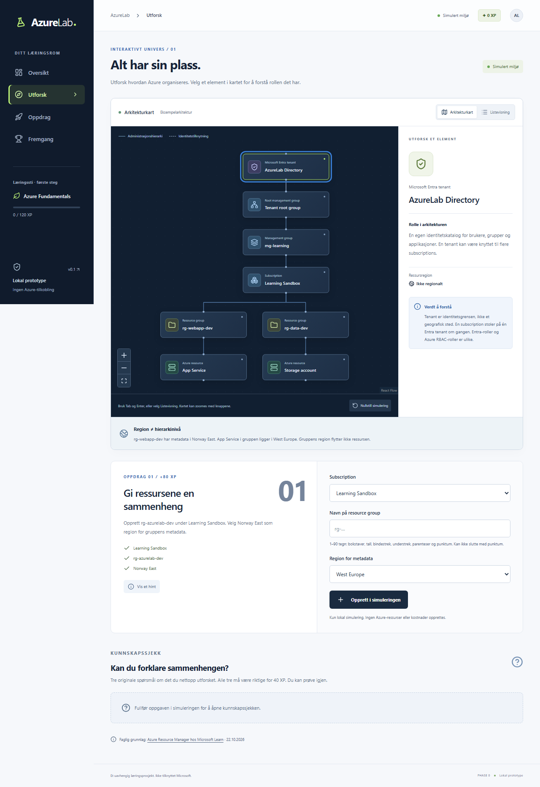

# Experience design — resource world and expedition

## G1.2 arrival and purpose

The canonical entry is now the RPG, with a short optional environmental arrival, a purposeful Ida welcome, a compact objective HUD and a context-preserving Expedition Log. The log connects existing systems through actual observations rather than a new course-card dashboard. Manual/assisted choices clarify movement; the world overview honestly distinguishes one station/workbench from future regions. [Onboarding](PLAYER_ONBOARDING.md) defines responsive and human-review gates. No art replacement or additional rendering dependency is claimed.

## L1 teaching and technical reference

The existing world/cinematic identity is retained. Six active investigations use a compact readable instrument surface, visible 3D model response and equivalent labelled diagram/table/select controls. Detailed technical theory lives in a reusable unit journal, available without WebGL and without route changes. Mechanism and relevant result explanations are part of the active sequence; optional external links do not replace core teaching. [Manuscript](FOUNDATIONS_01_CONTENT.md) defines the decisions, feedback and limits. This phase adds educational depth rather than a new rendering stack.

## G1.1 cinematic conversations

The game comparison now separates RPG speech from technical commands: transparent native CinematicDialogue, contextual shot direction and field-note inspection replace the generic CommandDialog conversation. The latter remains for settings/confirmation. [NPC dialogue design](NPC_DIALOGUE_DESIGN.md) owns pacing/depth; [gameplay architecture](GAMEPLAY_ARCHITECTURE.md) owns focus, camera and evidence boundaries. The Azure workbench and root journey are unchanged.

## G1 rendering exception

The existing SVG technical experience remains intact. The owner's G1 direction adds genuine character exploration with a separate Fiber/Three route, not a replacement of technical diagrams by decorative 3D. [GAME_WORLD_DESIGN.md](GAME_WORLD_DESIGN.md) owns art, camera and responsive composition; [GAMEPLAY_ARCHITECTURE.md](GAMEPLAY_ARCHITECTURE.md) owns implementation and fallback. Native dialogue and semantic place selection share learning/quest truth with the scene. Owner visual acceptance remains pending; see project status for actual image review and measurements.

Reviewed **2026-10-23**. The product moves from a lesson page containing a diagram to a world in which the learner performs a technical assignment. Phase 0.5 established the dimensional presentation; Phase 1A.5 added the expedition. Phase 1B.1 adds a bounded guided technical model without changing the legacy activity's rules.

## Build, predict and recover

The [guided chapter](CHAPTER_01_GUIDED.md) reuses the scene, camera and semantic alternatives. Compute plates identify an App Service plan; an upright code window identifies its webapp. Solid cyan management edges, dotted cyan resource membership, dashed magenta identity association and a directed violet hosting edge carry distinct meanings. An amber shield marks the custom policy at its actual subscription; inspecting it highlights that scope. An amber crossed footprint marks a rejected operation outside the resource inventory. It never becomes a deployed object.

Native controls configure one contextual operation at a time; separate learning events record the original prediction and later explanation. Receipts preserve the causal chain and unchanged revisions/counts. The location lens exposes group metadata and plan-derived app location as properties without moving geometry. On narrow screens the scene remains above a scrolling technical console; commands are reachable by touch and keyboard. Camera framing uses actual viewport aspect and includes the selected app's plan. Zoom/overview, XYFlow and the complete semantic list remain available. Short-height layouts scroll the console, rather than hiding its commands or overflowing the page. These decisions improve investigation; they do not prove educational effectiveness.

## Enter, discover, operate

Phase 1A.5 replaces the control room with the [Azure Expedition](JOURNEY_EXPERIENCE.md): perspective travel, teaching, side-route checks and a gateway into the real sandbox. That document owns journey/camera/content/resume decisions. The interactions below describe the retained organization world. Mission status and XP come from actual local progress; future worlds have no nonfunctional launch controls.

Explore devotes the viewport to a projected environment. A separate crystalline Entra identity beacon connects to Tenant root group with a dashed pink association. Solid cyan lines express the existing management hierarchy. They never represent traffic or deployment dependencies. Open trays distinguish resource groups; raised control structures distinguish management scopes; individual service forms represent resources. Heights and distances are schematic, not actual Azure geography or hardware.

Selecting a component centers the camera, emphasizes its branch and ancestors, reduces the prominence of unrelated geometry, and opens a contextual inspector. Text labels stay readable rather than fading with the model. The first explanation is short; technical nuance is available on demand. Parent and child controls navigate actual relationships.

## Rendering decision

The selected strategy is **orthographic 2.5D SVG, projected from explicit x/y/z coordinates**, with HTML buttons in SVG foreignObject labels. Top and side faces, elevated footprints, depth-sorted objects, projected connectors and a schematic ground grid produce visible volume. Camera yaw changes the projection; scale and translation support zoom, pan, focus and overview. CSS transitions interpolate camera transforms. There is no render loop, WebGL context, asset loader or new runtime dependency.

Alternatives evaluated:

| Approach                         | Educational/engineering tradeoff                                                                                                                                                    |
| -------------------------------- | ----------------------------------------------------------------------------------------------------------------------------------------------------------------------------------- |
| CSS 3D DOM plane                 | Useful perspective, but label counter-rotation, hit targets and connectors across elevations complicate consistent mobile behavior.                                                 |
| XYFlow with enhanced nodes alone | Retains excellent graph navigation, but does not by itself deliver the required spatial world. Retained as an explicit diagram alternative.                                         |
| Three.js / React Three Fiber     | Real perspective and richer models; requires WebGL fallback, context-loss handling, additional runtime cost and separate semantic controls. Unnecessary for eleven bounded objects. |
| Projected SVG + semantic HTML    | Chosen: actual elevated geometry, predictable screenshots, inspectable DOM and keyboard controls, with no GPU requirement.                                                          |

`scene-layout.ts` owns presentation coordinates, projection and related-scope selection. It never mutates simulation state or places resources by region. `spatial-scene.tsx` owns geometry/camera state. `Workbench` owns commands and contextual layers, delegating all validation/scoring/awards to the existing domain functions.

Implementation references: [SVG foreignObject](https://developer.mozilla.org/en-US/docs/Web/SVG/Reference/Element/foreignObject), [native dialog](https://developer.mozilla.org/en-US/docs/Web/HTML/Reference/Elements/dialog), [XYFlow viewport API](https://reactflow.dev/api-reference/types/react-flow-instance). These are rendering references, not sources of Azure teaching content.

## Depth, light and motion

[DESIGN_SYSTEM.md](DESIGN_SYSTEM.md) defines token values. Midnight is the environment, violet/magenta identifies attention and identity, cyan distinguishes technical containment/location comparisons, and green/amber indicate outcomes. Background grid and subdued lighting establish orientation; model faces provide the depth, rather than shadows alone. Labels remain upright as the camera rotates.

Camera focus takes roughly 420ms; inspector entry is about 220ms; creation materializes the new group over 650ms. These transitions communicate navigation, inspection and actual state mutation. No XP is awarded for selecting, focusing, orbiting or clicking. Reduced-motion mode removes all transitions and animations without removing any functionality. There is no continuous decorative animation.

## Mission as an operation

1. Start the mission from the hub or scene HUD; receive a short modal brief.
2. Identify and select Learning Sandbox. Its contextual action reveals a resource-group command.
3. Enter name and metadata region in a compact command panel. The selected subscription supplies the parent; no action is offered on invalid parent types.
4. Validation errors remain in the command with associated input feedback. A valid command changes the deterministic state, adds a visible object and relationship, focuses it, and reports actual first-time XP or replay status.
5. Open a three-step knowledge check in the same environment. Original questions, distractor explanations and all-three-correct scoring are retained. Results explain every selected answer and offer reflection/retry.
6. Reset the scenario independently of stored milestones. Current-attempt HUD steps reset; previous XP does not turn a replay into demonstrated competence.

A wrong but valid configuration creates an object without awarding the mission. Its properties and the mission feedback expose the mismatch. The bounded simulator offers reset instead of pretending to edit an immutable configuration or invoke Azure. Duplicate names and capacity limits retain their original domain errors.

## Responsive and accessible interaction

Desktop uses a slim navigation rail, a viewport scene, an anchored inspector and a compact mission HUD. Mobile uses bottom navigation, a focused camera viewport, large command controls and a scrollable contextual bottom sheet; the scene remains present behind it. Camera cropping is intentional navigation, not document overflow. Overview, zoom and list controls do not require precision dragging.

Tab/Enter operate native node buttons. Focus can move the camera to off-screen labels; arrows/+/-/Home operate the scene when the SVG viewport itself has focus. HTML list and XYFlow diagram modes share selection, inspection and commands with the spatial view. Essential explanations and hierarchy are never available only through 3D geometry. Native modal dialogs make the background inert and support Escape, with an explicit Tab boundary guard; creation returns focus to the new object, and assessment steps/results receive focus.

There is no WebGL dependency, so unsupported GPU/device contexts need no separate renderer. SVG/foreignObject and native-dialog support remain browser assumptions. The list provides a non-spatial path; Chromium coverage is not proof of Safari/Firefox or screen-reader conformance. Human assistive-technology and touch-device reviews remain explicit follow-up work.

## Review evidence

The Phase 0 baseline is preserved below. Reviewed desktop/mobile scene, selected subscription, command and created-object screenshots come from the production Playwright flow. The [review evidence table](PROJECT_STATUS.md#visual-review-evidence) links the current set and records viewport sizes and actual checks. Screenshots document the implemented UI, not static product mockups.

