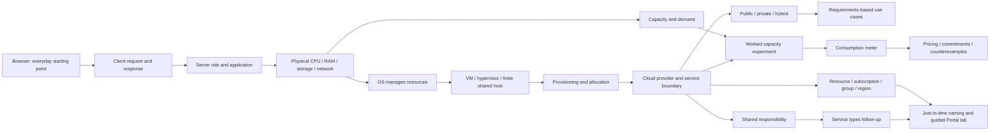

# Foundations pedagogy blueprint — 3.1A candidate

2026-10-25. Proposed production design for owner review; only the isolated [proof](VISUAL_LEARNING_SYSTEM.md#implemented-proof) is implemented. The current course, FC01–FC07 rubric and all saves remain unchanged. [Audit](BEGINNER_LEARNING_AUDIT.md) explains the need; [storyboard](FOUNDATIONS_31A_STORYBOARD.md) supplies original teaching and implementation gates.

## Learner and instructional contract

An adult can use a browser but may not distinguish a program, computer and service. Begin with their experience opening a shop page. Every segment answers: what is already understood, what new relation is established, what can be observed/changed, what would demonstrate a better mental model? No word quota, slideshow completion or interaction counter substitutes for that answer.

Recommended pattern: concrete problem → explain intuitively → name precisely → reveal mechanism → inspect a worked model → predict a changed case → act → explain consequences → independent changed application. Advanced learners can directly enter available material or a diagnostic without receiving skipped credit. Reading/inspection never awards evidence or XP. Full prose remains accessible alongside the guided presentation.

## Proposed conceptual graph

Arrows are prerequisite reasoning, not forced page locks. Database is an optional branch from stored application data; it is not required for a static page or prerequisite to understanding CPU. TCP/TLS, DNS internals, CPU scheduling, NUMA, overcommit, containers, billing APIs and high availability are deferred. Say that simplifications exist; do not require their terminology to understand the first picture.

## First-use register

Sequence IDs refer to the storyboard. Plain explanation is the first-use sentence; precision follows in the same segment, not in a pre-course glossary. Checks below are proposals, not existing evidence.

| Term / first use              | Needed before                    | Initial plain explanation → precise meaning                                                                                  | Concrete example / visual                                            | Understanding check → later reuse                                                |
| ----------------------------- | -------------------------------- | ---------------------------------------------------------------------------------------------------------------------------- | -------------------------------------------------------------------- | -------------------------------------------------------------------------------- |
| Browser / S01                 | Everyday browsing                | Programmet du åpner nettsiden i → client software rendering content and sending requests                                     | Shop on user's laptop / browser frame                                | Point to program versus device → S02                                             |
| Client / S01                  | Browser                          | Den som ber om en tjeneste → role of a program/device consuming a service                                                    | Browser asks for product page / labelled client boundary             | Identify requester, not server → S04/S07                                         |
| Request / S01                 | Client                           | En beskjed om noe programmet ønsker → message requesting an operation/resource                                               | Ask for product description / outbound labelled line                 | Order request before response → provisioning contrast S05                        |
| Response / S01                | Request                          | Det tjenesten sender tilbake → returned status/content, not necessarily success                                              | Product page returned / separate inbound line                        | A response can report failure → S06/S12                                          |
| Server / S02                  | Request                          | En datamaskin som leverer en tjeneste til andre → server can also name a software role; initially physical host              | Shop machine / cutaway                                               | A browser user is not inside the server → VM S04                                 |
| Application / S02             | Program in browser, server       | Programvare som gjør en oppgave → executing logic, possibly split client/server                                              | Shop computes a product view / app band over OS                      | Moving hardware does not replace custom code → service types                     |
| Database / S02 branch         | Application, stored data         | Organiserte data som et program kan hente og endre → managed collection plus software for access                             | Product stock; optional branch / cylinder only if enabled            | Static page can work without separate database → data later                      |
| CPU / S03                     | Physical server                  | Utfører programmets instruksjoner → processor executing operations                                                           | Product calculation / chip                                           | More CPU is not more stored disk data → S06                                      |
| Memory (RAM) / S03            | CPU, active application          | Arbeidsplass for data programmet bruker nå → volatile working memory                                                         | Current product list / modules                                       | Distinguish working copy from retained catalogue → VM assignment                 |
| Storage / S03                 | Data                             | Beholder data mellom arbeidsøkter → persistent medium/service; not identical to database                                     | Product photos / disk bays                                           | Turning off loses RAM contents, not necessarily stored images → metering         |
| Network / S01 then S03        | Two devices                      | Forbindelsen meldinger går gjennom → communication between systems                                                           | Request/response path / line, no simulated latency                   | Path is not an allocation or containment edge → technical lab                    |
| Operating system / S03        | CPU/RAM/storage, application     | Programvaren som fordeler maskinens ressurser → manages processes, memory/devices and application execution                  | OS band between hardware/app                                         | OS differs from app → responsibility S08                                         |
| Physical infrastructure / S03 | Hardware parts                   | Maskinene og anlegget som tjenestene trenger → physical hosts, network, facilities                                           | Host stays visible in both ownership models                          | Cloud still needs real hardware → S05                                            |
| VM / S04                      | Host, OS                         | En avgrenset virtuell datamaskin på en fysisk vert → assigned virtual hardware and guest OS, not another purchased chassis   | Two guest boxes inside host budget                                   | Two guests share finite host capacity → S05/service types                        |
| Hypervisor / S04              | Host, VM                         | Laget som oppretter og styrer de virtuelle maskinene → virtualization platform mediating guest access to host resources      | Label between host and guests                                        | Which layer supports both guests? → VM deeper track                              |
| Virtualization / S04          | VM, hypervisor                   | Flere avgrensede miljøer bruker samme fysiske vert → abstraction/isolation, not unlimited resources                          | Assign RAM to two guests / capacity rail                             | Reject over-budget teaching assignment without creating host RAM → later compute |
| Demand / S06                  | Application work                 | Arbeidet vi ber systemet gjøre i perioden → requested workload under explicit assumptions                                    | Campaign hour / filled request tiles                                 | Demand can exceed capacity → S07/S11                                             |
| Capacity / S06                | Finite hardware                  | Hvor mye arbeid modellen kan håndtere i perioden → supported work rate for specified workload/interval                       | Fixed four/six/ten bundles per hour / ceiling                        | Idle capacity is not unmet demand → S07                                          |
| Provisioning / S05            | VM/provider, request distinction | Bestille og klargjøre en ressurs → control operation requesting a supported configuration                                    | Request an Azure VM example, no actual command / control lane        | A customer visiting shop does not provision a VM → Portal lab                    |
| Allocation / S05 then S06     | Provisioning, finite capacity    | Gjøre en avgrenset mengde kapasitet tilgjengelig → assignment/reservation under model rules                                  | Capacity rail6 before demand8                                        | Allocation can remain while no work arrives → metering                           |
| Scalability / S07             | Capacity, allocation             | Mulighet til å endre kapasiteten når behovet endres → capability with service/configuration/limit constraints                | Explicitly compare6/10 / no automatic cloud toggle                   | Ability differs from enabled autoscaling → benefits planned                      |
| Cloud provider / S05          | Host, service/control boundary   | Tilbyr IT-funksjoner som tjenester → operator exposing supported resources via management interfaces                         | Microsoft Azure example / separate ownership band                    | Internet-connected owned machine alone is insufficient → S08/S09                 |
| Resource / S13                | Provider, provisioning           | En administrerbar forekomst i Azure → instance with type, ID, configuration and scope                                        | Plan or app / typed node                                             | A drawn denied request is not an existing resource → lab                         |
| Subscription / S13            | Resource                         | En administrasjons- og faktureringsgrense for Azure-bruk → scope linked to identity/access/policy context, not login synonym | App Sandbox / scope band                                             | Same group name can exist in different subscriptions → naming                    |
| Resource group / S13          | Resource, subscription           | Samler relaterte ressurser for forvaltning og livsløp → ARM management container under one subscription, not a physical host | App lifecycle group / membership lines                               | Group is not hosting compute or nested region → lab                              |
| Region / S13                  | Geography separate from scope    | Et geografisk område der Azure tilbyr infrastruktur/tjenester → service-dependent location; not every service regional       | Group metadata Norway East versus plan West Europe / property badges | Group metadata does not move hosted app → location lab                           |

## Capacity case: retain sound arithmetic, replace its teaching contract

Production `experiment()` stays unchanged in this phase. Its four-slot arithmetic can be explained; its cloud mode must be labelled an explicit pre-authored order, not observed Azure scaling. Proposed 3.1B model: `capacity-lesson@2`, finite four equal **teaching hours**, one **work bundle** is an invented amount of work that consumes one capacity unit for one whole hour. It is not one user, request, CPU core, VM or SKU. Treat each hour independently; unserved work is counted, not queued into the next hour. No claim about real throughput, latency or bill.

Terms: demand=requested bundles; allocated=available bundle capacity for that hour; served=min(demand,allocated); unused=max(allocated−demand,0); unmet=max(demand−allocated,0). Demand/served/unmet are work-bundle counts in each one-hour interval. Allocation is a rate (bundles/hour); with the fixed one-hour interval its available-work count has the same numeric value. Summed unused capacity is potential work bundles across the four hours, not bundle-hours and not capacity that can be carried forward. Utilization is served/allocated over the same interval; zero allocation has no meaningful ratio (display “ikke definert”, not fictitious healthy utilization). A conservation check per hour: served+unmet=demand and served+unused=allocated.

Sequence: (1) shop scenario, (2) physical mechanism, (3) define bundle/hour with one hour demand2/capacity6, (4) worked result served2/unused4/unmet0, (5) freeze changed campaign `[3,3,8,3]`, capacity6, (6) commit prediction **peak-hour unmet bundles** before result, (7) run shows served `[3,3,6,3]`, unmet `[0,0,2,0]`, unused `[3,3,0,3]`, (8) explain8−6=2 at peak, (9) deliberately change capacity to10: unmet0, unused23 potential work bundles across four hours, (10) changed independent task below. Do not show cost here.

The proof implements this presentation calculation separately, in memory only. It does not replace the course's `[2,2,10,2]` fixture or its `[1,1,9,1]` assessment. In 3.1B a candidate content/model version is required if those numbers/meaning change; old observations must remain pinned to content1/model1/rubric1 and cannot be remapped to the new unit. See handoff.

Later compare equal explicit allocations for owned/provider modes. First isolate procurement/ownership, then allocation, then meter. Show a steady owned-capacity counterexample and the idle-cloud meter before cost decisions. Provider choice does not magically change throughput; the same allocated work model gives the same served result. Any cost display is synthetic and incomplete, with no Azure quote or universal cloud advantage.

## Complete teaching → practice → independent example

Teaching: work bundle/hour definition and one-hour2/6 worked case. Guided practice: campaign3/3/8/3, capacity6, prediction then observation; correction explains the violated conservation relation. The learner changes capacity to10 and explains the unused/unmet tradeoff. Feedback is allowed and therefore guided.

Independent **community registration pilot**: four teaching hours `[1,7,4,2]`, capacity5 per hour. Before any result/feedback, construct the peak unmet count, choose which interval has unused capacity and select a reason why buying/provider choice alone does not alter the fixed allocation. Commit all three together. Rubric `capacity-transfer@2-candidate`: peak2; unused in first/third/fourth with amounts4/1/3 (total8 potential work bundles across four hours); same allocation cannot serve beyond5 at hour2 regardless of ownership. Require count plus causal relation, not just guessing a label. Different numbers, workload and question construction from guided example. No price comparison unless separately taught assumptions exist.

Preserve submitted responses and first-attempt assistance. In-task hint/journal/worked-model use marks assistance; correction/retry stays practice. A failed criterion is displayed individually with explanation after submission; it cannot erase the first observation. Retention needs a later changed task; this does not prove retention or readiness. Independent task is specified, **not implemented by the proof**.

## Just-in-time naming contract for 3.1B

Teach resource → subscription → group before naming. In the actual Portal name field, show an advisory breakdown `rg` | `webapp` | `dev`: type convention, workload label, environment. `dev` is development, `test` is testing, `prod` is production usage; changing the word does not configure isolation/security or the subscription. Hyphens improve readability where allowed. `rg-azurelab-dev` follows the same convention with a different workload. Never automatically rewrite input or treat a missing `rg-` as an Azure error.

Use two visibly different sections: **team convention (advisory)** versus **resource-type validity (enforced by supported model)**. On focus/selecting a token, give its purpose/example; full label and explanation stay available without colour. Unknown convention → “annen gyldig navnestruktur”, not failed parse. A valid `teamA` group is allowed even if it does not follow the suggested pattern. Conflicts use actual scope/name validation. The official Resource Manager table lists group uniqueness within a subscription, length1–90 and permitted characters including Unicode letters and decimal digits, with no trailing period. `simulation.validResourceGroupName` uses Unicode L/N categories, whose number category is broader than decimal digits; this is a fidelity discrepancy for future rule review, not evidence of exact Azure parity. Leave the rule unchanged in3.1A. Plans/apps currently use a bounded3–40 lowercase model; do not claim global availability checks. No live name lookup.

Sources BL03/04/05/06 below in SOURCE_REGISTER. Form acceptance test: learner explains `dev` and chooses a valid unprefixed name; command validation stays identical, no silent naming policy, resource/metadata region unchanged. Full integration belongs to 3.1B.
