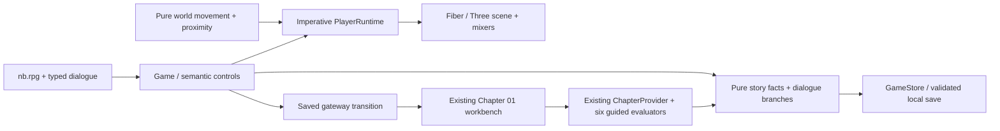

# G1 gameplay architecture

Historical RPG subsystem: preserved at `/legacy/rpg` after the owner-authorized 2026-10-24 Portal pivot. Canonical entry and ordinary learning now follow [PORTAL_PRODUCT_STRATEGY](PORTAL_PRODUCT_STRATEGY.md). The implementation/history below remains valid for the archive; it does not mandate new game development.

## G1.3 sequence, cue and audio boundaries

The same third-person world/director now consumes authored teaching-beat camera intent and temporary demo models. Independent model actions still dispatch the old story event; automatic examples never do. L1 teaching temporarily projects a registered example, then restores actual replayed probe state before interaction. Speaker anchors update from the existing projected eye position imperatively, not via React frame state. A shared native-dialog playback hook cancels timers on interruption, hidden page and nested journal/log; resume grants a fresh reading interval. One local AudioContext/loop is enabled explicitly, attenuated on hidden tabs and cleaned up on game unmount. [Engine specification](INSTRUCTIONAL_SEQUENCE_ENGINE.md) owns the finite contract.

## G1.2 entry, orientation and continuity

RPG is now canonical from /. Historical SVG movement/history lives only under /legacy-expedition. The existing follow/cinematic director accepts a transient three-composition arrival index; skip/replay never changes pose, evidence or quest facts. A read-only selected destination drives a small marker and distance/direction output. Module/workshop actions first offer manual or interruptible assisted walking. The shared log can overlay dialogue/session/workbench and restore focus. Noor reads real unfinished/built findings even for experienced direct workbench entry. [Expedition progression](EXPEDITION_PROGRESSION.md) specifies authority and persistence; [player onboarding](PLAYER_ONBOARDING.md) specifies controls and review gates.

## L1 content-driven workshop

Ida's additional investigation action routes the player to the existing installation, pauses movement, selects the existing cinematic demonstration camera and opens a semantic learning session. Registered probes project synthetic demand/allocation columns or deployment-boundary shapes at that location. Responsibility uses the existing reviewed PaaS layer projection. Geometry never evaluates a lesson. Module events and journal are a separate root provider/store; old story version, portal, return pose and Chapter01 findings remain unchanged. [Content architecture](CONTENT_ARCHITECTURE.md) owns new contracts.

## G1.1 implemented cinematic layer

- **Direction:** features/rpg/cinematics.ts owns a pure, bounded ShotPlan: position/target, intent, speaker, player visibility and transition duration. The dialogue node selects two-shot, over-shoulder, speaker-close or demonstration; exploration/return retains the existing follow pose. Plans use actual actor positions, 1.38 m eye targets, viewport aspect and measured conversation-content boundary. Conservative stylized-head silhouettes select a clear shoulder offset, with close-up fallback for an obstructing near approach. Plans are cached until pose/node/viewport/content bounds change; idle frame updates do not rebuild camera/projection objects. A distant player is excluded from a close-up; workshop dialogue targets the installation without teleporting Ida.
- **Rendering:** the existing Director applies authored building obstruction proxies and interruptible exponential damping (0.42 s conversational / 0.7 s demonstration settling constants). Reduced motion applies the same target immediately. Camera/control/actor/render ordering and adaptive quality/cleanup remain intact. Actual projected head/top and camera/visibility/facing diagnostics support browser assertions, not quest decisions.
- **Presentation:** CinematicDialogue is a separate transparent full-viewport native dialog, not CommandDialog. The browser makes the background inert. Speaker/subtitle semantics, initial choice focus, Tab wrapping, scoped arrows/numeric choices, Escape and focus restoration coexist with a paused controller. The only global gameplay handler exits while a dialogue is active. Settings/reset continue using CommandDialog.
- **Depth:** a secondary field-note region keeps the original complete paragraph, responsibility mechanism/caveat and official links. Opening it retains the dialogue node/model/attempt; Escape first returns to choices. Workshop layer inspection highlights the actual layer and reports the same reviewed responsibility function. Inspection/shot timing emits no learning event.
- **Characters:** two-shot/shoulder retain the player; close/demo hide it. Active NPCs damp toward the player, or toward the installation for workshop explanation. A short existing interaction gesture blends to idle, instead of gesturing continuously. The player idles/faces the conversation partner. No facial animation, voice or lip-sync is introduced.

The persistent schema/content version stays **1 / 1.0.0**: observation IDs, validation and technical meaning are unchanged. Subtitle/shot/journal state and larger-text preference are transient presentation. Existing saves are read without migration, new awards or inferred chapter completion. Noor's request to revisit service reasoning now walks to the actual workshop; post-report depth opens field notes while keeping Noor as speaker. No cross-location speaker teleport is fabricated. The historical G1 descriptions below are superseded where this section specifies cinematic presentation.

## Implemented boundary

`/expedition-3d` dynamically loads a client-only React Three Fiber **9.8.2** scene with Three.js **0.186.1** and `@types/three` **0.186.0**. Stable Fiber 9 supports the existing React **19.3.1**; Fiber 10 alpha/canary was rejected. Drei 10.7.9 was evaluated but is unnecessary for the bounded loader/controller/mixer. No standalone engine, physics dependency, database, authentication or AI endpoint is introduced.

Primary references reviewed 2026-10-23: [Fiber compatibility](https://r3f.docs.pmnd.rs/getting-started/introduction), [imperative frame-loop guidance](https://r3f.docs.pmnd.rs/advanced/pitfalls), [Canvas lifecycle](https://r3f.docs.pmnd.rs/api/canvas), [Three.js documentation](https://threejs.org/docs/). Versions are pinned in the lockfile, not selected dynamically at runtime.

## Ownership and source files

| System            | Files                                                         | Owns / must not own                                                                                       |
| ----------------- | ------------------------------------------------------------- | --------------------------------------------------------------------------------------------------------- |
| Presentation      | `features/rpg/scene.tsx`, `assets.tsx`, `game.css`            | Geometry, local materials, skeletal mixers, lights, camera, quality; cannot decide educational completion |
| Control           | `domain/rpg/world.ts`, `features/rpg/runtime.ts`              | Walkable zones, collision, step, proximity, assisted route; no Azure commands                             |
| Dialogue/learning | `domain/rpg/story.ts`, `content/nb.ts`                        | Versioned nodes, allowlisted effects, original explanations/answers; no executable authored scripts       |
| Quest             | `storyFacts`, `entryNode`                                     | Derives readiness from observations plus current validated guided findings; no animation/visit completion |
| Storage           | `domain/rpg/persistence.ts`, `features/rpg/game-provider.tsx` | Validated snapshot, conflict/denied-write handling; never edits legacy records                            |
| Technical truth   | Existing `domain/chapter01/*`, `features/chapter01/*`         | Unchanged deterministic resources, policy, receipts and guided evidence                                   |

## Player and frame loop

Pure `stepPlayer` validates finite input, normalizes diagonal movement, applies walkable-zone/circular obstacle checks and axis sliding. Fixed 1/60-second integration advances position, with a 0.25-second frame catch-up cap to avoid a giant leap after a stall. Hidden tabs/blur clear input; gameplay pauses for dialogue/settings/loading. Animation and camera do not determine the position or quest facts. Ordinary travel is not teleportation.

Optional non-precision navigation builds a bounded 0.5-unit grid route through the same walkable model, then simplifies only collision-free segments. Manual movement/Escape cancels it. `PlayerRuntime` holds live mutable frame data outside React. Fiber updates player transforms, mixers and camera imperatively; React receives only changed proximity, semantic controls and persisted snapshots. Position is rounded/saved on stop, periodically while moving and on exit/pagehide. No unchanged idle-position write occurs. A file-scoped React immutability lint exception in `scene.tsx` permits imperative Three objects; application/domain rules remain enabled.

## Rendering and asset lifecycle

Local GLTFLoader caches 26 reviewed GLBs; SkeletonUtils creates separate character skeletons. AnimationMixer crossfades idle/walk/interact. Per-frame transforms do not trigger application rerenders. Static architecture is transformed and merged by equivalent PBR material, preserving geometry detail while reducing calls. Four authored building bounds support camera obstruction tests instead of casting against every triangle each frame. The teaching plates remain separate because their positions convey responsibility.

`grounding.ts` samples a cached set of lower-leg/shoe vertices from the actual skin after animation, applies vertical contact correction and updates skeleton matrices without React state. It supports the flat authored deck, including the side bays; this is not general terrain IK. The 1.12 walking clip rate is calibrated from the player asset's median stance velocity at normalized 1.75 m height against the 2.7 m/s controller. A CPU test loads all three real GLBs and independently checks every leg-weighted vertex across 108 idle/walk/interaction poses. Browser tests observe the animated player's contact height. This does not establish perfect foot planting, arm clearance or human acceptance of motion.

Quality starts without shadows on narrow auto viewports, with bounded DPR on desktop. Automatic mode reduces DPR/shadows after 30 sustained slow samples. It does not remove educational objects or alter rules. The metric is observed browser frame interval, not GPU time. Explicit high/low overrides exist; orientation/reduced motion are independent. There is no representative phone/hardware FPS certification.

The adaptive decision is retained in Canvas props, so ordinary React/storage updates cannot restore the higher DPR or shadows behind the controller's back. This is a single quality-change state update, not frame-by-frame application state. The largest client chunk in the reviewed local build is 982,664 raw bytes; it loads behind the game route boundary. This is a build-file size, not a measured compressed network transfer.

Quality also updates the directional light's `castShadow`, keeping the light/program state consistent with the renderer. Disabling only `shadowMap.enabled` left an observed frozen shadow in an already compiled material program; browser checks now inspect both actual renderer and light flags. Frame order is controller (priority −1), actors/animation/ground contact (0), then camera/render (1), keeping the visible pose and camera on the same input step.

Owned merged geometry, cloned textures, CanvasTextures, mixers, cloned skeleton/bone textures and loaded source geometry/materials/textures are disposed on unmount; loader entries are cleared. Fiber owns renderer/context disposal. Error boundaries catch asset/render initialization failures. Context-loss handling removes its listener on unmount and switches to semantic learning; retry reloads the route. Hidden tabs pause the frame loop without destroying the Canvas/assets, preserving live/save state and avoiding context teardown/reload churn. Assets load only from the app origin; failure does not silently mark learning complete.

## Dialogue and teaching contracts

`dialogueVersion = 1.0.0` is pinned by `contentVersion`. A node has a speaker, typed choice IDs, optional next node, allowlisted event/action, condition key, detail and source IDs. All display text lives in `nb.rpg`. Static TypeScript definitions supply no remote expressions or arbitrary scripts. The renderer dispatches `meet`, `model`, `answer`, `accept` or `report`; runtime parsing rejects unexpected event keys/values. All graph edges and copy resolve in tests. See [NPC dialogue design](NPC_DIALOGUE_DESIGN.md) for actual branches.

The installation reuses the reviewed service-model responsibility function: selecting a model physically moves layers between provider/customer/shared columns and changes materials; HTML reports the equivalent relationships. The current OS mesh position is observable in browser tests. Wrong responses remain observations, not Azure mutations. Guided corrective responses explicitly do not establish independent competence.

## Quest and portal contracts

Eligibility requires at least two distinct model selections, current correct service/ownership answers and an accepted engineer quest. These are meaningful guided learning events, not visits. Returning with six satisfied existing guided findings makes a result available to discuss; it is still not full Chapter 01 completion. Reporting is explicit and derived again against current technical state. Resetting technical work removes readiness even if a prior report event exists. G1 earns **zero XP**; the existing unique 80/40 ledger remains authoritative for local participation only.

The physical portal requires proximity plus explicit activation. Before its 650 ms presentation transition (zero under reduced motion), GameStore saves `returnPending` and the safe gateway pose. The route `/explore?chapter=01&from=rpg-g1` loads the existing technical workbench. Its return link restores `/expedition-3d?return=chapter01`; it does not update the old expedition return position. Unfinished technical work stays in ChapterProvider's validated log. Browser back/resume uses the same stable pose; exiting has no completion side effect. No completion depends on timer success.

## Persistence and compatibility

New key `azurelab.rpg.g1.v1`: schema 1, content 1.0.0, finite walkable pose/yaw, at most 200 allowlisted story observations, pending return, quality. Maximum raw size is 64,000 characters. On load, malformed/unsupported records are quarantined with a warning, never converted into successful completion. Forged numeric XP/completion fields are ignored. Unsaved memory-only operation is visible; no claim of durable storage. Compare-before-write and storage events detect stale tabs and offer explicit reload. They are best-effort, not atomic transactions.

Legacy progression, expedition and guided workspace keys are untouched. There is no cross-key evidence migration or new award. G1-specific reset requires confirmation and clears only this key. The existing explicit all-learning-data clear event also clears G1. Server accounts would require a separate reviewed migration with authorization and revalidated evidence; local records cannot authenticate proficiency.

## Authoring and expansion

Add a reviewed place/zone only with a reachable controller fixture, localized labels, dialogue and accessible equivalent. Add dialogue through typed nodes/choice events and graph tests; altered technical meaning requires a new content version and explicit migration decision. Introduce future worlds through a saved entry/return contract backed by supported domain state, not color variants of empty rooms. This implementation is deliberately one bounded location, one quest and one existing workbench. It does not implement the full 30-unit curriculum or general physics/navmesh platform.

## Verification and limitations

Pure tests cover boundaries/proximity, routes, deterministic quest facts, dialogue integrity, malformed storage, conflicts and legacy preservation. Production E2E drives actual character position/bone animation, physical approach, two NPCs, workshop transforms, wrong/correct choices, gateway/workbench/return, reload, keyboard/touch, reduced motion, context loss and Axe. `assets:check` validates model hashes, local URIs, buffers, rigs, clips/licenses and transfer budget. Actual runs/results and reviewed evidence are recorded in [project status](PROJECT_STATUS.md), not inferred from this design.

Known scope limits: authored flat walkable zones, approximate building camera boxes, no jump/orbit/combat/audio, no lipsync, no physically accurate foot IK, no real Azure calls/runtime/health. Headless software-rendered evidence is useful regression coverage, not a phone performance benchmark, human accessibility audit or educational study.
