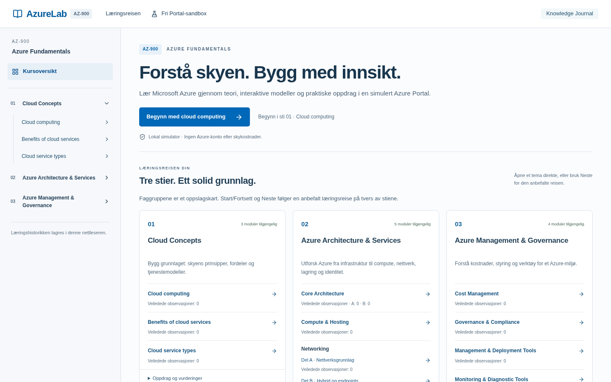
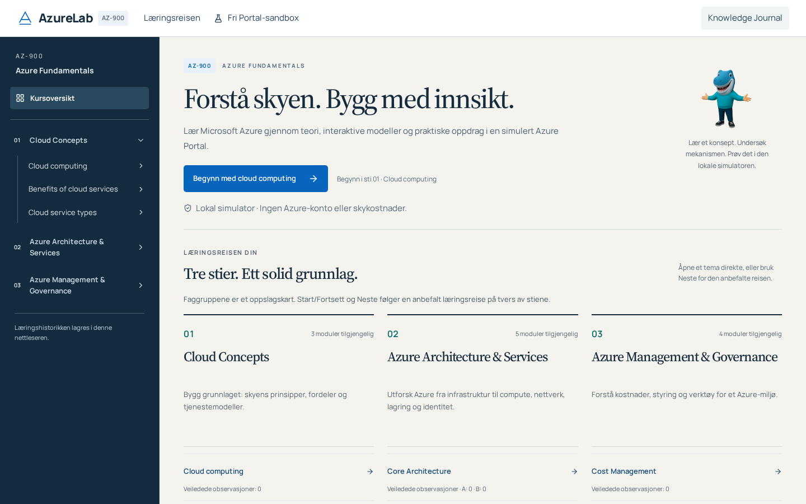
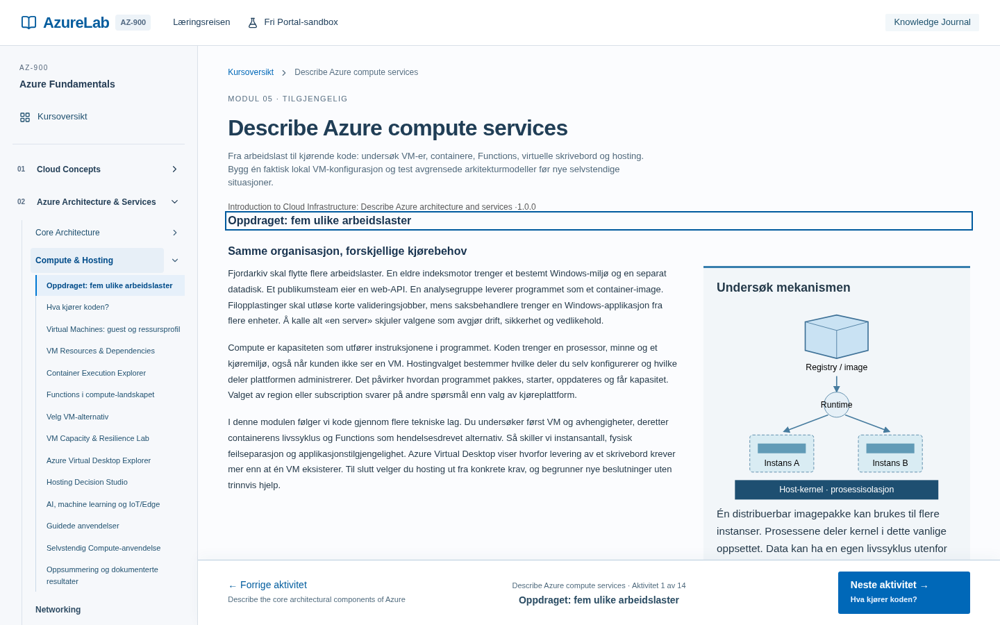
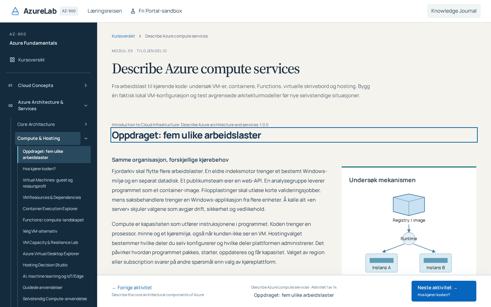
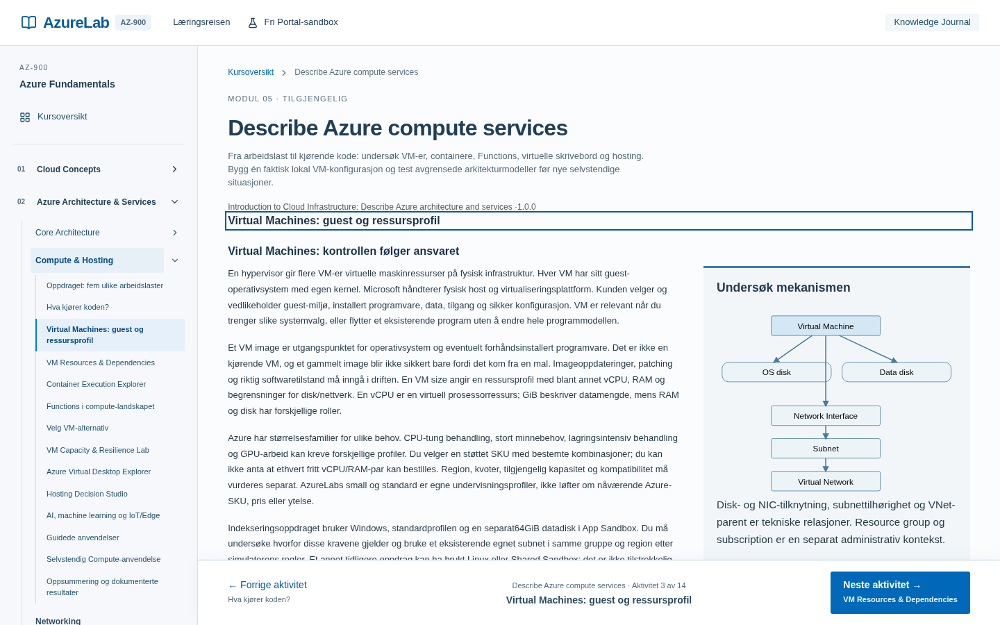
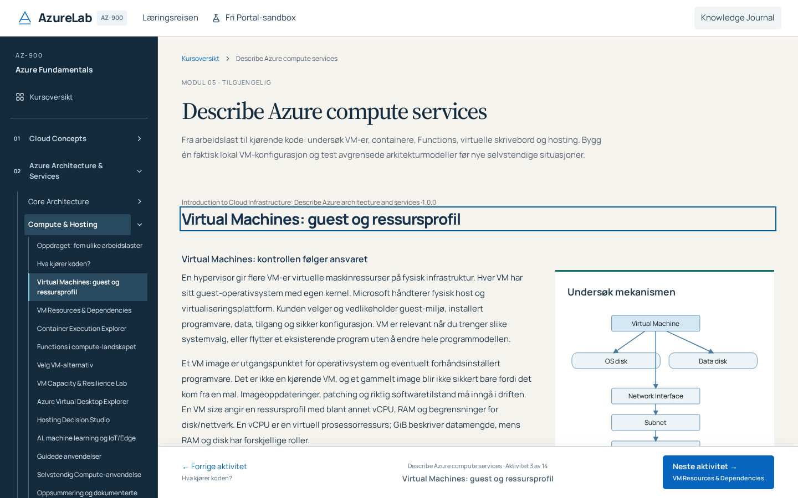
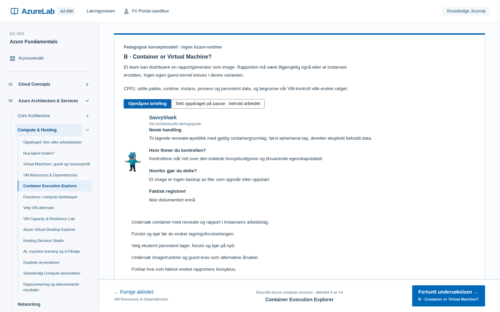
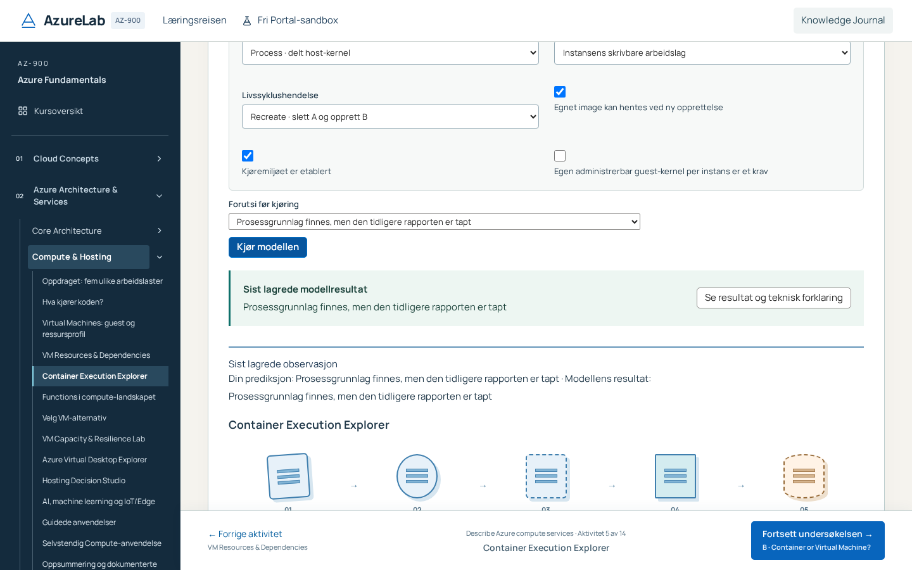
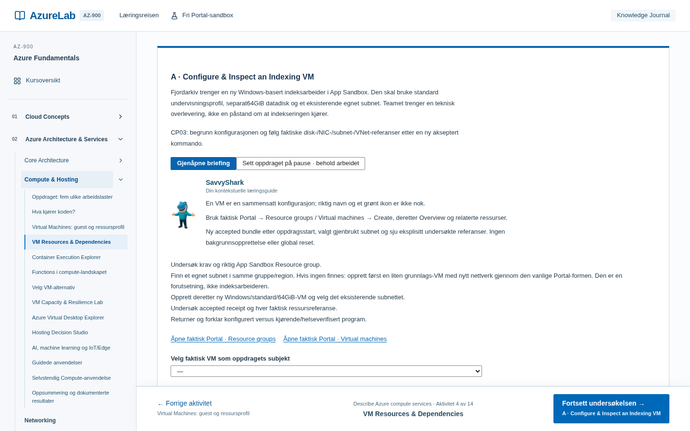
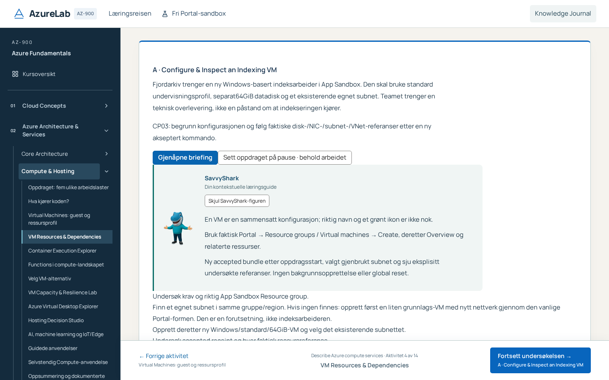

# PR51 — approved hybrid, first production implementation

Base: `daa4c6a03945a634633286711fcef452d14b785f`, branch `codex/azurelab-hybrid-production-foundation`. The owner selected B's paper/navy/editorial identity with A's compact technical precision. This is an in-place implementation on ordinary `/learn` and `/portal`, not a third prototype or a new application. Publication remains a Draft preview; merge and production deployment are not authorized.

## Actually implemented surfaces

| Surface                     | Implementation and retained authority                                                                                                                                                                                                                                                                                                 |
| --------------------------- | ------------------------------------------------------------------------------------------------------------------------------------------------------------------------------------------------------------------------------------------------------------------------------------------------------------------------------------- |
| Course Hub                  | Real Start/Fortsett, three original paths, all17 module routes, original grouped catalogue and unchanged recommended sequence/resume. Three open numbered chapter columns retain early visibility of all subject headings; warm paper, editorial type and navy rail carry B's identity. No fictional progress.                        |
| Global Course shell         | Local Manrope, navy contextual sidebar, original responsive menu and measured fixed footer. Focus, hover, selected/sticky states and native scroll clearance are explicit. Other modules inherit this compatible foundation; their individual teaching/Studio structures remain unchanged.                                            |
| Compute introduction/theory | Actual original manuscripts, examples, figures, terms, technical limits and closed SourceDisclosure. Source Serif4 is restricted to editorial module headings; technical activity/workbench headings use Manrope. No teaching version or coverage change.                                                                             |
| Compute Studio              | Original guide/configure/predict/run/explain/store. A nearby live summary reports the last **stored** run, with changed-input warning and explicit link to full original output. Accepted Run brings the nearby summary into view/focus unless the original milestone dialog owns focus. Failed writes cannot fabricate a new result. |
| SavvyShark                  | Original native Start/Cancel/recall and existing guide state. Compute can hide/restore the optional portrait without hiding required instructions or ending a session. Portal's original full-guide minimize/recovery remains unchanged.                                                                                              |
| Course ↔ Portal             | Existing native links, allowlisted origins, actual resources/receipts and both original return routes. An optional320ms destination bracket marks the actual mounted workspace; return/resource/chapter marks use240ms. No review strip, fake loading, delayed routing, root text fade or transformed fixed ancestor.                 |
| Journal                     | Complete original production Journal and its teaching boundary remain. Only typography and precise Benefits/Services history headings with the existing updated version are refined; no partial prototype history replaces it. Feedback/replay/first/helper logic is unchanged.                                                       |

The historical PR50 Designlab remains separately gated to the two explicitly trusted preview branches for comparison and its retained regression tests. Its42px comparison bar never appears on the actual production course/Portal journey, and production metadata cannot enable the historical route. No rejected character asset is activated.

## Reusable implementation contract

`hybrid-foundation.css` owns shared learning tokens and focused Compute overrides, rather than copied prototype CSS per module. Ink `#142b3d`, paper `#f5f3ee`, action `#0865bd`, teal `#0e706a`, quiet separators,8px card radius and4/8px spacing rhythm support the selected direction. Portal retains its original Segoe UI/Arial operating structure. Source Serif4 is an editorial accent, not a technical heading default. Native controls, clearly named statuses and text explanations accompany every diagram.

The unchanged local PR50 WOFF2 files and OFL provenance are reused through `next/font/local`, with preload, swap and metric-adjusted Arial/Times New Roman fallbacks. The source files total146,892bytes; Next's fingerprinted served bytes and actual font/CLS behavior are measured separately. There is no runtime Google/remote-font dependency. Norwegian glyphs, fallback, cold loading and actual125%/200% Chromium zoom require real browser evidence, not just declarations or CSS-zoom screenshots.

`ExperienceMotion` is nonsemantic orientation over the committed pathname/query only. It measures an existing destination heading and reveals a small pointer-transparent bracket outside the text. It never reads/writes learner stores, changes focus/scroll, intercepts clicks, waits before routing, animates text opacity or transforms a Portal ancestor. Unsupported `Element.animate` skips the enhancement. Reduced motion removes it; normal navigation/actions remain immediate. The original Course/Portal components still own focus, history, scroll and guidance. No new completion/progress/attempt state exists.

Original footer measurement already supplies `--course-navigation-height`; scroll margins use that real value so native focus/scroll can expose controls above the fixed footer. This avoids a second layout authority or hardcoded target coordinates.

## Preservation and source evidence

`reviews/evidence/hybrid51-preservation.json` pins320 unchanged source/asset paths, all original domain/store/rubric/source bytes, canonical character and fonts. The entire1,486,136-byte original locale prefix is preserved; only separate interface copy is appended. The RefinedHistory heading-only exception has a byte-protected unchanged render/feedback tail, with the tiny presentation diff reviewed separately. No World schema/commands/resource ID, technical receipt, XP, first/help/retry/abandon, exposure, guide observation, source bank or learning sequence is changed.

The existing current Microsoft Portal workflow references from PR50 remain the factual boundary; no new Azure service or A–F coverage claim is introduced. Additional actual design/API references are recorded in `reviews/evidence/hybrid51-design-sources.json`: Next Font Module (local/fallback/preload), MDN Element.animate and prefers-reduced-motion. The Next page was served as Markdown; an initial HTML-only title parser was corrected rather than falsely treating the document as unavailable. Source structure checks do not prove rendering or usability.

## Concrete development findings

- Sticky sidebar headings and selected activity/hover backgrounds initially retained more-specific old light CSS beneath new light text. Actual Axe exposed the contrast defects; precise dark-state overrides fix the actual selectors, without a scan delay or threshold change.
- The original generic button hover could lighten the blue Run button under white text. Actual post-Run screenshots/Axe exposed it; explicit blue-on-blue primary hover and legible disabled colors are used.
- The original dialog remains centered. At1024×768, an assessment-start control could sit behind the fixed footer: click scrolled it after the test's prior position sample. A DOM-only experiment isolated footer clearance from font loading (fonts were loaded, document height unchanged). Native scroll margin from the existing measured footer removes the unexpected click scroll; no modal framework, test tolerance or timeout is changed.
- Separate post-stamp audit found a genuine MAJOR: explicit result inspection could scroll the focused result title underneath the fixed header. The click now derives top clearance from the actual header bottom plus16px, including its94px compact wrap. Regression compares the actual result-title top against the measured header at1024×500 and800×500; the nearby summary and original output/evidence are retained. A fresh fingerprint and independent recheck are required after this correction.
- New probe oracles were corrected to native behavior: Properties is a button; failed Journal aid may show a neutral recovery dialog while protected content remains unmounted; reload must follow committed route navigation. These are not relabeled application fixes or relaxed pre-existing assertions.
- The PR50 inherited Compute test's prior missing-assisted-label/Back flake remains a separate unresolved observation. The initial PR51 run of that test passed its actual assistance/Back assertions and instead failed later on the real selected-sidebar contrast defect. Do not conflate those causes or declare the old flake resolved without evidence.

## Measured final author evidence

Actual production build, fresh Chromium,1440×900: initial Hub CLS fell from0.110 to0 after reserving the native course route height while its existing Suspense content mounts. Delaying both local fonts800ms gave CLS0.0101; blocking both gave0 and a readable system fallback without horizontal overflow. The initial defect also occurred with blocked fonts and was attributed to preview metadata initially occupying the empty route, not to font swapping. Linux does not supply the configured Arial/Times fallback faces; this is explicitly tested rather than assumed. `fc-scan` confirms both unchanged fonts cover U+00C5/C6/D8/E5/E6/F8 (ÅÆØåæø). These are synthetic lab observations, not field Core Web Vitals or human readability validation.

Actual Chromium `chrome.tabs.setZoom/getZoom` at125% and200% produces1152px/720px CSS viewports from1440px. Hub Start remains available, open-source Compute theory has no overflow or Axe findings. A local QA-only browser extension performs this check; it is never shipped. Fourteen final production frames across1920/1440/1366/1024/800, including1024×500, have no Axe findings or horizontal overflow. Normal motion is sampled at0/160/320ms; unsupported WAAPI and reduced motion navigate without the enhancement.

Full `npm run check` exited0:626 Vitest,503 curriculum,20 Node, build. The subsequent route-height fix received fresh typechecked production build, preservation tests, ESLint and all7 new desktop cases passed without retry. Earlier targeted inherited tests exposed actual CSS defects now corrected. A later15-case batch had13passes and2localtimeouts (Journal newPage consumed roughly10s; VM inspection cause unisolated); identical isolated tests then passed without retry. Those failures are retained and not called a clean full run. The final inherited Compute case passed; its older PR50 Back/aid instability remains open. Full final exact-head329CI and strict release remain required.

Actual production captures at the same routes and1440×900 viewport (baseline is anonymous PR50, candidate is the current local production build). Studio intentionally shows different states: the original active guide versus the candidate after an accepted Run. It is not a matched-input/result comparison.

| Surface                                               | Before                                                                                          | After                                                                                        |
| ----------------------------------------------------- | ----------------------------------------------------------------------------------------------- | -------------------------------------------------------------------------------------------- |
| Course Hub                                            |             |             |
| Compute introduction                                  |  |  |
| Actual VM theory                                      |                  |                  |
| Container Studio: earlier guide / candidate after Run |              |              |
| Active native VM guide                                |                |                |

The warm reading surface, persistent navy identity and editorial heading now distinguish learning from operational Portal. Technical copy and original figures remain unchanged. The near-control last-run summary makes the consequence discoverable at short height; this is a functional improvement beyond recoloring. The footer remains fixed and consumes real height; deeply nested native content still scrolls. No claim of measured learning improvement follows.

## QA and delivery boundary

All320 earlier browser executions remain. Seven targeted desktop cases plus two distinct actual compact witnesses (Studio result/focus and shell/Journal/reduced motion) produce329 executions:300desktop/29compact; worker/retries/timeouts/skips and previous test bodies remain unchanged. Optional legacy profile600 remains available. New checks cover actual catalogue/reading, result/stale-run evidence, native resource/receipt return, authored motion0/mid/end and unsupported/reduced-motion behavior, denied durable aid, exact independent resume and World/receipt/XP preservation.

Actual before/after captures, matched comparison sheets, keyboard/Axe, cold/fallback fonts, genuine browserzoom, layout stability and complete local native journey accompany delivery. Early failed/interrupted probes remain evidence, not final acceptance. Full check, fresh stamped independent six-domain audit, complete exact-head CI/strict and actual anonymous full-SHA Gate7 must finish before Draft delivery. Localhost never proves deployed SHA; Vercel Ready never proves the journey. Final exact-head gate records are on the Draft PR/evidence package, preserving the dated in-repository audit snapshot.

Human novice/IT/Azure-SME, UX, screen-reader, measured learning/psychometric and real-user performance validation are unperformed. Engineering/agent review must not be described as those studies.

## Subsequent bounded stages — not implemented here

1. **Stage2:** Studio and Guided Experience across remaining technical modules; preserve each model/rubric and native instructional needs.
2. **Stage3:** Extend proven Portal handoff/microinteraction patterns only where useful. PR-01 StageB/C operative capabilities remain separately designed and authorized.
3. **Stage4:** Complete Journal/feedback presentation across every historical version, without evidence migration or score changes.
4. **Stage5:** Controlled character-master/rig/illustration acceptance before new poses. The original [Character Bible](SAVVYSHARK_CHARACTER_BIBLE.md) and manifest remain unchanged:3rejected,0newapproved,19planned; full library blocked.

No P17/P18, new Azure API, new resource class, dependency upgrade, broad individual17-module redesign, merge or production deployment.
