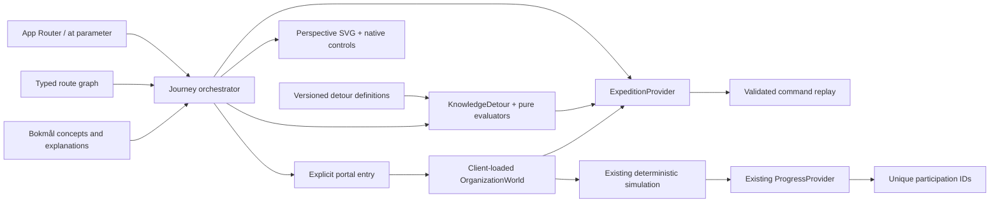

# The Azure Expedition — implemented Phase 1A.5

Delivered 2026-10-23. This is a bounded playable journey, not the full [Chapter 01](CHAPTER_01_BLUEPRINT.md) or the complete 30-unit curriculum. The owner explicitly authorized this implementation after Phase 1A. No backend, WebGL, Azure connection or live content integration is introduced. [PROJECT_STATUS.md](PROJECT_STATUS.md) records actual verification and remaining review gates.

## Creative exploration and selected direction

These are design judgments, not measured learner preferences. Three distinct navigation concepts were evaluated before implementation:

| Criterion                | Cinematic expedition                                              | Dimensional constellation                                         | Layered descent into systems                                     |
| ------------------------ | ----------------------------------------------------------------- | ----------------------------------------------------------------- | ---------------------------------------------------------------- |
| Travel                   | Continuous forward/reverse movement with recognizable route       | Hops between islands; weaker continuity                           | Strong movement into progressively deeper layers                 |
| Spatial coherence        | One landscape, side areas and stable return landmarks             | Global relationships clear; local orientation needs extra anchors | Excellent abstraction depth; difficult to return across domains  |
| Teaching                 | Stop and transform a meaningful object beside the route           | Each island can use a different representation                    | Reveals internal mechanisms naturally                            |
| Branching                | Short side routes and later professional branches                 | Best free-form specialist navigation                              | Vertical nesting risks imposing a rigid sequence                 |
| Detours                  | Small observatories remain visibly attached to the main route     | Mini-islands can feel like separate quizzes                       | Side rooms break the descent metaphor                            |
| Portals                  | Large gateways distinguish substantial work from short checks     | Large/small nodes need stronger semantic distinction              | Doorways between layers risk confusing Azure scopes              |
| Technical plausibility   | Explicitly a knowledge landscape, never Azure geography           | Risk of presenting all service relationships as graph edges       | Risk of presenting identity/geography as nested containment      |
| Mobile                   | One focused destination with native controls and a bottom console | Selecting distant nodes requires zoom/precision                   | Camera/occlusion and label management harder                     |
| Performance              | Bounded projected geometry and event-driven camera                | Cheap overview; a large graph eventually needs virtualization     | More geometry and visibility rules as layers accumulate          |
| Extensibility / identity | Familiar route, distinct teaching structures and world entrances  | Scales to specialists but can resemble a course map               | Distinctive, but poor fit for logs, operations and tradeoff work |

Select **the cinematic expedition**, with an optional route overview for revisits/direct professional entry. Unlike a static map, the active camera actually travels through the same projected landscape. A responsibility structure approaches and changes operational ownership; observatories sit to either side; a larger infrastructure arch opens the working simulator. The overview is an orientation alternative, not the primary experience. No moving avatar, steering, empty travel or arbitrary progress for visiting scenery.

## What the learner does and what it means

| Stop                 | Action and scene response                                                                                           | State / evidence                                                                                          | Continue                                                                  |
| -------------------- | ------------------------------------------------------------------------------------------------------------------- | --------------------------------------------------------------------------------------------------------- | ------------------------------------------------------------------------- |
| `arrival`            | Begin the expedition; a curved illuminated route approaches the responsibility structure                            | Navigation only; no XP/evidence                                                                           | `models`; direct practical entry also available                           |
| `models`             | Switch IaaS/PaaS/SaaS; eight elevated layers change owner; select a layer and explanation depth                     | Selected model/layer saved; conceptual exploration, no mastery claim                                      | Enter decision side route                                                 |
| `decision`           | Select a model for a team with its own code and no guest-OS patching requirement                                    | Authored answer validation records wrong/correct attempts; specific feedback; success lights the platform | Correct answer returns to `crossing`; unfinished exit returns to `models` |
| `crossing`           | Relate reduced operational work to retained customer responsibility                                                 | First detour's actual completion shown, not inferred from location                                        | Enter the other side route                                                |
| `ownership`          | Allocate customer duties in SaaS with multiple independent checkbox decisions; selected signals change in the scene | Exact set `data,identity` succeeds; adding OS/hosts or omitting a retained duty fails                     | Correct answer returns to `gateway`; unfinished exit to `crossing`        |
| `gateway`            | Inspect skills, supported operations and actual saved status; explicitly enter the arch                             | Opens the existing resource-organization world; no completion on entry                                    | World or `horizon`                                                        |
| Infrastructure world | Select subscription, issue validated creation, inspect the new scope/edge, complete the original guided check       | Unchanged domain rules; 80 + 40 XP once; accepted commands persist                                        | Return to the gateway, even unfinished                                    |
| `horizon`            | Review actual guided completion and revisit; inspect differentiated future landmarks                                | Networking, operations and architecture are explicitly unavailable; no fake launch buttons                | Revisit through overview or return to models                              |

Theory is not a tooltip collection. The same structure supports **intuition → mechanism → technical detail → application**, with direct access to any depth. The mechanism view names the selected owner, the technical view explains the specific layer and service caveats, and application connects the model to a different operational decision. PaaS here uses App Service's built-in runtime; custom containers/runtimes have different patch responsibilities. Application responsibility remains shared in PaaS/SaaS, matching the current Microsoft matrix. Data, customer settings and user access remain customer duties. This model does not describe every endpoint, network or service-specific security control.

Original Bokmål explanations/questions are in `src/content/nb.ts`; the source register owns publisher/review/licensing metadata. No Learn content is fetched at runtime or embedded from a catalog API. Source references are explicit links opened by the learner. S01/S12 and the Phase 1A.5 source supplement support the model, with public pages reviewed 2026-10-22.

## Bounded implementation architecture

The seven requested boundaries exist as small contracts, not seven frameworks:

- **Journey engine:** `domain/expedition.ts` owns stop IDs, route graph, visited positions and typed snapshot. Visited is orientation history, never an award condition. All currently playable stops remain available through overview; diagnostic placement is future work.
- **Experience orchestrator:** `Journey` coordinates URL navigation, teaching, detours, focus, overview and explicit portal entry. There is one active journey position. `/explore` remains an independently accessible route.
- **Content:** `nb.expedition` owns localized structured explanations, scenarios, alternatives, feedback and source labels. Stable competency IDs connect the slice to F01/G01/F02 and the I01 introduction; this does not complete the corresponding curriculum units.
- **Challenge engine:** `DetourDefinition` has ID/version, objective IDs, trigger/return, interaction/evaluator, source IDs, assistance, retry/reward and accessible mechanism. Both local evaluators are code-owned exact rules. No executable expressions, remote question interpreter or generalized plugin registry.
- **Simulation:** existing `createResourceGroup` and `missionSatisfied` remain unchanged. Scene geometry cannot grant success or mutate a scope. Only accepted creation commands are retained/replayed.
- **Progression/evidence:** legacy award IDs remain authoritative for local XP calculation. Guided detours save answers and derive completion from evaluators, award zero XP, and are labeled assisted participation. No independent-performance/retention/readiness engine is advertised.
- **Rendering:** journey perspective and organization orthographic projection are separate task-specific adapters sharing the shell, locale, progress and world state. Future worlds should add a bounded adapter/model only when they teach a reviewed technical capability.

The current route graph is intentionally small. Adding a new stop requires reviewed route/content definitions, a rendering composition if genuinely different, valid competency/source references, evaluator fixtures and browser coverage. New world IDs require an explicit loader/return contract and supported command model. This phase does not claim that adding an arbitrary catalog entry automatically produces a world.

## Camera and rendering decision

`route-geometry.ts` contains explicit presentation coordinates, a sinusoidal main route, perspective projection and clamped smooth interpolation. Main-route travel follows the curve; detours interpolate toward a lateral destination. Foreground/near objects scale with distance, elevated faces expose volume, and future structures remain behind the current interaction. Route coordinates have no relationship to Azure region or scope IDs.

The camera moves for **850 ms** on a navigation intent. It starts at the currently rendered position; cleanup cancels the previous animation frame, so a newer intent wins without an old callback completing later. Overview changes camera position/scale, and returning restores the current stop. There is no idle render loop. Resizing changes the viewport projection. Reduced motion applies the exact target on the next frame, including when the preference changes during travel. Portal approach uses a short 440 ms scene enlargement before the actual router transition; reduced motion enters immediately. Transition timers are canceled on unmount/position change.

| Rendering option                  | Decision and tradeoff                                                                                                                                                                                                                                                              |
| --------------------------------- | ---------------------------------------------------------------------------------------------------------------------------------------------------------------------------------------------------------------------------------------------------------------------------------- |
| Existing orthographic scene alone | Retained inside the technical world. Excellent scope inspection, but flat camera scaling alone does not convey travel through a landscape.                                                                                                                                         |
| CSS 3D layered DOM                | Low dependency cost; perspective labels, route geometry and independently animated layers become harder to keep aligned and accessible.                                                                                                                                            |
| React Three Fiber / Three.js      | Real camera lighting/occlusion and richer future traffic visualization; requires WebGL/context-loss/performance fallback and additional runtime/authoring cost. Not justified by this bounded route and responsibility teaching task. Reconsider for a demonstrated learning need. |
| Perspective SVG + semantic HTML   | Selected. Explicit depth, testable projection, finite geometry and camera movement without GPU support requirements. Limitation: authored painter order, not general 3D occlusion/physics.                                                                                         |

The technical world is loaded with `next/dynamic`, `ssr: false`, behind an accessible loading state. Its browser-measured SVG/native dialogs become interactive after load, avoiding competing inert streamed copies during hydration. Journey prefetches the route when the gateway is active. No timed loading film conceals a nonfunctional destination. Desktop diagram/list alternatives remain in the actual world.

## State, persistence and history

`azurelab.expedition.v1` stores a versioned position, visited stops, selected model/layer, up to 20 answer records per detour, up to three accepted resource-group commands and mission activation. It never stores numeric XP or arbitrary scope objects. Parsing caps input at 24,000 characters, filters known IDs/answers, rejects unknown envelope versions and replays the valid command prefix through existing rules. Forged `correct`/XP fields are ignored. An invalid command cannot create a resource; later commands after a bad prefix are discarded. These are untrusted local learning records, not authenticated evidence.

`azurelab.progress.v1` remains the separate fixed-award ledger. Existing users retain awards. Scenario reset clears current resource commands and current workbench steps, retaining historical participation. Explicit progress deletion clears **both** categories through the shared provider reset event. Storage failures show a memory-only warning. Storage events support best-effort tab updates, not transactional editing; simultaneous tabs can overwrite the latest workspace. Do not treat this as multi-user persistence.

`/?at=<stop>` is a real router/history position. Opening `/` resumes a validated saved stop and normalizes the URL. Back/forward restores the corresponding position; direct URLs and overview provide accessible revisits. Entering the world leaves the gateway in history; its explicit return link uses `/?at=gateway`. Reload replays accepted resources; unfinished exit preserves them without marking the world complete. The gateway distinguishes available, group-created/check-pending and historically completed. Historical completion can remain lit after a practice reset; it does not claim the new attempt is complete.

Travel, entry and return intents persist synchronously before router navigation. URL reconciliation runs on actual location/readiness changes with the latest snapshot, rather than reacting to its own state write. This prevents an immediate exit/reload from losing the chosen destination or an old URL overwriting the in-flight intent. Browser history still supplies the actual position when Back/Forward occurs.

Only **submitted** detour answers persist. Unsubmitted choices, current explanation depth/overview, camera frames, inspector selection and incomplete legacy check answers are transient. Resources and valid submitted work survive; a partially answered three-question check restarts after reload. This limitation is explicit; no draft-answer recovery is claimed.

## Responsive, accessible and performance behavior

Desktop uses a large landscape with a restrained contextual console, a layer-control rail during teaching, and explicit camera overview. At small laptop heights the console scrolls internally. Mobile retains a visible scene above a contextual, independently scrollable bottom console, horizontal native layer controls and touch-sized actions. It does not convert the entire route into a vertically scrolling article. New stops reset console scroll/focus to their heading. Short feedback may require scrolling within the console; the landscape stays visible.

Native buttons/radio/checkbox groups support every essential action; no dragging or precision gestures are required. Semantic explanations and owner labels duplicate the color-coded geometry. Focus indicators, skip link, native world dialogs and diagram/list remain. Reducing motion preserves identical state/commands. Automated Chromium/axe and screenshot review are engineering evidence; human screen-reader, physical touch-device and learner/SME validation are still pending.

Projection uses about 100 route samples and a small fixed landmark set, recalculated only while traveling or interacting/resizing. No external assets/fonts, polling, idle animation, continuous GPU rendering or new runtime dependencies. Browser tests retain traces for the new journey cases. There is no measured low-end-device/FPS or validated learning-effectiveness claim.

## Reproducible walkthrough and evidence

1. Run `npm ci`, `npm run build`, `npm run start`; open the local root. On a used device, delete local progress through its explicit confirmation if a fresh start is desired.
2. Begin; switch to PaaS. Observe OS change from customer to Microsoft while customer data remains customer-owned. Select runtime, open technical detail and inspect the custom-runtime caveat.
3. Take the first side route. Choose IaaS, test, read the requirement-specific correction, change to PaaS and test. Return to the main crossing.
4. Take the other side route. Mark OS incorrectly, test, then change the set to customer data plus user access. Inspect the changed signals and return to the gateway. XP remains zero.
5. Enter the infrastructure world, accept the brief, select Learning Sandbox, create `rg-azurelab-dev` with Norway East metadata and observe the new group/edge plus first-time 80 XP.
6. Complete the original check: under a subscription; resource location separate; each subscription trusts one tenant. The first complete check adds 40 XP. Return to the expedition; the gateway now reflects actual historical completion.
7. Reload, resume saved work, exit unfinished practice, revisit/retry a detour, use Back/Forward and verify XP stays 120. Resetting the simulation clears the current groups, not past awards. Explicit learner deletion clears both stores.

Automated reproduction: `npm run check` then `npm run test:e2e`. The new test file retains desktop/mobile `trace.zip` files and screenshots under ignored `test-results/`; open a trace with `npx playwright show-trace <trace-path>`. Tests exercise wrong/correct decisions, actual commands, return, replay, reload, storage corruption/deletion, keyboard, reduced motion, axe and no external app requests. Reviewed screenshots below are committed separately from raw traces:

- [Desktop arrival](screenshots/expedition-desktop-arrival.png), [teaching](screenshots/expedition-desktop-teaching.png), [detour](screenshots/expedition-desktop-detour.png), [portal](screenshots/expedition-desktop-portal.png), [technical world](screenshots/expedition-desktop-world.png), [completed return](screenshots/expedition-desktop-return.png).
- [Mobile arrival](screenshots/expedition-mobile-arrival.png), [teaching](screenshots/expedition-mobile-teaching.png), [detour](screenshots/expedition-mobile-detour.png), [portal](screenshots/expedition-mobile-portal.png), [technical world](screenshots/expedition-mobile-world.png), [completed return](screenshots/expedition-mobile-return.png).
- Compact viewport checks: [1280 × 720 laptop](screenshots/expedition-laptop-portal.png) and [360 × 780 touch layout](screenshots/expedition-narrow-portal.png), including interrupted overview/camera travel.

## Limits and next implementation target

One authored route, one teaching structure, two guided checks and one real technical world are playable. There is no diagnostic assessment, new service simulator, universal scenario renderer, checkpoint promotion, independent transfer assessment, mastery/readiness computation or account sync. Future landmarks are previews only. The 30-unit graph remains the reviewed curriculum specification, not a shipped content catalog.

Complete Chapter 01 next by retaining this journey shell and adding its bounded scope/geography prediction, typed plan/app dependency, source-backed policy denial/correction, unfamiliar transfer fixtures and explicit checkpoint promotion. Validate learning demand with beginner, experienced-engineer and Azure-reviewer exercises before claiming educational effectiveness. Extract wider authoring infrastructure in Phase 1C from that evidence rather than expanding empty destinations.
