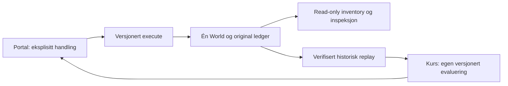

# Laboratory Platform · Stage 0

5. november 2026. Kontrollert mot `f0272ea5d181d88f2c3bad0ee186eac0893150e8` (PR57). Dette er kontrakten for **dagens** lokale plattform, ikke en påstand om implementert Azure-paritet. [Storage-forslaget](STORAGE_VERTICAL_DESIGN.md) er neste beslutningsgrunnlag, ikke en ny operativ tjeneste.

PR58 legger til kontraktstester og dokumentasjon. **Ingen runtime-, kurs-, assessment-, provider-, kommando-, ressurs- eller lagringskode endres.** Ingen ny read-only adapter er nødvendig: eksisterende funksjoner nedenfor dekker behovet. [PR57-overleveringen](LABORATORY_PLATFORM_HANDOVER.md) og dens låste bevis er bevart uendret.

## Eierskap

| Eier                 | Autoritet og eksisterende grense                                                                                                                                                                                                               | Skal ikke eie                                                                                                                     |
| -------------------- | ---------------------------------------------------------------------------------------------------------------------------------------------------------------------------------------------------------------------------------------------- | --------------------------------------------------------------------------------------------------------------------------------- |
| Laboratory Platform  | `sandbox/model.ts`: ressursidentitet, scope, typed commands, avhengigheter, validering, støttet Web-policy, atomisk World-endring og receipt. `replay.ts` og `store.ts`: teknisk replay, forsøk og tilgjengelige arkiver.                      | Faglig mestring, rubrics, guidede observasjoner eller XP.                                                                         |
| Azure Portal UI      | `portal/model.ts`, `inspection.ts` og Portal-komponentene: søk, projiserte lister, skjemaer, Review, eksplisitt Create/Apply/Delete VM, Overview/Properties, relasjoner og originale ledger-kvitteringer.                                      | Egen inventory, alternative valideringsregler eller teknisk fullføring ved navigasjon. En review-fork er ikke en utført kommando. |
| Course & Assessments | Eksisterende scenario-/mission-/assessment-stores: læringsmål, oppdragskrav, SavvyShark, inspeksjonsobservasjoner, faglige svar, assistance og immutable innleveringer. Refererer technical attempt, boundary/through, ressurs- og command-ID. | Kopiert operativ ressursstatus eller en egen ressursmotor. Et oppdragskrav er ikke plattformens tekniske fasit.                   |

Kurs kan kjøre tydelig merkede konseptmodeller og hypotetiske fork-er; de blir ikke operative ressurser eller technical receipts. Det separate fiktive SaaS-produktet er heller ikke ARM-inventory. Teaching boundaries, assistance og SavvyShark skjerming ligger fortsatt i de eksisterende kurskontraktene.

## Autoritativ kjede og versjoner

- Frosset Chapter01 (`organization-web@1.0.0`, `chapter01/model.ts` og persistence) replayes med sine opprinnelige regler. Det pensjonerte ChapterProvider gjeninnføres ikke.
- `continueEngine` importerer et validert Chapter-prefiks. `prefix` er ledger-lengden ved overgangen. Fortsettelsen er `sandbox@2.0.0`, lagret under `azurelab.sandbox.v2`, schema2. Den gamle nøkkelen omskrives ikke.
- `continueEngine` initialiserer `infrastructure` og `appSettings` til tomme samlinger. Den er **ikke** en generell oppgraderingsfunksjon for en allerede videreutviklet World.
- `SandboxProvider` oppretter én `SandboxStore`; Portal og kursadaptere leser samme engine. `inventory`, `projectArchitecture`, `infrastructureRelations`, `resourceOperations`, `receiptReferences` og `vmChain` lager read-only projeksjoner.
- Ressurs-ID-er allokeres deterministisk fra World.nextId og kan gjentas etter et eksplisitt nytt teknisk forsøk. ID og commandId er ikke globale bruker-/workshopidentiteter.

## Verifiserte operative kommandoer

Kilde: den faktiske `Command`-unionen, `supportedFields`, handlerne og `execute` i [sandbox/model.ts](../src/domain/sandbox/model.ts). Alle inputs har konvolutten `{commandId, expectedWorldRevision, command}`. Regler nedenfor gjelder sandbox2; et historisk Chapter-prefiks beholder blant annet sin lavere kapasitetsgrense.

| Kommando og input                                                        | Validering, scope og mulige avslag                                                                                                                                                                                                                                                                                                                                                                                              | Atomisk effekt og original receipt                                                                                                                                                                                                                                                                                             | Faktisk Portal-/kursbruk                                                                                                                                           |
| ------------------------------------------------------------------------ | ------------------------------------------------------------------------------------------------------------------------------------------------------------------------------------------------------------------------------------------------------------------------------------------------------------------------------------------------------------------------------------------------------------------------------- | ------------------------------------------------------------------------------------------------------------------------------------------------------------------------------------------------------------------------------------------------------------------------------------------------------------------------------ | ------------------------------------------------------------------------------------------------------------------------------------------------------------------ |
| `CreateGroup(subscriptionId,name,metadataRegion)`                        | Eksisterende subscription; trimmet RG-navn1–90 Unicode-bokstaver/tall eller `_ . ( ) -`, uten avsluttende punktum; støttet region; navn unikt uten hensyn til store/små bokstaver innen subscription. Maks8 grupper og samlet entitetsgrense96. Ugyldig navn/region/parent, duplicate eller capacity avvises.                                                                                                                   | Én `group-N`, metadataLocation og subscriptionId. Revision+1, nextId+1; `created`, `scope@1`, addedIds. RG-region bestemmer ikke barnas region.                                                                                                                                                                                | **Operativ og eksponert:** RG-create, blant annet Web-/VM-laber og missions.                                                                                       |
| `DeleteEmptyGroup(groupId)`                                              | Eksisterende RG. Enhver Web- eller infrastructure-ressurs i gruppen hindrer sletting: `cascade-delete-unsupported`/`supported-operation@1`; manglende gruppe gir invalid-parent.                                                                                                                                                                                                                                                | Fjerner bare tom gruppe, revision+1, `deleted`/`scope@1`, removedIds. Ingen generell cascade.                                                                                                                                                                                                                                  | **Operativ i domenet, ikke eksponert:** ingen RG-Delete-handling i dagens Portal eller ordinære læringsflyt.                                                       |
| `CreatePlan(groupId,name,region,profile)`                                | Eksisterende RG; navn `[a-z][a-z0-9-]{2,39}` og unikt per type/gruppe; tre støttede regioner; bare `linux-learning-v1`; eksisterende avgrenset Web-policy; kapasitet96.                                                                                                                                                                                                                                                         | `plan-N` med Linux/profil/region; revision+1 og nextId+1; `created`, `web-profile@1`, addedIds. Policy-deny inkluderer faktisk witness og ingen World-endring.                                                                                                                                                                 | **Operativ og eksponert:** App Service Plan-skjema; guidet Web, PaaS og Policy-arbeid.                                                                             |
| `CreateWebApp(groupId,name,planId)`                                      | Samme navneregler; eksisterende typet plan i samme RG. Manglende plan gir `missing-plan`; annen RG gir unsupported `cross-group-hosting`. Arver planens OS/region; Web-policy og kapasitet valideres.                                                                                                                                                                                                                           | `app-N` med planId; revision+1 og nextId+1; `created`, `web-plan-location@1`, addedIds. Ingen applikasjonsruntime.                                                                                                                                                                                                             | **Operativ og eksponert:** Web App-create, laber, missions og gammel/ny Portal challenge.                                                                          |
| `CreateVmBundle(groupId,name,region,image,profile,dataDiskGiB,subnetId)` | Eksisterende RG; navn3–15 tegn: liten bokstav først, deretter små bokstaver/tall/bindestrek, alfanumerisk slutt; image Ubuntu22.04/Windows2022; profil small/standard; diskstreng0/32/64. Tom subnetId oppretter nettverk. Gjenbruk krever eksisterende subnett i samme subscription, region og RG; annen RG er unsupported, annen subscription invalid-parent, annen region invalid-region. Maks8 VM-er og96 entiteter totalt. | VM, OS-disk, NIC, eventuelt VNet/subnet og datadisk **i én endring**. OS-disk64GiB Linux/128GiB Windows; faste lokale nettverksprefikser. Revision+1 én gang, nextId øker per objekt; `created`, `vm-profile@2`, alle nye IDs. Ingen credentials, boot, trafikk, helse eller ytelsesmåling. Web-policyen er ikke en VM-policy. | **Operativ og eksponert:** VM-wizard og infrastrukturoppdrag, blant annet `guest-control@1`. Disk/NIC/nettverk opprettes her, ikke gjennom egne create-kommandoer. |
| `DeleteVmBundle(vmId)`                                                   | Eksisterende VM, ellers invalid-parent/`vm-dependency@2`. Eierskap og gjenværende NIC-/subnettreferanser avgrenser cleanup.                                                                                                                                                                                                                                                                                                     | Fjerner VM og egne disk/NIC-objekter. Eget subnet/VNet fjernes bare når ingen beholdte referanser trenger dem. Revision+1; `deleted`, `vm-dependency@2`, removedIds.                                                                                                                                                           | **Operativ og eksponert:** Delete VM i infrastructure-details. Tilgjengelig teknisk cleanup, ikke læringskreditt.                                                  |
| `SetAppSettings(appId,environment,catalogMode)`                          | Eksisterende Web App og hostingplan; environment development/staging/production, catalogMode standard/read-only. Andre verdier unsupported-profile; manglende app/hosting avvises.                                                                                                                                                                                                                                              | Erstatter innstillingene for appId i samme World; revision+1; `updated`, `app-settings@2`. addedIds/removedIds er tomme. Også identisk innhold med **ny commandId** er en ny oppdatering.                                                                                                                                      | **Operativ og eksponert:** App settings med eksplisitt Apply; brukt av PaaS-/konfigurasjonsoppdrag. Skjemautkast er ikke anvendt konfigurasjon.                    |

Regionlisten er lokalt `norwayeast`, `westeurope`, `northeurope`, ikke en live Azure-katalog. Web-assignmenten avviser støttede Web-ressurser utenfor West Europe i App Sandbox. Andre Azure Policy-effekter, RBAC og datatilgang håndheves ikke av denne regelen.

**Cleanup-grense:** Hvis VM B gjenbruker A sitt subnett, beholdes nettverket når A slettes. Sletting av B rydder ikke senere A sitt nettverk automatisk. `origin` er opprettelses-/cleanup-proveniens, ikke en invariant om at opprinnelig VM fortsatt finnes. Gjenværende nettverk hindrer fortsatt DeleteEmptyGroup. Stage0 endrer ikke dette til generell garbage collection.

### Kapabilitetsklasser utover kommandoene

| Klasse                        | Faktisk støtte                                                                                                                                                                                                                               |
| ----------------------------- | -------------------------------------------------------------------------------------------------------------------------------------------------------------------------------------------------------------------------------------------- |
| 1 Operativt og eksponert      | Seks av de sju kommandoene over. Review + create/Apply, original activity/receipt og ressursinspeksjon.                                                                                                                                      |
| 2 Operativt, bare domene      | DeleteEmptyGroup. En registrert handler betyr ikke at Portal har en tilsvarende knapp.                                                                                                                                                       |
| 3 Read-only projeksjon        | Subscriptions og hierarki, RG/resource-lister, Overview/Properties, VM→disk/NIC→subnet→VNet, Web App→Plan, arkitektur og faktisk avgrenset Policy-witness. Ingen subscription-/Policy-editor eller selvstendig nettverksadministrasjon.      |
| 4 Pedagogisk simulering       | Eksempelvis capacity, subnet-failure/diagnose, serverless, storage, RBAC, monitoring, kostnad og migrering i kursene. Parametere/resultater er ikke operative Azure-ressurser eller målt telemetri.                                          |
| 5 Ikke implementert operasjon | Storage Account/Container/Blob, Entra-/RBAC-håndheving, NSG/IP/routing/trafikk, Functions-runtime, Monitor-innsamling, Migrate-operasjoner, faktiske priser og Azure API-er. Ikoner, undervisning og navigasjon etablerer ingen slik støtte. |

## Gjenbrukbar teknisk evidenskontrakt

Dette er en **lesekontrakt over eksisterende typer**, ikke et nytt lagringsformat eller en ny resultat-store.

1. Fastslå validert lagrings-/modellversjon, ready/issue og teknisk attemptNumber. `engineFor(attempt)` velger tilgjengelig nåværende/arkivert engine. At metoden returnerer et objekt er ikke alene en gyldig recovery-/lagringsstatus.
2. Finn original ledger-entry med commandId innen dette forsøket. Request binder command og expectedWorldRevision; receipt er resultatet. `(attemptNumber, commandId)` må i tillegg være knyttet til riktig lokal historikk/versjon. En sidecar for kursopphav er ikke vurderings- eller teknisk autoritet.
3. Bevar receiptens eksisterende felt: commandId, sequence, beforeRevision/afterRevision, operation, targetType, scopeId, location, outcome, code, ruleId, addedIds/removedIds, beforeCount/afterCount og valgfri field/policy. **Ingen nye receipt-felt trengs i Stage0.**
4. For modified resources uten addedIds, eksempelvis app settings, les faktisk appId fra original request og innstillingene ved verifisert through. Ikke finn på et `changedIds`-felt. `receiptReferences` og `resourceOperations` skiller ressurs, referanse og scope; scope-relasjon beviser ikke at alle barn ble endret.
5. Kursenes boundary/through er command-ID-referanser. Slå dem opp i riktig ledger og replay eksakt prefikslengde med `replayEngine(engine, endIndex+1)`. Sammenlign med samme forsøksgrense som den eksisterende evaluatoren. Et fullt replay verifiserer også slutt-World; et delvis replay trenger ikke dagens World for å gjengi historien.
6. Bruk den verifiserte historiske World til expected/actual, avhengigheter og inspeksjon. `missionEvaluation` og PR56-debriefen gjør allerede dette; de skal ikke erstattes. `inventory(liveWorld)` alene kan ikke dokumentere en slettet eller endret historisk ressurs.

### Accepted, denied og levering er forskjellige forhold

`outcome` er accepted/rejected/unsupported. Policy-avslag og de fleste valideringsavslag er originale ledger-hendelser uten World-endring. Faglig complete følger **ikke** av accepted: VM med Small kan være teknisk gyldig og samtidig avvike fra et guidet Standard-krav.

Samme commandId med identisk kanonisk payload returnerer samme originale receipt uten ny hendelse. Endret payload med samme ID gir transient command-id-conflict; ugyldig konvolutt og engine-history-limit gir heller ingen ledger-entry. Store.responses kan inkludere en slik transient konflikt. **Responses, review-receipts og en beregnet accepted-fork er ikke varig original evidens.**

World.revision øker bare ved akseptert endring. Ledger.sequence teller registrerte handlinger, også avslag. Store.revision teller lagrede forsøks-/kommandorevisjoner, også restart. Ingen av disse er Azure-etag, timestamp eller servertransaksjons-ID. Ingen signert Azure-kvittering påstås.

### Persistens og verifiserbarhet

Sandbox2 lagrer validerte requests og eventuelt rått validert Chapter-prefiks; receipts/World rekonstrueres deterministisk med riktig frosset motor. Det er derfor avgjørende at nye handlers **ikke** endrer sandbox2-replay. Current store er begrenset til400 nye requests,1,5M tegn og **ett** tidligere SavedAttempt; motorens separate ledger-grense er900. Et senere restart kan gjøre eldre teknisk evidens utilgjengelig. Bevar læringsresultatet og vis uverifiserbart teknisk grunnlag fremfor å bruke dagens ressurser.

`SandboxStore.persist` bruker compare-before-write og melder conflict ved endret base. Dette er nettleserens best-effort stale-beskyttelse, ikke distribuert lås eller flerbrukerautorisasjon. Ved setItem-feil publiseres fortsatt in-memory World med `issue='unsaved'`, og dispatch kan returnere true. Det finnes ingen generell readback-bekreftelse i denne tekniske store. **Accepted eller true er ikke bevis på varig lagring.** Eksisterende assessment-stores har egne durable kontrakter; de svekkes eller omdefineres ikke her.

Ukjent schema/modell, korrupt arkiv, ugyldig grense, feil receipt eller manglende attempt gir ikke rekonstruert suksess. `replayEngine` er et internt grensesnitt for allerede validert engine, ikke en parser for vilkårlige fremtidige modelVersion-verdier. Gjenbruk `restoreSandbox`/frosset Chapter-parser ved tillitsgrensen. En senere versjon må ha eksplisitt dispatch/restore, ikke falle gjennom til legacy.

## Verifisering og leveransestatus

[Nye kontraktstester](../src/laboratory-contract.test.ts) kontrollerer en faktisk innsamlet [baseline med17 ledger-hendelser](reviews/evidence/laboratory-stage0/command-golden.json), alle sju handlerfamilier, gamle/nye Policy-avslag, alle14 historiske continuation-Worlds, fremtidig unsupported Storage, read-only projeksjoner, delt nettverkscleanup, review/transient-receipts, invalid/stale, avvist lagring og begrensede arkiver. [1875 baseline-filer](reviews/evidence/laboratory-stage0/preservation.json), inkludert alle eksisterende runtime-/lærings-/testfiler og PR57-bevis, skal være byte-uendret; bare aktivt quality-record og prosjektstatus unntas fra denne bevaringslisten. Den gjentakende enhetstesten begrenses til169 historiske domenefiler; full1875-filskontroll er separat leveranse-/auditbevis, ikke en permanent frysing av alle UI-/dokumentfiler.

Den eksisterende komplette browserprofilen beholdes; ingen nye UI-/E2E-scenarioer eller QA-terskler introduseres når runtime er uendret. Faktiske kommandoer/resultater og uavhengig review føres i [PR58 audit](quality/PR58_FINAL_AUDIT.md) og aktivt release-record. Eksakt head-CI/streng release og anonym ordinær-root Gate7 dokumenteres på Draft PR58 etter push. Pending må ikke fremstilles som bestått. Menneskelig SME-, brukbarhets- eller læringseffekt er ikke verifisert av disse plattformtestene.
