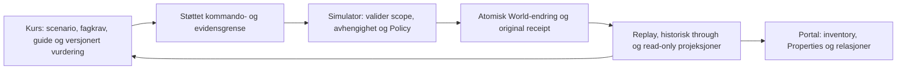

# AzureLab Laboratory Platform · avgrenset overlevering

5. november 2026 · arkitektonisk veikart etter AZ-900 RC-aksept. **Ingen nye tjenester implementeres i PR57.**

## Eksisterende fundament

Den operative Portalen leser ett replayet inventory fra `SandboxStore`/`SandboxProvider`, med `azurelab.sandbox.v2`, frosset Chapter01-prefiks og versjonert `sandbox@2`-fortsettelse. Typede kommandoer validerer konfigurasjon, scope, avhengigheter og den avgrensede Web-policyen. Aksept/avslag gir originale technical receipts; ressurslister, Properties, relasjoner og graf er projeksjoner av samme World. Historisk evaluering bruker originalt technical attempt og `through`, ikke en kopi av dagens inventory.

Faktisk eksisterer lokal RG, Web-plan/app-hosting, allowlistede appinnstillinger og atomic VM-bundle med disk/NIC/subnet/VNet. Scope-objekter og Policy-assignment er avgrensede modellobjekter, ikke en generell Azure-adminmotor. Domain kan ha kommandoer som ikke eksponeres som egen Portal-meny; eksempelvis må `DeleteEmptyGroup` ikke forveksles med et implementert generelt Delete-grensesnitt.

Storage Account/Blob, faktisk RBAC/Entra-håndheving, nettverkstrafikk, Monitor-innsamling, migrering, priser og gjesteruntime er **ikke operative tjenester**. Deres nåværende undervisningsmodeller skal ikke omdøpes til tekniske ressurser. SaaS-labben er et separat oppdiktet produkt, ikke Microsoft 365 eller ARM.

Autoritative utgangspunkt: [Sandbox-arkitektur](PORTAL_SANDBOX_ARCHITECTURE.md), [integrerte laber](INTEGRATED_LABS_ARCHITECTURE.md), [kapabilitetsmatrise](PORTAL_CAPABILITY_MATRIX.md), `src/domain/sandbox/{model,replay,store}.ts` og de eksisterende mission-/scenario-kontraktene.

## Eierskap og grense

Ressurslogikken eies av simulatorplattformen. Kurs definerer problem, premisser, krav, veiledning og vurdering — og refererer plattformens ressurs-/receipt-identiteter. De skal ikke lage egne operative inventory-kopier, tekniske fasiter eller parallelle kommandomotorer. Diagrammet beskriver eiergrensen; det lover ikke at alle fremtidige grensesnitt allerede er generalisert.

## Prioritert teknisk veikart

| Trinn                         | Avgrenset leveranse                                                                                                          | Må være bevist før videreføring                                                                                                                                                                                                                     |
| ----------------------------- | ---------------------------------------------------------------------------------------------------------------------------- | --------------------------------------------------------------------------------------------------------------------------------------------------------------------------------------------------------------------------------------------------- |
| 0. Plattformkontrakt          | Beskriv støttede kommando-/ressurskapabiliteter og lesbar evidensgrense rundt eksisterende motor; behold kursadaptere tynne. | Ingen historisk replay-/receipt-/rubric-endring; samme faktiske Portal-operasjoner og kursretur. Ingen generell ARM-tolk før behovet er dokumentert.                                                                                                |
| 1. Første nye vertikal        | Vurder Storage Account → container → Blob som første operative utvidelse, med ett klart elevproblem.                         | Eget godkjent design: stabile IDs, scope, control/data-plane, navn/konfigurasjon, atomisitet, Policy-grenser, feilkvitteringer, replay og historiske fixtures. Ny resource-/model-version når semantikken utvides; ingen omskriving av `sandbox@2`. |
| 2. Bruker-/workshop-isolasjon | Definer reelle sesjons-/workshopgrenser og eventuell varig flerbrukerlagring.                                                | Nettleserens lokale CAS er ikke serverautorisasjon eller brukeridentitet. Dokumenter eierskap, revisjoner, deling, eksport, personvern, tilgang og recovery før backend velges/bygges.                                                              |
| 3. Flere faglige vertikaler   | Prioriter konkrete Compute-, Networking-, RBAC- eller Monitoring-handlinger ut fra pilotbehov.                               | Hver handling trenger faktisk domain-regel, avhengighet, receipt og feil-/historikktest. Ikon, tekst eller en inaktiv knapp er ikke en kapabilitet.                                                                                                 |
| 4. Fremtidige kurs            | AZ-104/AZ-305 bygger scenarioer på de samme operative kontraktene.                                                           | Avklar nødvendige tjenestefasetter og vurderingsversjoner kursvis. Ikke kopier ressurslogikk inn i et nytt kurs eller lov full Azure Portal-paritet.                                                                                                |
| 5. Separat ekte Azure-adapter | Eventuell eksplisitt integrasjon mot avgrensede Azure-treningsmiljøer.                                                       | Egen sikkerhets-/kostnads-/identitets-/cleanup-/tenant- og godkjenningsmodell. Lokale kvitteringer kan aldri fremstilles som faktisk Azure-deployment. Ingen credentials eller ekte kall følger av dette veikartet.                                 |

Velg først trinn 0 og én liten vertikal etter eierens RC-/pilotgjennomgang. Flere nye tjenester, generelt IaC, hele RBAC og full Portal-fidelity skal ikke bli ett nytt gigantprosjekt. Prioriter faktisk læringsverdi og etterprøvbar ressurssemantikk fremfor tjenestetelling.

## Bevaring ved enhver senere utvidelse

Gamle typed commands, ressurs-ID-er, avslag, receipts, attempts/through, first/help/retry/abandon og rubrics må fortsatt replayes identisk. Felles inventory og originale kvitteringer forblir autoriteten; guidede observasjoner og selvstendige faglige begrunnelser er andre evidenstyper. Nye kurs eller ressurser gir ingen automatisk migrering, XP eller mestringskreditt.
