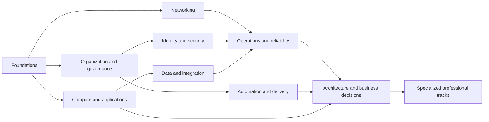

# Learning journey and competency universe

## Current Portal-first learning route — 2026-10-24

The owner replaces RPG progression as the main product. Learners enter the Portal workspace, select complete original **Describe cloud computing** or **Describe cloud service types**, explore the relevant responsibility/mechanism model, perform guided configuration, inspect actual relationships and submit a changed independent task. Exact topic/mode survives operational navigation. Existing six-unit observations/awards are preserved; new ST01–ST04 records do not complete F01, professional competencies or Microsoft training automatically.

The 30-competency graph/specializations below remain the curriculum foundation. Service-model education now has a complete original bounded module rather than only an NPC workshop; [current coverage](CURRICULUM_COVERAGE.md) records exact implementations/gaps. Benefits, wider AZ-900 architecture/governance and specialist modules remain visibly unavailable beyond the explicitly implemented slices. The historical station/quest sequence below is archived, not ordinary navigation.

## G1.3 official names without exam-driven architecture

Lysningen is the first fictional station, not the certification or path. The visible starting overlay is Microsoft Certified: Azure Fundamentals / AZ-900: Microsoft Azure Fundamentals / Introduction to Cloud Infrastructure: Describe cloud concepts. Describe cloud computing is delivered through the existing six original investigations, guided questions and separate changed task. Describe the benefits of using cloud services is planned; Describe cloud service types is partial and leads to Noor's bounded engineering quest. The professional competency graph and specialist directions below remain independent of credential codes. No local activity completes Microsoft Learn or grants official XP.

## G1.2 implemented orientation route

The canonical RPG now recommends welcome → Foundations 01 → service responsibilities → Noor → actual Infrastructure World → debrief. This is guidance, not a mandatory competency chain. The log projects real observations and supports direct experienced workbench entry without assumed mastery. Its honest world overview references the 30 IDs below; all additional regions remain planned/unavailable. [Expedition progression](EXPEDITION_PROGRESSION.md) owns current availability and next-action rules. No certification readiness or new competency coverage is inferred.

## L1 refinement: competencies are not lessons

F01 and F03 now map to the first local module's seven objective IDs FC01–FC07. Six units contain separate teaching, practical investigations and guided decisions; the changed-context task retains first independent criterion observations and assistance/retry history. The remaining professional graph below stays a blueprint, not an implemented catalogue. A competency can require multiple modules, chapters and quest presentations. [Coverage](CURRICULUM_COVERAGE.md) audits every current introductory exam objective and all 20 path-module unit indexes; [content architecture](CONTENT_ARCHITECTURE.md) owns the new hierarchy and versioning. Existing service-model quests remain a connected follow-up, not proof of full F01 completion.

Status: **proposed curriculum architecture**, version 1.0.0, reviewed 2026-10-22. Phase 1A.5 adds playable F01 service-responsibility teaching, two assisted checks and a portal to the existing G01/F02 mission. [JOURNEY_EXPERIENCE.md](JOURNEY_EXPERIENCE.md) owns its actual scope. The 30 units/specializations remain curriculum specifications. Stable objective IDs connect the route to this graph; a completed detour does not complete a competency. Overview/direct practical entry supports experienced users; diagnostic placement is not implemented. This map is a scope/progression design, not a claim of available courses or verified mastery. [SOURCE_REGISTER.md](SOURCE_REGISTER.md) owns authoritative URLs, observed versions, credential status, attribution and review rules.

## A graph of capabilities, not an exam syllabus

Competency IDs survive service renames, exam retirement and translations. Each competency has a semantic revision, observable outcomes, hard prerequisites, helpful prior knowledge, known misconceptions, supported scenarios and evidence requirements. Topics and Azure services are content tags; they are not automatically competencies. Levels describe task demand within an area: **L0 orient**, **L1 explain/predict**, **L2 configure/build**, **L3 diagnose/operate**, **L4 evaluate/design**. They are not XP levels or a universal ranking of a person.

**Core** means broadly useful professional capability. **Specialist** means depth selected for a role/workload. A core area can contain specialist units. A prerequisite means the named minimum outcomes, not completion of every preceding lesson. Reference checkpoints let experienced learners enter advanced work without rebuilding a beginner estate. Independent placement can satisfy prerequisites; self-reported experience only changes recommendations.



This is an orientation diagram. The unit table below defines the actual minimum dependencies; architecture reasoning begins with small tradeoffs in Chapter 01 rather than being withheld until the final node.

## Competency units and dependencies

`—` means no Azure prerequisite. F00 is optional bridging support in operating systems, basic IP/DNS, HTTP, JSON and Git, with a short diagnostic; it is not an Azure competence award. Hard dependencies apply to independent task variants; guided chapters may teach dependencies internally before assessing them.

| ID  | Observable objective                                                                             | Minimum prerequisite IDs                     | Target demand / scope                                |
| --- | ------------------------------------------------------------------------------------------------ | -------------------------------------------- | ---------------------------------------------------- |
| F01 | Select a service/deployment model from requirements and allocate responsibilities                | —                                            | L1, core                                             |
| F02 | Distinguish management scope, geography, region and zone; predict failure boundaries             | F01                                          | L1–L2, core                                          |
| F03 | Distinguish elasticity/scaling/availability and explain consumption/cost drivers                 | F01                                          | L1–L2, core                                          |
| G01 | Place resources in valid scopes and separate Entra identity from containment                     | F01                                          | L1–L2, core                                          |
| G02 | Interpret ARM/provider/resource identity and construct a valid dependency sequence               | G01                                          | L2, core                                             |
| G03 | Predict policy applicability, denied configuration and remediation boundaries                    | G01, G02                                     | L2–L3, core                                          |
| G04 | Design lifecycle grouping, tags, locks and ownership/cost boundaries                             | G01, F03                                     | L2–L3, core; Service Groups preview optional         |
| N01 | Allocate nonoverlapping address spaces/subnets and resolve a hostname                            | F02; F00 networking diagnostic or equivalent | L2, core                                             |
| N02 | Trace new flows through NSGs, routes and peering; explain transport versus application failure   | N01, G02                                     | L2–L3, core                                          |
| N03 | Configure private endpoint/DNS boundaries; choose VPN/ExpressRoute for requirements              | N02, I01                                     | L3, core private access; hybrid depth specialist     |
| N04 | Choose and trace L4/L7/global application delivery and API boundaries                            | N02, C01                                     | L3–L4, core selection; implementation specialist     |
| C01 | Choose PaaS hosting and configure an App Service plan/app dependency                             | F01, G02, F02                                | L2, core                                             |
| C02 | Build/operate VM and VM Scale Set configurations, images/disks and patch responsibilities        | G02, N01, F03                                | L2–L3, core                                          |
| C03 | Choose Container Apps versus AKS and reason about ACR/image/runtime responsibilities             | C01, N02, I01                                | L2–L4, specialist operations depth                   |
| C04 | Design Functions/event-driven hosting and understand scaling/execution constraints               | C01, D03                                     | L2–L3, core selection; advanced execution specialist |
| D01 | Choose Blob/Files/disks, access modes, tiers and redundancy for a workload                       | F02, G02, I01                                | L2–L3, core                                          |
| D02 | Choose relational/NoSQL storage; reason about partitioning, consistency and recovery             | D01, F03                                     | L2–L4, core selection; engine tuning specialist      |
| D03 | Choose messaging/event/integration services; handle retries, ordering and duplicate effects      | C01, G02                                     | L2–L3, core                                          |
| I01 | Trace authentication versus authorization using principals, roles, scopes and managed identities | G01, G02                                     | L2–L3, core                                          |
| I02 | Establish least-privilege data access and diagnose network versus Key Vault authorization errors | I01, N02                                     | L3, core                                             |
| I03 | Evaluate security posture, privileged access, Conditional Access and policy/compliance limits    | I02, G03, O01                                | L3–L4, core review; advanced controls specialist     |
| O01 | Collect/query/correlate metrics, logs and traces and configure actionable alerts                 | G02, C01                                     | L2–L3, core                                          |
| O02 | Form a hypothesis, choose diagnostics, correct a fault and verify no regression                  | O01, N02, I01                                | L3, core                                             |
| O03 | Define/test availability, backup, restore, RTO/RPO and performance targets                       | O02, D01, F03                                | L3–L4, core                                          |
| A01 | Interpret CLI/PowerShell operations and declarative Bicep/ARM changes and diffs                  | G02, C01                                     | L2, core                                             |
| A02 | Design a reviewed, testable IaC/deployment pipeline with bounded identity                        | A01, I01, O01                                | L3, core                                             |
| A03 | Select safe release/rollback strategies and test configuration/data compatibility                | A02, C01, O02                                | L3–L4, core                                          |
| R01 | Evaluate a workload against requirements and Well-Architected tradeoffs with witnesses           | O03, I02, D02, C01                           | L4, core                                             |
| R02 | Design landing-zone governance/platform versus workload responsibilities                         | G03, N03, I03, A02                           | L4, core architecture; implementation specialist     |
| R03 | Advise on migration, modernization, cost, capacity and portfolio/technical-debt choices          | R01, G04, A03                                | L4, core advisory                                    |

No dependency cycle exists in the declared minimum graph: D03 requires C01, while only C04 requires D03; private-access engineering N03 builds on I01, while I01 requires no private-network task. Authors must check cycles/missing IDs when this graph becomes executable content in Phase 1C.

## Domain designs

The following are authoring briefs for each major area. Simulation and assessment are proposed. Every area needs more than service-name recognition. Cross-domain links below describe transfer opportunities in addition to hard prerequisites.

### F — Cloud foundations

Objectives: F01–F03. Prior knowledge: everyday application use; optional F00 bridges technical vocabulary. Conceptual model: service abstraction changes who operates each layer; public/private/hybrid describes deployment context; scaling and elasticity differ from failure tolerance; regional fault domains do not form management scopes. Technical ability: allocate ownership, select a justified hosting model and compare a region/zone placement against constraints.

Simulation: responsibility matrix with scenario-specific ownership, capacity/demand controls and separate scope/geography lenses. Changing demand/instance configuration changes a declared synthetic capacity result; changing a region never reparents a resource. Misconceptions: PaaS transfers all security to Microsoft; cloud automatically scales or backs up everything; every region has a pair; an Azure budget caps spending. Assessment: predict a different workload's responsibility and failure outcome, configure it, then explain a counterexample. Connections: G01, C01, O03, R03. Sources S01/S02/S23/S32 and CR02; L1 before L2, foundational throughout later tracks.

### G — Organization and governance

Objectives: G01–G04. Prior knowledge: F01; dependency details in the table. Conceptual model: tenant is identity authority; management hierarchy establishes scopes; ARM/control plane differs from workload data access; lifecycle grouping, authorization and policy are separate controls. Technical ability: create a valid resource/dependency sequence, locate inherited constraints and propose the least disruptive remedy.

Simulation: typed scope/identity relations, custom filtered deny rules, tag/lock metadata and deployment diffs. A rejected command produces no requested resource; earlier successful commands remain. Misconceptions: tenant admin automatically reads all resources; resource groups nest; tags inherit automatically; changing group metadata moves an app; resource-group membership grants network access. Assessment: build a differently named environment under changed scope/location rules and explain why the rejected configuration failed. Connections: I01, A01, R02 and cost ownership. Sources S03–S07/S25/S36; L1–L3. Service Groups are optional preview cross-boundary views, never another containment level or an access shortcut.

### N — Networking and connectivity

Objectives: N01–N04. Prior knowledge: address/DNS basics plus G02; identity for private access. Conceptual model: DNS resolution, route selection, transport filtering, TLS/application protocol and authorization are distinct stages. A private endpoint provides an interface to a service, not automatic DNS or role assignment. Technical ability: allocate subnets, inspect effective routes/rules, distinguish NSGs from firewalls and L4/L7 delivery, and correct a traced failure.

Simulation: packet/connection trace with a five-tuple, ordered rule witness, routes and resolver table; peering, VPN/gateways, ExpressRoute and Private Link added only through named model capabilities. Misconceptions: peering is automatic transitive routing; a line on a graph makes traffic work; private means authorized; a 403 always means RBAC; NSGs inspect HTTP paths. Assessment: diagnose an unseen broken flow and verify a negative control still fails. Connections: I02, C02/C03, O02 and R02. Sources S08–S10/S33/S35 and CR07/CR09; L2–L4. B in [EXPERIENCE_BLUEPRINTS.md](EXPERIENCE_BLUEPRINTS.md) is the concrete engineering case.

### C — Compute and application platforms

Objectives: C01–C04. Prior knowledge: service models, scopes and relevant networking/identity units. Conceptual model: hosting dependency and execution environment differ from application configuration, code deployment and data dependency. VM/VMSS, App Service, Functions, Container Apps and AKS offer different control/operational burdens. Technical ability: choose a platform from workload requirements, configure a bounded deployment, trace dependencies and reason about scaling/blast radius.

Simulation: dependency construction plus resource-specific controls, deployment/health timeline and capacity fixture; container image/configuration provenance for specialist exercises. Misconceptions: AKS is always the most advanced/best choice; a successful ARM deployment proves application health; every app owns isolated plan capacity; serverless means no limits or costs. Assessment: justify two plausible service choices, build one and diagnose a failed dependency without recreating everything. Connections: D03, A03, O03 and R01. Sources S01/S12/S13/S37; L2–L4. Only CR01's named plan/app subset enters Phase 1B.

### D — Storage, databases and integration

Objectives: D01–D03. Prior knowledge: regional placement, identities and an application model. Conceptual model: storage durability, availability and recoverability differ; object/file/block and relational/document models solve different access problems; asynchronous integration introduces duplicate/retry/ordering concerns. Technical ability: select access, replication and data-model options, reason about consistency/partition keys, and make message handlers safe under declared delivery behavior.

Simulation: object lifecycle/version timeline, replica/restore state, partition workload distribution, queue/event replay and a bounded duplicate side effect. Misconceptions: redundancy prevents deletion; any database fits the same query/access pattern; at-least-once delivery means business effects occur once; cache is authoritative storage. Assessment: recover an accidentally deleted object, demonstrate a duplicate-safe flow, or predict a consistency/cost consequence on an unfamiliar dataset. Connections: I02, C04, O03, R01. Sources S14–S18/S31; L2–L4. SQL, Cosmos DB, Service Bus, Event Grid, Event Hubs, Logic Apps and API Management are selections to model incrementally, not promised simulators.

### I — Security and identity

Objectives: I01–I03. Prior knowledge: G01/G02 and relevant network observations. Conceptual model: authentication establishes a principal; authorization evaluates actions at scopes/planes; managed identity removes a credential-management task but grants no role by itself. Zero Trust, Conditional Access, privileged access and posture are risk controls, not a compliance certificate. Technical ability: inspect effective access, distinguish control/data rights, choose least privilege, rotate/revoke a modeled grant and verify negative cases.

Simulation: principal → role/action/scope evaluation trace, synthetic Key Vault data operation, network isolation comparison and posture findings tied to actual configuration. Misconceptions: Owner/Contributor always reads secret contents in RBAC mode; enabling managed identity grants data access; private endpoints replace identity; a green posture score establishes compliance. Assessment: resolve a denied secret read without broadening unrelated permissions and explain why a second identity remains denied. Connections: N03, O02, A02 and R02. Sources S06/S10/S11/S22/S34/S35 and CR06; L2–L4. Deny assignments, ABAC, PIM and cross-tenant behavior require separate explicit extensions, not hidden approximations.

### O — Operations and reliability

Objectives: O01–O03. Prior knowledge: a deployed workload, transport/identity basics and relevant data recovery concepts. Conceptual model: telemetry is collected evidence with gaps; symptom and cause differ; alerts need signals/actions; backup, HA and disaster recovery meet different objectives. Technical ability: instrument/query a synthetic dataset, correlate changes and symptoms, test a hypothesis, perform a safe correction and demonstrate restore/failover against stated RTO/RPO.

Simulation: correlated metrics/logs/traces and incident timeline; fault injection uses explicit logical ticks; retry/restore state changes produce measurable observations. Misconceptions: no logs means no failure; an alert fixes an incident; region pairing implies application failover; SLA is an observed workload SLO; backup is availability. Assessment: diagnose a new failure using the minimum necessary evidence, verify regression controls and perform a restore drill. Connections: every implementation track, especially A03 and R01. Sources S15/S19/S20/S24/S37 and CR10; L2–L4. Logs must be generated from modeled causes, with decoys and missing telemetry explicitly authored.

### A — Automation and DevOps

Objectives: A01–A03. Prior knowledge: successful manual configuration, scopes/identity and observability. Conceptual model: desired state, deployment dependency and rollout state differ; a pipeline has its own identity and trust boundary; application rollback may not reverse data changes. Technical ability: interpret a reviewed CLI/PowerShell/Bicep change, predict its diff, introduce validation/approval gates and select a tested rollout/recovery strategy.

Simulation: constrained terminal grammar and declarative resource plan, diff/review timeline, synthetic pipeline and release/rollback witnesses. No shell or arbitrary learner code executes. Misconceptions: rerunning any command is safe; IaC is inherently least privilege; a successful pipeline is a healthy app; rollback always reverses schema changes. Assessment: correct a bad plan, show a repeat run produces no extra resources, and recover a failed release under changed constraints. Connections: G02, C03, I03, O02, R02. Sources S05/S21/S22/S25 and CR08; L2–L4. Full Bicep/PowerShell compatibility is not implied by a teaching subset.

### R — Architecture and business decisions

Objectives: R01–R03. Prior knowledge: operating and testing an application across compute/network/identity/data boundaries. Conceptual model: requirements and tradeoffs drive architecture; a platform landing zone and a workload architecture have different owners; cost includes operations, egress, capacity and risk, not only a service price. Technical ability: elicit constraints, compare feasible designs, test failure/capacity assumptions, record an ADR, and advise on migration/modernization or technical debt with stated uncertainty.

Simulation: architecture alternatives, synthetic cost/capacity model, fault/recovery scenarios, migration waves and dependency evidence. Misconceptions: one reference architecture is universally correct; cheapest unit rate minimizes workload cost; multi-region guarantees zero loss; every workload needs Kubernetes; a landing zone is just a resource group. Assessment: more than one design may pass hard constraints; reasoning, tests, residual risks and rejected alternatives need rubric review. Connections: all domains plus business ownership and platform operations. Sources S23–S28/S32/S37 and CR04/CR11; L4. C in EXPERIENCE_BLUEPRINTS.md supplies exact illustrative constraints and arithmetic.

## Branching specialist tracks

These are optional expansions, not an equal-depth service catalog. Each begins with independent placement or the minimum unit outcomes and a reference checkpoint; each must add one bounded model at a time.

| ID / track                  | Prior outcomes                     | Learn and do / simulation                                                                                                  | Misconception and assessment                                                                                               | Cross-domain/source anchors / level                                                 |
| --------------------------- | ---------------------------------- | -------------------------------------------------------------------------------------------------------------------------- | -------------------------------------------------------------------------------------------------------------------------- | ----------------------------------------------------------------------------------- |
| X01 Advanced networking     | N01–N04, O02, I02                  | Diagnose hybrid routing/DNS, delivery and PaaS perimeter boundaries; manipulate route/resolver/rule traces                 | Connectivity is not transitive permission; resolve an unseen asymmetric/private-access failure and preserve isolation      | R02/C03; S08/S09/S33/S35, CR07; L3–L4                                               |
| X02 Security engineering    | I01–I03, N03, O02                  | Investigate identity exposure, privilege, network and posture controls; compare blast radius before/after a grant          | Tool findings are not compliance; independent threat/least-privilege repair with negative tests                            | A02/R02; S06/S11/S22/S34/S35, CR06; L3–L4                                           |
| X03 Data engineering        | D01–D03, A02, O01                  | Design ingestion/storage/quality/lineage and data access; replay duplicate/late events and query/cost effects              | Pipeline success is not data quality; reconcile an unfamiliar late/duplicate dataset and recovery objective                | I02/R01; S14–S18/S31; L3–L4; Fabric/Azure service choices reviewed before authoring |
| X04 Application engineering | C01/C03/C04, D02/D03, I02, O02     | Build reliable APIs/event consumers, manage configuration and dependencies; test retry/idempotency and service selection   | Distributed retries do not guarantee exactly-once business effects; unseen dependency failure with regression checks       | A03/N04; S12/S13/S18/S20; L3–L4                                                     |
| X05 AI workloads            | X04 or equivalent C/D/I/O outcomes | Compare grounding/evaluation/identity/safety/observability decisions using synthetic retrieval/model fixtures              | A plausible answer is not accurate or authorized; evaluate a held-out dataset and data-leak/permission counterexample      | R01/X02; S20/S22/S30, CR05/CR06; L3–L4; no live model service required              |
| X06 Hybrid infrastructure   | C02, N03, I03, O03                 | Compare Azure Arc/Azure Local connectivity, ownership and recovery constraints in an explicit hybrid topology              | Hybrid is not identical service availability or offline Azure; diagnose a disconnected-management case and recovery limits | R02/R03; S25/S26/S29; L3–L4                                                         |
| X07 Platform engineering    | G03, A02/A03, I03, O02             | Design paved paths, landing-zone/workload contracts and safe self-service; change a platform policy and test two consumers | A platform is not just a template repository; demonstrate developer task success without excessive privilege               | C03/R02; S21/S25/S28; L4                                                            |
| X08 DevOps / delivery       | A01–A03, O02/O03, I02              | Trace build/deploy/runtime provenance and safe promotion; inject release/configuration failure                             | Delivery frequency is not reliability; independently restore service and explain residual data risk                        | X04/X07; S19–S22, CR08; L3–L4                                                       |
| X09 Architecture / advisory | R01–R03 plus one engineering track | Compare migration/platform/portfolio alternatives with evidence and a decision record; test a changed business constraint  | A certification title does not resolve tradeoffs; defend two feasible designs and a rejected option to a reviewer          | All domains; S23–S28/S32, CR04/CR11; L4                                             |

## Routes through the graph

- **New to Azure:** F00 if useful → Chapter 01 (F01/F02/G01/G02/G03/C01 introductory outcomes) → I01 + N01 → N02/D01/O01 → bounded troubleshooting → choose application, administration or architecture direction. F03 and security responsibilities recur within these chapters, not as a prerequisite reading wall.
- **Experienced infrastructure engineer:** attempt placement for F/G/N basics; if successful start C02/N02/O02 from a reference world, bridge I01 or PaaS responsibilities where evidence is missing. Existing non-Azure experience is useful but not automatically equivalent.
- **Software developer:** Chapter 01 challenge entry or placement → C01/D03/I01/O01 → X04 → A02/A03 → containers, AI or architecture as needed. AKS is optional, not a rite of passage.
- **Administrator/security engineer:** G/I/N/D/O common spine → X01 or X02, with independent incident variants and delayed retrieval; add platform/automation as practice requires.
- **Technical advisor/architect:** challenge placement across G/N/C/D/I/O, bridge weak areas, then R01/R02/R03 and X09. Architectural reasoning must include evidence from configurations/failure tests, not only selected diagrams.

A failed placement returns specific evidence gaps and optional prerequisite exercises. It does not erase self-reported experience or lock the entire world. Accessibility controls, sources, glossary and operational diagnostics never count as a hint merely because they are alternative representations. Teaching/solution hints before submission do affect assistance classification. Placement cannot be earned by importing edited local scores.

## Progression and evidence

| Concept                    | What it records                                                                               | Evidence / uncertainty                                               | Proposed presentation                                                                         |
| -------------------------- | --------------------------------------------------------------------------------------------- | -------------------------------------------------------------------- | --------------------------------------------------------------------------------------------- |
| Participation              | Meaningful chapter work and submitted reflection/attempt                                      | Does not show technical correctness                                  | Fixed repeat-safe XP; optional activity levels, never used as access/skill authority          |
| Mission completion         | Scenario's technical success predicates                                                       | May be heavily guided or memorized                                   | Milestone plus assistance/version, separate from transfer                                     |
| Demonstrated understanding | Prediction + appropriate reason on changed constraints                                        | Narrow concept/variant; not general proficiency                      | Named outcomes with witnesses, no aggregate percentage                                        |
| Independent performance    | Unfamiliar task, no teaching hints before submission, required checks                         | Finite scenario coverage; local records untrusted                    | Task/variant outcome with constraint failures and assistance history                          |
| Retention                  | Delayed unfamiliar retrieval, dated separately                                                | Timing/accessibility and prior exposure matter                       | Review due / observed again / needs practice; no assumed forgetting curve                     |
| Certification readiness    | Current mapped coverage, independent varied performance, retention and independent assessment | Broad sampling and calibration needed; no validated estimator exists | Not calculated until evidence/review supports a bounded recommendation; never pass guarantees |

Evidence records must include competency/revision, scenario/model/assessment versions, variant, attempt/checkpoint provenance, observed actions/witnesses, assistance timing, result per criterion, collection date and trust (`local-unverified` initially). Repeated same-variant success is practice, not additional independent breadth. After feedback has exposed a solution, retrying that variant cannot restore independent status; offer a different frozen variant. Contradictory/old evidence remains visible rather than silently averaged away.

For the first chapter, use the explicit rubric in CHAPTER_01_BLUEPRINT.md. No general mastery classifier is required. Later topic labels such as independently demonstrated require reviewed evidence rules, varied tasks and retention; lacking evidence is **unknown**, not zero ability. Recommendations name the gap and can be declined. Adaptive difficulty initially means transparent selection of authored variants, not an opaque algorithm. Harder variants change constraints/reasoning, not pointer precision or speed.

Existing 80/40 awards remain legacy participation only. Chapter 01 proposes one distinct 100-XP participation award after chapter technical completion (guided or successful challenge entry), transfer submission and reflection; success on transfer is reported separately. The chapter runner must not also fire legacy awards for reusing the group-creation primitive. Replays/hints/clicks/lens switches yield no additional XP. Stable award identity survives content patches. No streak penalty, ranks or leaderboard in Phase 1B. Future opt-in organizational achievements require comparable conditions, pseudonyms, withdrawal and privacy boundaries; speed must not penalize assistive technology or accommodations.

## Certification is a versioned overlay

The competency graph never embeds exam codes in primary IDs or prerequisite rules. A separate mapping package references a credential, its status, objective snapshot and reviewed relations to competencies/scenarios. Certifications and Applied Skills use the same relation structure but different credential types. An exam may have separate credential prerequisites; an AzureLab assessment awards neither.

```ts
// Proposed serialized metadata, not implemented tables or official Microsoft objective IDs.
type CredentialMapping = {
  mappingId: string;
  mappingVersion: string;
  provider: 'microsoft';
  credentialType: 'certification-exam' | 'applied-skills';
  credentialId: string;
  status: 'active-observed' | 'retiring' | 'retired' | 'unknown';
  objectivesVersion: string; // effective date, or observed-date snapshot when undated
  sourceId: string;
  reviewedAt: string;
  nextReviewDue: string;
  reviewState: 'candidate' | 'reviewed' | 'stale';
  relations: {
    objectiveKey: string; // AzureLab key; preserve official heading/path separately
    officialHeadingPath: string[];
    competencyId: string;
    competencyRevision: string;
    scenarioVersions: string[];
    relation: 'supporting' | 'partial' | 'full-reviewed';
    rationale: string;
    gaps: string[];
  }[];
};
```

Initial mapping candidates: CR02 AZ-900 → F/G and service-selection foundations; CR03 AZ-104 → G/N/C/D/I/O; CR04 AZ-305 → R plus advanced cross-domain design; CR05 AI-200 → C/D/I/O/A/X05; CR06 SC-500 → I/N/O/X02/X05; CR07 AZ-700 → N/X01; CR08 AZ-400 → A/O/X08; CR09/CR10 Applied Skills → networking/monitoring outcomes. Exact current statuses/dates are in SOURCE_REGISTER.md. These are proposed mapping directions, **not coverage claims**.

Example candidate relation: `chapter-01@1.0.0` → G01/F02 → CR02's architectural-components heading, **partial** because the chapter does not cover the entire objective. CR04 may have a supporting relationship but cannot be labeled architect-level assessment. Retired AZ-204/AZ-500 mappings remain historical only; AI-200/SC-500 require a new reviewed scope diff, not renaming an old mapping. On source change, retain the previous snapshot, review added/removed objectives and mark affected relations stale. Review availability every 30 days and before an exam-aligned release; do not use a stale mapping to calculate readiness.

## Transition to real practice

After an independently solved simulation, offer an optional source-linked real-practice brief: what was modeled, omitted, and what an authorized lab would need to verify. Preparation may include an inert reviewed IaC artifact, cleanup/cost plan and a comparison checklist. No credential entry, shell execution, Azure resource creation, paid lab enrollment or live integration is authorized by this blueprint. A future real-lab feature needs explicit owner/user authorization, cost/security boundaries and separate verification. Microsoft Learn/Applied Skills links supplement the original curriculum; their lessons/labs are not reproduced.
