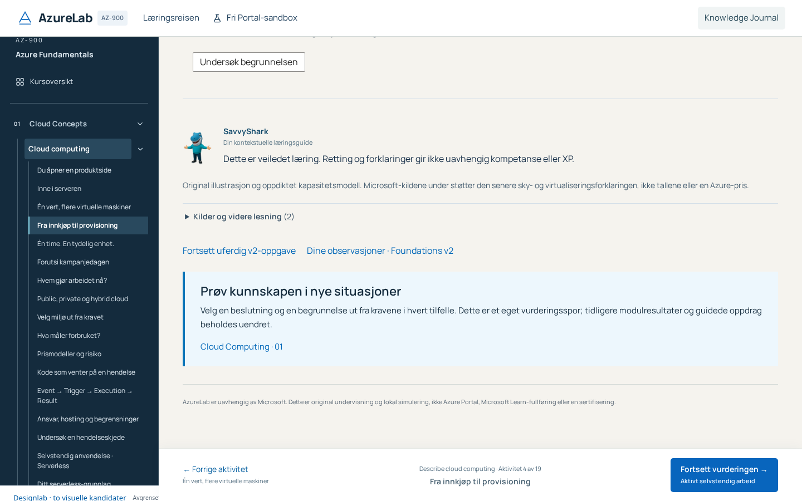
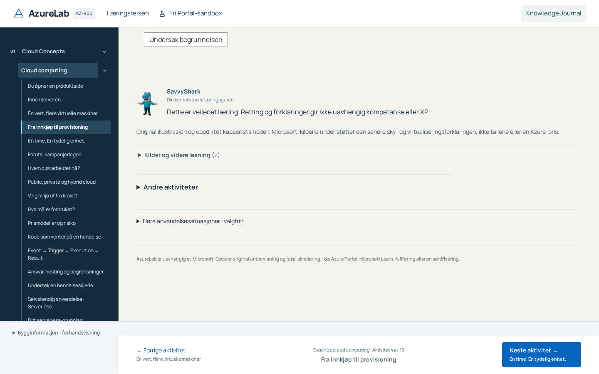
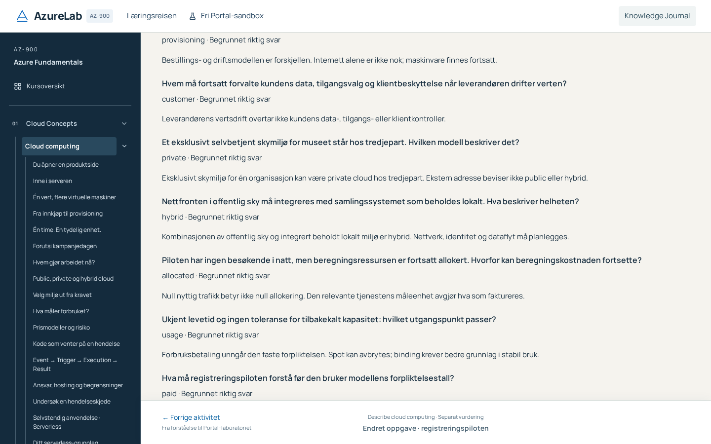
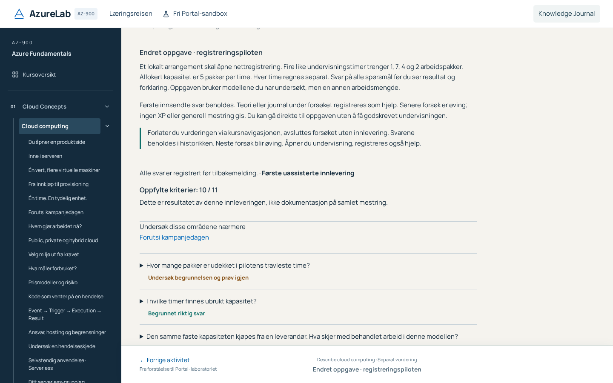

# PR51 — Owner acceptance corrections

The owner tested preview head `065d42cccde0f28052b5453ac10704eaa9eb57e7` and withheld broad rollout approval. These corrections continue the same Draft PR and approved hybrid identity. They do not start Stage2–5, PR52, new assessment content or Portal operations.

## Findings and bounded changes

1. **Confirmed lifecycle bug:** the original Foundations v2 assessment had begin/draft/aid/submit but no explicit end without submission. Actual anonymous baseline navigation persisted aid plus a lesson visit while leaving the attempt active. SavvyShark correctly suppressed solutions for that still-active context; the context lifetime was wrong.
2. **Confirmed entry inconsistency:** practical Resume previously checked only its own session write. New Start checked a partial independent list. Both now use the existing complete mission-safety context list, plus current storage checks, and explain blocked access. Their original practical/technical session IDs, boundaries and commands remain unchanged.
3. **Navigation overload:** raw assessment/observations link pairs in Foundations v2 and modern Benefits/Services are replaced by secondary, closed “Andre aktiviteter” with destination explanations. Optional Cloud Concepts transfer entry is separately collapsed. The original fixed Next/Fortsett remains the single recommended step. Compute and newer Studio links were inspected: their existing specific model/guide/resource actions remain intact.
4. **Feedback overload:** the existing11-criterion assessment now presents submission classification, unchanged criterion total, relevant review topics, and native question disclosures. After a confirmed submit, keyboard focus and native scrolling reveal the short criterion summary. Reload does not replay this focus action. Selected answers resolve through the original option labels; original explanations and precise repetition links remain available. Earlier submissions and abandoned drafts remain inspectable; no rubric/answer key or scoring change.

## Foundations lifecycle1 under schema3

Key stays `azurelab.learning.foundations.v2`. Schema2 records retain content/model/rubric2.0.0, original event semantics and600-event/220000-character replay bounds. Reading a schema2 record does not migrate or write it. Five golden baseline fixtures capture fresh, guided, active draft, first submission and assisted retry facts. The original criterion array is independently hash-pinned.

Only explicit navigation abandonment promotes the envelope to schema3 with `lifecycle: 1.0.0`. Every original event stays in place. A new strict `{kind: abandon, lifecycle: 1.0.0, reason: navigation}` ends the active attempt without submitting, deleting its draft, or producing a result. Content/model/rubric remain2.0.0. Required aid precedes abandonment in one checked persistent write. Schema3 has four terminal-event reserves above the normal600 cap and a222048-character parser bound; new starts/drafts cannot consume the reserve. An old client sees unsupported schema3 rather than silently overwriting unknown events.

Any attempt after an abandonment is practice/retry, even when no submission preceded it. Assistance from an abandoned attempt remains inherited. Previous first submissions and their classifications/criteria are unchanged. This closes the route to a fresh unaided first after seeing teaching. Reload, remount and same-assessment query/hash navigation never abandon. Journal opening stays within the active assessment and still requires durable assistance before protected content mounts.

The store now returns failure and retains its last confirmed snapshot on rejected/no-op/unreadable writes, checks its base before deduplication, and reads back persistence. Stale tabs cannot submit or close another snapshot. LocalStorage remains local best-effort storage; recovery is explicit. No server authority or database is claimed.

## Explicit navigation, not component cleanup

A narrow app-shell adapter observes actual same-document Navigation API push/replace/traverse intent. Reload is excluded. Without that API, explicit same-tab links, existing History API navigation and popstate provide a progressive fallback. An ephemeral in-memory marker remembers that this document actually opened the active assessment before the browser changes the URL. It creates no learning evidence or persistent progress and is never acquired merely by opening theory in another tab. No unload/unmount handler creates evidence. A tab that opens other teaching never silently abandons another tab's attempt.

Neutral catalogue/raw resource inspection needs no fabricated aid. Answer-bearing teaching, feedback, learning Portal entries and Journal retain durable preflight. A rejected exit remains active/uncertain and shows recovery; a noncancelable browser traversal cannot authorize protected teaching. Existing ManagementTeachingBoundary and all other independent guards remain authoritative.

## Presentation and verification

Narrow assessment reading width, min-inline-size0 fieldsets, wrapping legends/answers and native disclosures replace the feedback wall. Measured existing footer clearance remains; no global overflow hiding or new modal framework. Original navy/paper, Manrope/selected Source Serif4, native SavvyShark, motion and Portal are preserved.

Seven focused desktop tests plus one initial compact feedback/reflow witness extend329 to337 (307desktop/30compact). All prior desktop cases remain; only old Foundations UI selectors follow the explicitly changed disclosures and readable status. No retry, worker, timeout, skip or assertion-threshold change. Domain tests cover legacy facts/rubric, explicit aid/end, abandoned draft, practice classification, reserve, denial/readback and stale writes. Browser tests cover actual navigation/Back/Forward/fallback/reload, Journal denial, cross-tab, PaaS resume/guide, feedback, links, geometry/Axe/reduced motion. Actual125%/200% browser zoom is measured separately through a local QA-only Chrome extension.

Full check, a fresh stamped separate six-domain audit, complete exact-head CI/strict release and actual anonymous SHA-bound Gate7 remain required. The historical first-delivery audit and pictures are retained, not rewritten as evidence for these corrections. Current actual results are attached to the Draft/evidence package and the focused audit.

Human novice/Azure-SME/UX/screen-reader/psychometric and measured-learning validation remain unperformed. Broad hybrid rollout still requires owner acceptance. Stage2–5, PR01B/C, P17/P18, merge and production remain outside scope.

## Actual local evidence before fresh audit

Full `npm run check` exited0:634 Vitest,503 curriculum and20 Node checks plus the production build. The first attempt exposed only pre-existing ignored QA scripts under `.artifacts`; these were preserved outside the repository rather than weakening ESLint. A subsequent preservation assertion correctly detected the newly authorized lifecycle change; its exception now pins the full original v2 source/model/rubric prefix and old replay fixtures rather than silently removing preservation.

All16 targeted inherited-Foundations/hybrid/owner browser cases passed; after the final durable-reserve, briefing/resume-preflight and feedback-focus refinements, all7 owner desktop cases and the distinct compact witness passed without retry. Actual feedback geometry/Axe at1920×1080,1440×900,1366×768,1024×768,1024×500 and800×700 shows no horizontal overflow. Native Chrome125%/200% zoom, verified through tabs.getZoom, yields1152/720CSSpx inside a1440px browser and no overflow/Axe findings. Exact metrics are in [author checks](reviews/evidence/pr51-owner-author-checks.json). These are engineering checks, not human accessibility or learning validation.

| Same real activity       | Earlier preview065                                                                    | Owner-corrected production build                                                                 |
| ------------------------ | ------------------------------------------------------------------------------------- | ------------------------------------------------------------------------------------------------ |
| Secondary course actions |                 |    |
| Assessment feedback      |  |  |

The short-window summary remains visible above the footer; full details and retry use ordinary vertical scrolling. The eleven original questions are retained, so expanded feedback can still be long. Voluntary assessment/observations and separate transfer work remain available through their labelled disclosures. Future content consolidation is a separate owner priority.

## Independent audit correction

The first fresh audit reproduced a serious fallback traversal defect: after denied abandonment on a noncancelable browser Back, a recovery dialog appeared but the old core-only filter omitted v2, permitting teaching behind it. A modal is not a teaching boundary. The existing core filter now includes v2, while Course explicitly identifies its own v2-assessment so opening/working on the form cannot register help. Management-only neutral Portal inspection is unchanged. The regression asserts that the manuscript is not mounted, including after Escape. The eight authorized byte-preservation exceptions remain enumerated;312 other raw files and the full authored locale prefix stay pinned. The candidate is rechecked and restamped before renewed independent acceptance; the original failed probe remains evidence.

The same audit also challenged terminal reserve at the actual UI: a full schema3 history could support Submit in the store but the form disabled every submit after a rejected edit. The form now freezes edits/Begin while allowing only a complete, already persisted schema3 draft to use terminal Submit. A real browser600-event fixture rejects a new value, retains the stored answers and completes that explicit submission. No rubric or historical result changes.

The first author native-zoom DOM/Axe measurements were valid, but its emulated-viewport screenshot clipping was not visual evidence. Independent native-window/CDP capture replaces that visual check; neither dark capture margins nor a DOM-only pass are treated as approved rendering.

## Complete CI contract reconciliation

The first corrected-head CI ran all337 cases:336 passed; the single inherited `assessment draft survives persistent Previous and browser return without submission` test still expected the intentionally departed assessment to remain active. Its surviving draft requirement is preserved and strengthened: original event prefix and archived answers survive Previous/Back/reload, no submit is fabricated, no form restarts automatically, and a new explicit attempt begins with an empty draft and inherited assistance. This updates that assertion to the owner's new lifecycle requirement; it is not a retry/timeout/skip change. The failed head/run stays historical evidence. A renewed stamp/review and full successor CI are required.
