# Shared AzureLab Portal Experience — Stage A

Owner architecture correction,6November2026. Base: verified PR62 `26408f5bcb77fdc2aa5bde5027c1959f14d6c928`. Its complete [Quality run100](https://github.com/EspzY/Azure-learner/actions/runs/42248149421) and strict release passed:403passed+1flaky in404cases. The existing Landing/Course Hub startup strict locator saw two `.course-shell` nodes and passed only on the existing retry; this new timing observation is unresolved. Earlier Compute/Axe and local screenshot/trace uncertainties are not declared fixed.

## Product boundary

AzureLab has one reusable Portal presentation and separate, explicitly scoped authorities. Course mode adds original guidance, observations, assistance and assessments. Free Laboratory uses its own server workspace without a course learning layer. Sharing presentation never converts a v3 World into a v2 World or grants one adapter access to the other's history.

The existing large `PortalWorkspace` reads many curriculum/assessment providers, executes existing durable aid boundaries and composes native coaches. Mounting that controller for Laboratory would risk incorrect effects and authority. The extraction instead supplies actual presentation components through explicit props and callbacks. Common components import no learning provider, persistence, command evaluator or server repository.

| Layer                 | Owner                                                                                      | Boundary                                                                                                                                                    |
| --------------------- | ------------------------------------------------------------------------------------------ | ----------------------------------------------------------------------------------------------------------------------------------------------------------- |
| Laboratory platform   | Original PostgreSQL repository and frozen3.0/3.1 engines                                   | Validated commands, locks/revision/idempotency, atomic commit, one World, original receipts/replay/session ownership                                        |
| Legacy course adapter | Original SandboxProvider, PortalLocation and course orchestration                          | v2 course World, typed original routes/returns, commands, native guidance and assistance callbacks                                                          |
| Free adapter          | Original Laboratory controller and ephemeral display projection                            | Verified server Snapshot only; original session/review/run/reset and model dispatch                                                                         |
| Shared presentation   | `src/features/portal/presentation.tsx` plus existing ServiceIcon/PortalDialog/PropertyList | Header/search, navigation, working frame, titles/breadcrumbs, filters/tables, resource menu/layout, create frame/actions and operation/receipt presentation |
| Course learning layer | Original caller-owned course components                                                    | SavvyShark, task instructions, guided observations, teaching protection, first/help/retry/abandon and feedback                                              |

## First implementation phase

Both production routes consume the same actual presentation components and canonical Portal stylesheet. Laboratory's separate header, sidebar and oversized table overrides are removed. Its resource pages use contextual titles, breadcrumbs, a native resource menu, Overview/Properties, parent links, original Activity/receipt links and shared tables with scope/location/type filters. Resource Group details use one actual resource list rather than three empty child tables. The independent free workspace is labelled clearly without repeating a large Laboratory title and separation paragraph above every resource.

Create field sets and validation remain adapter-owned. They use common creation surface/action components and the original explicit Review→Create/Apply boundary; course-only tabs and observations are not copied into free mode. Original request construction and controller persistence are preserved. No new technical result is inferred from a render, search, menu or property visit.

The ephemeral `laboratoryInventory` projection derives labels, scope, parent and region from the same World. It is not stored and cannot dispatch commands. Only Storage Account/VNet/NSG are top-level free resources. Containers/blob objects and subnet/rule subresources remain contextual children, with searchable explicit types. NSG associations still come solely from authoritative subnet state. The course adapter retains its original inventory/filter semantics.

The two authorities currently have different operative subsets. Course v2 retains RG/plan/Web/VM and its existing read-only dependencies; free3.0 retains Storage; free3.1 adds Networking. Common menus advertise the active adapter's supported subset. This is shared presentation, not a claim of backend feature parity. No service, traffic result, account login, effective route or unsupported command is invented.

## Source and asset provenance

Current official Microsoft pages were actually retrieved6November2026: [Portal overview](https://learn.microsoft.com/en-us/azure/azure-portal/azure-portal-overview), [Resource Group Portal workflow](https://learn.microsoft.com/en-us/azure/azure-resource-manager/management/manage-resource-groups-portal) and [Azure architecture icons/terms](https://learn.microsoft.com/en-us/azure/architecture/icons/). Header/global search/contextual command structure and explicit Review+Create are the scoped reference, not a claim of complete Azure Portal parity. Azure account switching, Cloud Shell, Copilot, real deployment and authentication remain unsupported.

Four additional original service identities come from the same pinned Microsoft V24 archive, SHA256 `921594ccd1bf3d9c0a1bd7b6d924e050551a59342f2b353bb74bdcf761c35141`: Storage Accounts10086, Network Security Groups10067, Storage Container10839 and Blob Block10780. Actual16/24/32/48px renders were inspected. Original SVG bytes/colours/proportions and the existing terms PDF are retained; current live Portal variant status is explicitly UNVERIFIED. Their bounded use is inside independent Azure training/simulation surfaces, under the existing training-material interpretation, never AzureLab branding or marketing. No new mascot, runtime package or external font is introduced.

## Historical integrity and future migration

No domain, server API, repository, SQL migration, World schema/model, resource identity, command or receipt changes are authorized. The original course/provider/store/locale/assessment/XP data remain intact. Pure read-only presentation does not supply a new progress engine, inventory database or assessment result store. Pending/denied writes keep the original recovery behavior; server-unavailable does not create an empty successful World or local fallback.

The next architectural step for **new** course practical work is explicit course-owned server workspaces, with server ownership/isolation and a separately versioned evidence/assessment adapter binding workspace model, attempt and original receipt/through identity. That contract must define active-attempt conflicts, assistance, historical replay and Journal/resume before activation. Free anonymous data cannot satisfy a course result merely because it appears in the same UI. Existing v2 history remains readable under its original engine; no automatic import, origin rebinding, rubric reinterpretation or cutover is performed. PR59's ABA migration blocker remains historical unresolved evidence, not a repaired migration claim.

## Verification checkpoints

The baseline comparison used real UI-created synthetic Resource Groups in each authority, at1440×900 and1024×500, before refactoring. It confirmed the missing free search, simple ID/receipt lists, repeated global introduction and absent native resource menu. Actual free PostgreSQL creation left all existing course local storage unchanged. Current implementation testing, paired after-images, preservation controls, final independent audit and complete exact-head CI/strict are recorded at their actual checkpoints; they are not inferred from the PR62 baseline.

Public persistent Laboratory remains intentionally deferred. The unconfigured preview must show503, disabled Start and no local fallback. Public root/fullSHA/entry verification and local/CI operative PostgreSQL journeys are separate evidence. Human SME/UX/screen-reader/learning validation remains unperformed. No external resources, credentials/Vercel changes, merge or production deploy.

## Actual side-by-side evidence

The24 paired PNGs are unedited production-browser captures:12baseline and12candidate images, each visually inspected;4additional Review checkpoint images preserve the independent finding, insufficient focus-only intermediate, and final immediate/keyboard states. Synthetic `rg-shared-portal` was actually created through the native v2 controls and the real local PostgreSQL server in a separate v3 workspace. The [baseline record](reviews/evidence/pr63/before/result.json), [candidate source hashes/metrics](reviews/evidence/pr63/after/result.json) and [image hashes](reviews/evidence/pr63/images.json) distinguish the checkpoints. Baseline8b72295 has identical production UI to verified26408f5; candidate images are precommit captures bound to the actual source hashes, not falsely labelled a new deployed SHA.

| Surface                 | Earlier free Laboratory                                                          | Shared free Laboratory                                                         |
| ----------------------- | -------------------------------------------------------------------------------- | ------------------------------------------------------------------------------ |
| Resource list1440×900   | 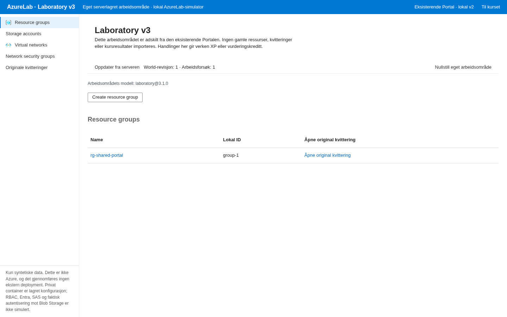     | 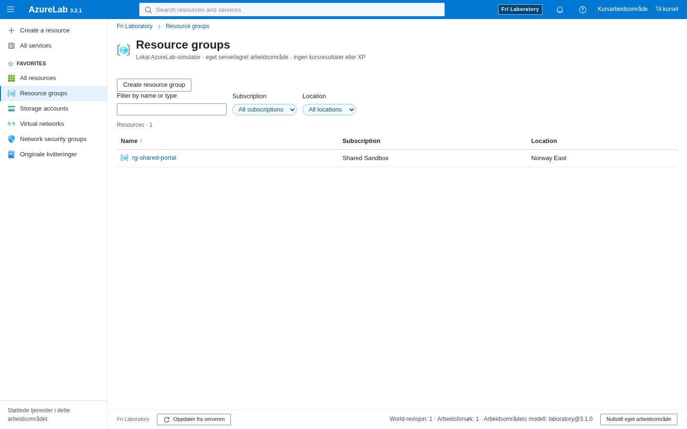     |
| Resource detail1024×500 | 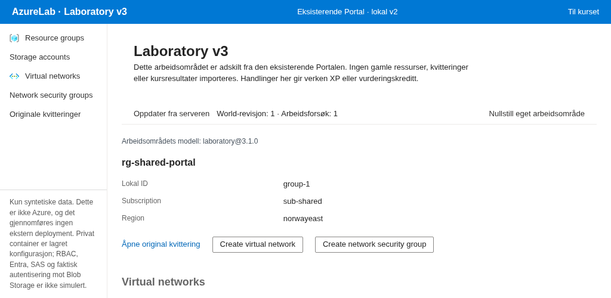 | 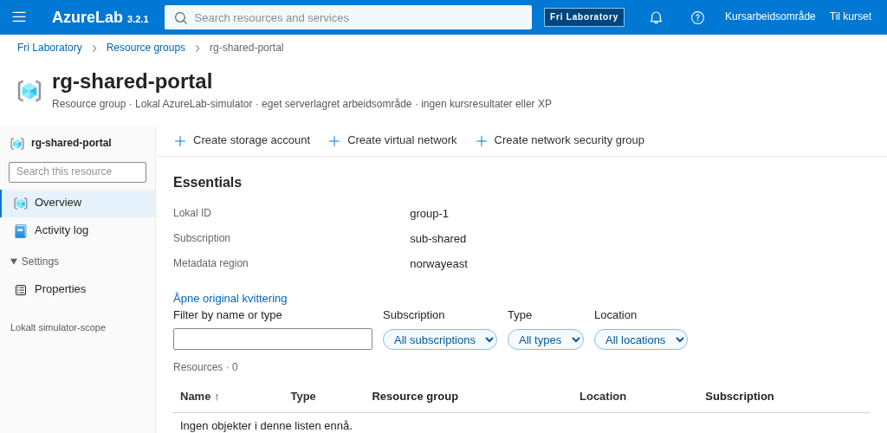 |
| Create1024×500          | 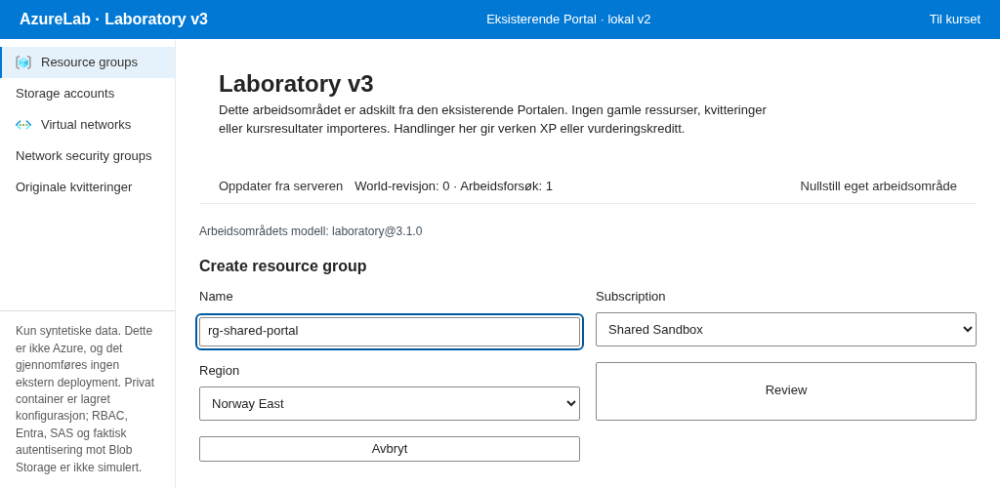 | 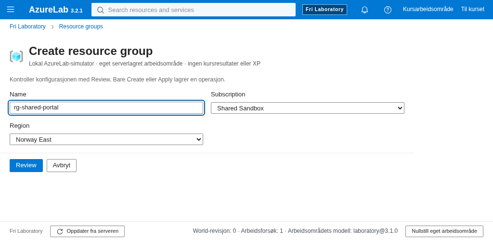 |

| Shared surface          | Course adapter                                                              | Free adapter                                                            |
| ----------------------- | --------------------------------------------------------------------------- | ----------------------------------------------------------------------- |
| Resource list1440×900   | 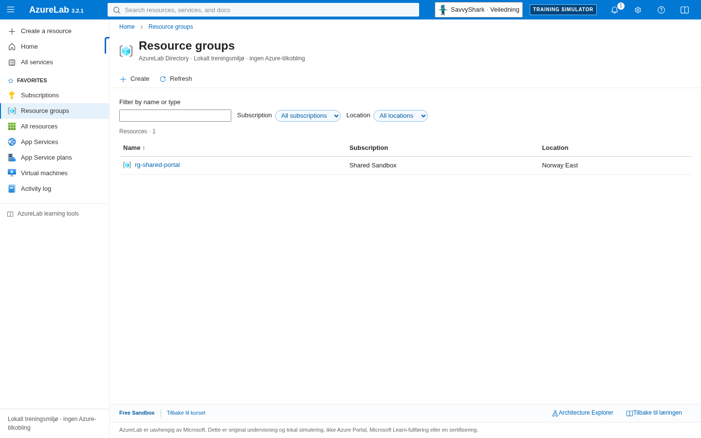     |      |
| Resource detail1440×900 | 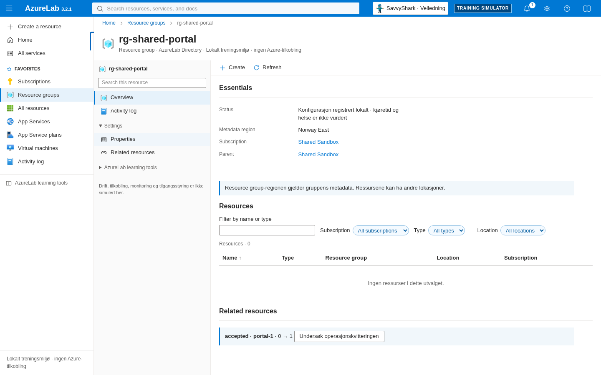 | 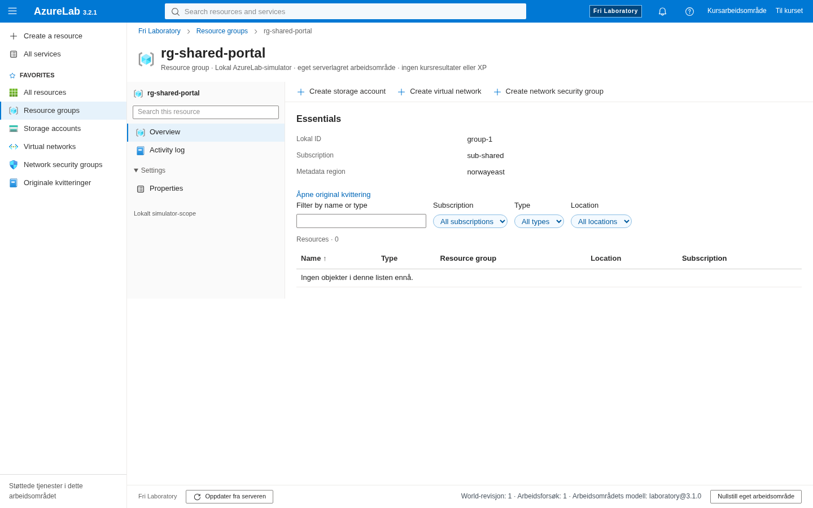 |
| Create1024×500          | 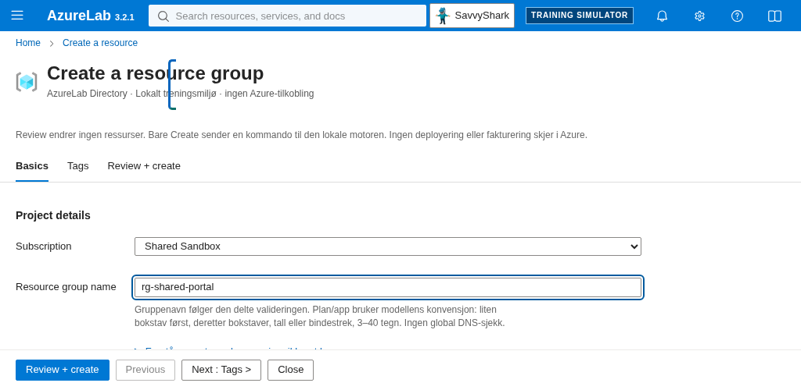 |  |

The structural improvement is specific: a real global resource/service search, scope/type/location filtering, contextual resource title/menu, Properties and one combined child-resource list replace the separate administration view. Compact native creation actions replace the oversized grid buttons. The course retains its original guidance slots, course tabs, naming teaching, metadata cautions and supported command set; free mode has none of those course callbacks. Differences in available commands/fields reflect different actual engines, not claimed feature parity.

The separate audit then found a skipped Review heading and an inherited accepted-preview message saying an object was created before commit. The presentation now uses an h2 plus native instant scroll to the reading start and focus after explicit Review, a validation-only preview message, and an actual short-window keyboard/Axe/no-write check. Original preview/committed receipt bytes and server rules remain unchanged. Initial audit failure/captures and renewed verification are retained separately. Heading focus alone left the result at the bottom edge; that intermediate capture is also retained. The strengthened test checks the actual Create button is fully visible above the footer before any Tab/autoscroll.

Critical observations retained: the course's pre-existing focused-heading outline can cross part of its title in these captures; it is also visible in the baseline and no focus style was changed. Original course create forms and longer network/security-rule views still require normal vertical scrolling at1024×500. Read-only NSG default tables retain their bounded horizontal scrolling. These are not hidden with global overflow clipping. A final author visual pass corrected the free form's oversized actions by extracting the same actual action component; no engine rule changed. No human usability or measured learning improvement is claimed.

## Test scope and delivery boundary

The original404browser executions remain. Four focused desktop journeys plus one distinct compact keyboard/Axe witness give409(369desktop/40compact); optional legacy738 remains. Old retries/workers/timeouts/skips and assertions are retained. Two import-only historical-preservation adapters pin actual permitted source changes before projecting original bytes into old historical source assertions; independent tests compare all other original files and critical controller/callback bodies. That test-only mechanism is not used as proof of actual UI functionality. Actual server/browser journeys separately exercise commands, isolation, old/new modes and original receipts.

Prior local failures and their narrow corrections are retained in [verification](reviews/evidence/pr63/verification.json): the old comma selector incorrectly counted all inputs once real search existed; a moved visible model marker lost its selector; new assertions initially raced a Next route commit or compared the wrong unavailable text surface. None was hidden by retries or timeouts. Final affected retests, full check, fresh post-stamp six-domain review and exact-head CI/strict must be reported at their actual completed checkpoint. Public persistent PostgreSQL remains owner-deferred; anonymous root/SHA/expected503 checks are not a persistent Storage/Networking Gate7.

| Review checkpoint1024×500                   | Actual browser capture                                                                       |
| ------------------------------------------- | -------------------------------------------------------------------------------------------- |
| Initial audit: result belowfold             |  |
| Intermediate focus-only: still insufficient | 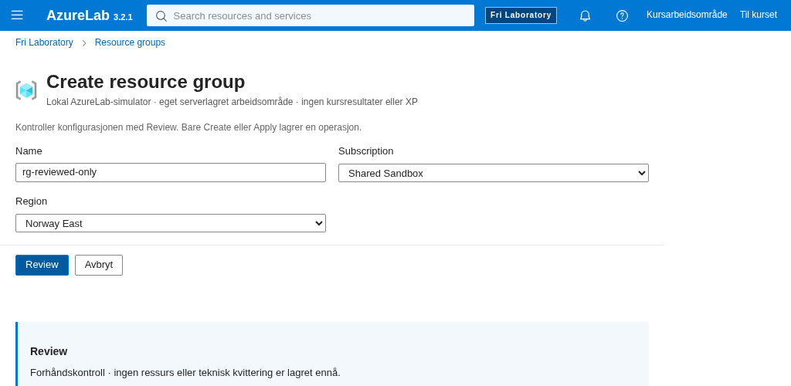  |
| Corrected immediate result before Tab       |             |
| Keyboard Create after Tab                   | 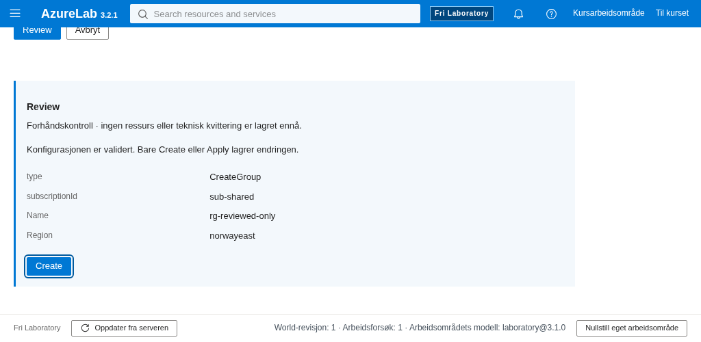            |

The Review images use distinct real synthetic sessions and name fields, not one fabricated before/after World. Review itself preserved each original verified snapshot/ledger; the displayed preview is not a persisted receipt or a created resource. The separate audit retains the original failing Axe probe and its own subsequent actual request/receipt comparison.
