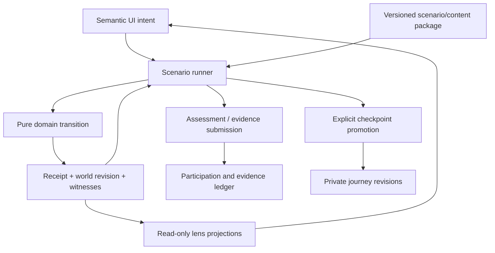

# Bounded simulation and scenario platform

Status: **proposed contracts**, version 1.0.0, 2026-10-22. No platform engine, scenario runner, world persistence or new service model is implemented in Phase 1A. Phase 1B should implement only the Chapter 01 subset, with small typed definitions; Phase 1C extracts reusable infrastructure after evidence from real use. This specification supersedes the generic Phase 0 future-schema sketches, not the tested current domain behavior.

## Six independent responsibilities

| System                 | Owns                                                                                               | Inputs → outputs                                                                                     | Must not own                                                                          |
| ---------------------- | -------------------------------------------------------------------------------------------------- | ---------------------------------------------------------------------------------------------------- | ------------------------------------------------------------------------------------- |
| Domain simulation      | Typed resources, relationships, accepted commands, compatibility, validations and consequences     | Immutable world + validated command + pinned model context → next world / rejection + causal events  | Mission step numbers, XP, prose, React, storage, network or wall clock                |
| Scenario orchestration | Frozen fixtures, variants, staged events, objective predicates, branch/replay/promotion contract   | Scenario definition + receipts/learning decisions → stage/objective observations and allowed actions | Hidden Azure behavior, arbitrary evaluator code from content or UI-specific branches  |
| Learning content       | Objectives, misconceptions, explanations, hints, sources and localized keys                        | Content/version + outcome/witness → original explanation                                             | Technical truth inferred from animation or credential metadata                        |
| Experience rendering   | Spatial/diagram/flow/table/console/timeline projections and camera/focus                           | World + scenario presentation state → view model; semantic intent → command                          | Direct state mutations, grading from coordinates, advancing an objective on selection |
| Assessment             | Criterion witnesses, variant exposure, assistance/reference mode, submission and retained evidence | Frozen attempt trace + rubric version → per-criterion findings                                       | XP-as-mastery, hidden hints, arbitrary free-text grading                              |
| User progression       | Participation ledger, milestones, evidence references, journey checkpoints and recommendations     | Verified local outcome/event IDs → deduplicated participation/history                                | Resource simulation, credential award, authoritative trust in local imports           |



## World model and relation semantics

The current `Scope`/`Simulation` is a useful legacy fixture. Its single `parentId` and generic resource kind cannot safely represent the next chapter. Introduce narrowly typed records and an adapter for the existing scene rather than rewriting it or importing a generic graph engine.

- **Identity tenants:** identity-authority records, not resource containers. Subscriptions explicitly reference one authority. Tenant root group is a separate management-scope record associated with that tenant; custom management groups are optional. Root/tenant identifiers remain different domain identities even where real Azure uses the same identifier value.
- **Management scopes:** root/custom management groups, subscriptions and resource groups with valid parent kinds. Resource groups have `metadataLocation`, not an inherited resource region. No nested resource groups. Model scope exceptions only when explicitly introduced.
- **Resources:** discriminated supported types with validated configurations and versioned models. Phase 1B adds only `Microsoft.Web/serverfarms` (narrow Linux plan) and `Microsoft.Web/sites` (web app linked to that plan). Existing generic resource icons are legacy/reference illustrations, not automatically supported command targets.
- **Relations:** `identity-authority`, `management-parent`, `resource-member`, `depends-on`, `network-path`, `access-at-scope` and optional view grouping are distinct. `depends-on` points dependent → prerequisite. No generic connector implies network traffic, permission or geographic proximity.
- **Geography:** reference fixture regions/geographies/zones and service capabilities live outside management hierarchy. Resource location is `regional(regionId)` or explicitly `nonregional`; not-applicable belongs to identity/management records. Supported region/SKU combinations are named teaching fixtures, not a global Azure capability catalog.

Each service model records its source IDs, supported operations, invariant/validation rule IDs, configuration schema, dependency types, observable consequences, omitted Azure behaviors and positive/negative fixtures. Unknown model/type/operation returns `unsupported-capability`; it never becomes a generic successful node addition.

## Narrow serialized contracts

This is a design-level shape; IDs are language-neutral and every boundary needs runtime validation. Concrete Chapter 01 commands/fixtures are in its blueprint.

```ts
type Version = string;
type EntityId = string;
type Receipt = {
  commandId: string;
  sequence: number;
  beforeRevision: number;
  afterRevision: number;
  outcome: 'accepted' | 'rejected' | 'unsupported';
  code: string;
  affectedIds: EntityId[];
  witnessIds: string[];
};
type DomainCommand =
  | { type: 'CreateGroup'; subscriptionId: EntityId; name: string; metadataRegion: string }
  | { type: 'DeleteEmptyGroup'; groupId: EntityId }
  | {
      type: 'CreatePlan';
      groupId: EntityId;
      name: string;
      region: string;
      profile: 'linux-learning-v1';
    }
  | { type: 'CreateWebApp'; groupId: EntityId; name: string; planId: EntityId };
type CommandEnvelope = {
  commandId: string;
  expectedWorldRevision: number;
  command: DomainCommand;
};
type ScenarioDefinition = {
  id: string;
  version: Version;
  worldSchemaVersion: number;
  modelVersions: Record<string, Version>;
  contentVersion: Version;
  sourceIds: string[];
  competencyRefs: { id: string; revision: Version }[];
  variants: { id: string; fixtureId: string; constraintSetId: string }[];
  stages: {
    id: string;
    briefKey: string;
    objectiveIds: string[];
    objectiveEvaluatorIds: string[];
    permittedCommandTypes: DomainCommand['type'][];
    nextStage: { conditionId: string; stageId: string }[];
    hintKeys: string[];
  }[];
  rubricId: string;
  rubricVersion: Version;
  awardId: string;
  checkpointExportContract: string;
  limitationsKey: string;
};
type EvidenceRecord = {
  attemptId: string;
  scenarioId: string;
  scenarioVersion: Version;
  modelVersions: Record<string, Version>;
  contentVersion: Version;
  rubricVersion: Version;
  variantId: string;
  competencyRefs: { id: string; revision: Version }[];
  checkpoint: { id: string; revision: number; provenance: 'learner' | 'reference' };
  mode: 'guided' | 'transfer' | 'placement' | 'retention';
  referenceMode: 'open-book' | 'closed-reference';
  assistance: { sequence: number; kind: 'concept-hint' | 'worked-solution'; contentKey: string }[];
  criteria: { id: string; outcome: 'met' | 'not-met' | 'unobserved'; witnessIds: string[] }[];
  submittedAt: string; // host metadata, never used to compute simulated behavior
  trust: 'local-unverified';
};
```

The world and domain events are versioned, but not represented with an unconstrained `Record<string, unknown>` configuration at runtime. Model parsers use discriminated schemas and bounded lists/strings. The evidence record references immutable prediction/decision records, receipts and observations in its attempt package; it does not store screenshots, typed credentials or simulated secret values.

### Determinism, receipts and replay

1. Load a frozen variant fixture with scenario/content/model versions and a supplied attempt ID. Variants are enumerated, not chosen by unrecorded randomness. Host-generated attempt IDs are inputs to replay, not sources of rule randomness.
2. Validate envelope and payload. New request IDs get a monotonically increasing attempt sequence. A repeated ID with the same payload returns its original receipt; the same ID with a different payload is rejected as conflict. Duplicate delivery never creates a second resource, advances a stage or awards XP.
3. Require the expected world revision. A stale revision returns an explicit rejection and no world mutation. A retry after reading current state uses a new command ID. Rejected operations are recorded but do not increment world revision or the successful resource-ID sequence.
4. Evaluate the declared model rules. Teaching order is input/parent/name → compatibility/dependencies → relevant custom policy → apply, with deterministic precedence. This does **not** assert Azure's internal validation order. Scenario requirement mismatch is distinct from technical rejection.
5. Produce a new immutable world plus causal events, receipt and witnesses. A rejected resource command does not add that resource. Multiple commands are **not** one transaction; previously accepted plan/group creation remains after a later app failure.
6. Derive objectives, view models and assessment observations from receipts/world. Command execution cannot be triggered by render/animation callbacks.
7. Replay fixture + recorded commands/learning decisions + explicit staged events with the pinned models. Require the same world, receipts and criterion results. Wall clock, frame rate, storage ordering and layout are excluded. Future time-based incidents use explicit logical ticks, never `setTimeout` as technical truth.

Resource IDs follow a deterministic sequence in the workspace. Canonical serialization sorts maps/sets by stable IDs for comparison; a checksum can detect corruption but is never an anti-cheat signature. A content/rule mismatch on resume is a version-compatibility decision, not permission to replay against whichever implementation is current.

## Scenario authoring without one-off JSX

Phase 1B should use a reviewed TypeScript data object satisfying the serialized definition (no functions inside content). Registered command handlers, objective evaluators and condition IDs are code-owned and allowlisted. Do not build a general expression language, execute YAML/JavaScript strings or load remote plugins. UI composes generic brief/decision/command/receipt/assessment views from the current stage and capability list. A second meaningful variant must change fixture constraints without a new Workbench conditional.

An author submits: objective/misconception IDs, source/rule records, initial world, role bindings (`application-group`, `hosting-plan`), allowed capabilities, stage/branch conditions, explanations/hints/localization keys, positive and counterexample traces, transfer criteria, promotion contract, explicit omissions and equivalent accessible actions. Scene coordinates are a projection file, not part of the assessment specification.

Authoring validation must reject missing references, unreachable required stages, stage/dependency cycles, unavailable actions needed by an objective, invalid initial worlds, unsupported command payloads and fixtures without a feasible solution. A reviewer must inspect whether the solution actually teaches the named objective; schema validation cannot establish pedagogy. Authors may make an incident intentionally unsatisfiable only if diagnosing/escalating unsupported requirements is the explicit objective and rubric.

### Rule admission

Every rule needs an ID/version, original statement, source IDs, applicability/preconditions, deterministic outcome, witness shape, known exceptions and fixtures that isolate it. Example: `web.plan-location@1` derives a web app's location from its referenced plan; changing the group's metadata does not change either. Example: `chapter.allowed-web-location@1` denies only matching Web resource types under the assigned subscription with a location outside the declared list; resource-group metadata is not its target. This is a deliberately authored custom-policy subset, not an emulation of all built-in Azure policies.

Add a service by adding its schema/commands/rules/events, dependency/observation projections, source boundary and test fixtures. Then author scenarios consuming those capabilities. No new engine is needed unless a model introduces a new kind of consequence; even then preserve old model versions/fixtures or explicitly retire unsupported replay. Presentation adapters map new resource types to a readable fallback before introducing richer geometry.

## Rendering interfaces and shared state

A read-only selector produces entity summaries, typed relation edges, configuration properties, command capabilities, findings and witness links. Each lens consumes that view model. A semantic action such as CreatePlan or InspectReceipt is independent of spatial input, table input or terminal-like input. View-specific camera/layout/focus state is ephemeral and excluded from domain/evidence reducers.

Retain 2.5D SVG for organization and a diagram/list path. Add a responsibility matrix and deployment diff for Chapter 01; future network/access/timeline adapters consume the same IDs/events. A selected record remains selected across lenses. UI errors/status messages are localization keys in `src/content/nb.ts`, not strings embedded in rules. Unsupported capability, read-only reference object and actionable resource must be visually/semantically distinct. Accessible alternatives execute the same command/evaluator, not a separate simplified exercise.

## Assessment and progression boundary

Assess a frozen submission using the scenario rubric, trace and prediction/reason records. World feasibility and learning evidence are different outputs. Record observed, unmet and unobserved criteria; absence is not a failure percentage. Machine checking handles explicit predicates and structured reasons. Open-ended rationale is human-review-pending, never auto-passed by keyword or an AI grader. Sources and operational diagnostics may be allowed in independent open-book tasks; worked guidance is explicitly recorded. After solution exposure, a same-variant retry is practice.

Progression consumes stable event/award IDs and references evidence. It never calculates understanding from XP. Preserve legacy award IDs/values; do not reinterpret imported completion IDs as independent attempts. A content patch does not mint a new participation award. A new scenario version must declare whether it shares the same non-repeatable award identity. Retention dates are scheduling metadata outside replay; no notification/automation is created in this phase.

## Journey state, isolation and promotion

Proposed local data has four boundaries: immutable **journey checkpoints**, isolated resumable **workspaces**, immutable submitted **attempt packages**, and the **participation ledger**. A checkpoint records source attempt, model/export versions, parent revision, semantic role bindings and provenance. A scenario may take a learner checkpoint only through a declared compatibility adapter; otherwise offer a labeled reference fixture. No hidden state repair or retroactive migration of learning evidence.

Promotion is explicit after the chapter's technical criteria. Show a diff and the fact that guided completion is not independent mastery. Only a supported, validated world can be promoted; rejected operations never enter it. Later chapters bind to exported roles, not hardcoded names such as `rg-app`. Additional supported sandbox resources may remain but are not magically assessed. Incidents, independent variants and destructive experiments do not auto-promote.

Reset affects the current workspace and current-attempt steps, retaining submitted evidence/XP/checkpoints. Replay forks the original pinned checkpoint. Resuming loads the exact saved versions. A new run can branch from another checkpoint without overwriting the main revision. Deleting local learner data must explicitly list the categories removed; cancel leaves all untouched.

### Local persistence and future accounts

Phase 1B proposes a separate version-2 envelope, leaving `azurelab.progress.v1` readable. Migrate only valid unique legacy award IDs into a legacy participation section; retain their values once, never create synthetic attempts or mark prerequisites demonstrated. A repeated migration is idempotent. Unknown schema/model versions are quarantined with reset/export/restart choices; corrupted input falls back to a safe reference world and explains what was not recovered.

Parse all persisted fields and commands at runtime; bound resource/history sizes. Initial implementation budgets: 16 active resources/scopes per Chapter 01 workspace, 500 command/decision records per attempt, five journey checkpoints and ten retained attempts, with explicit pruning confirmation/export choice before removing evidence. Target serialized data below 250 KiB for this chapter; quota is not guaranteed. Storage failure leaves a usable memory workspace with an honest unsaved status. Never claim persistence succeeded merely because the UI changed.

LocalStorage is nontransactional. Before promotion/resume re-read revision, respond to storage events and detect known conflicts; save a new fork rather than blindly replace a divergent checkpoint. This is best-effort detection, not cross-tab linearizability. Do not introduce IndexedDB/CRDT/backend solely for this chapter. If tests expose unacceptable lost work, reconsider the persistence choice with evidence before shipping.

Future accounts need a repository interface for loading/saving validated packages, server authorization and transactional award uniqueness. The server revalidates attempts/model versions; imports remain `local-unverified`, not trusted competence. Separate product organization IDs, memberships, consent/retention/export/deletion and personal versus employer-owned records. No Entra tenant ID implies membership. Team simulation/concurrent shared worlds are separate future designs, not assumed requirements of organizational reporting.

## Implementation scope, performance and verification

Phase 1B: one scenario package with two transfer variants, four domain command types, two Web resource models, one custom deny subset, one responsibility decision model, per-criterion evidence and explicit local checkpoint promotion. No networking engine, general RBAC evaluator, full ARM deployment interpreter, Bicep/KQL runtime, accounts, service catalog or cloud calls. Current Phase 0.5 remains available through a compatibility path until regression checks pass. Phase 1C extracts reusable registries/authoring checks from actual duplication and a second case.

Proposed budgets, **not measured results**: no continuous render loop, no new WebGL dependency, no external runtime requests, at most 200 synthetic log records when first added. Benchmark Chapter 01 at 1440×960, 412×839 and a short landscape viewport; input-to-visible command receipt should be under 100ms for bounded fixtures on the documented reference device. Report measurements/device rather than treating desktop CI timings as mobile performance. Unsupported performance conditions retain the same semantic list/matrix/diff path.

Required tests: schema/parser corruption and size limits; pure valid/invalid commands; missing dependencies, policy applicability and nonmutation on rejection; duplicate delivery/conflicting IDs/stale revision; canonical replay across views; stage reachability and feasible solutions; hints/solution exposure; per-criterion transfer findings; migration/award deduplication; promotion/reset/fork/conflict/storage failure. Production E2E must cover guided and transfer loops, reload/resume, replay, accessibility alternatives, keyboard, reduced motion and mobile. Human technical/learning/accessibility review remains mandatory; a green test suite cannot establish Azure fidelity or educational effectiveness by itself.

## Phase 1A.5 implementation delta

The [expedition contract](JOURNEY_EXPERIENCE.md) implements only a typed seven-stop route, two local detour evaluators, a shared validated snapshot and replay of the existing resource-group command. The legacy simulation, mission predicate and awards are unchanged. There is no generic service registry, causal receipt engine, independent evidence evaluator, isolated scenario workspace or checkpoint promotion yet. Preserve these boundaries when completing Chapter 01; extract the broader architecture above from demonstrated reuse in Phase 1C.
