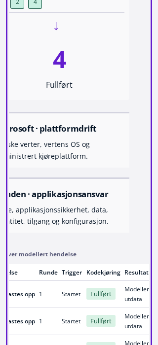
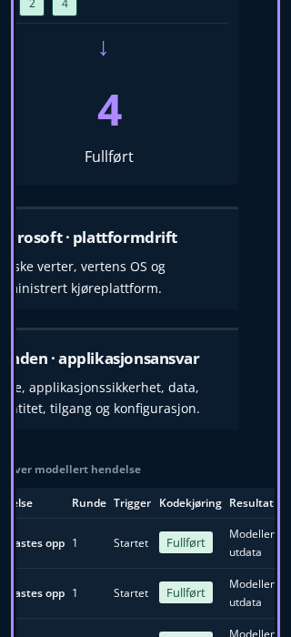

# Bifrost course presentation

## Final159-file source · exact historical test-reader correction

The mandatory check on the158-file source reported1173/1174 Vitest passing. The single200ms failure was an old whole-manuscript equality: its raw filesystem import observed the approved Serverless `tabIndex={0}`. The actual before/after diff is only that attribute; this is not a timing failure. The original command log and explicit exit1 are retained in the existing CI evidence. Node tests and the final check build were not reached.

Only that old test's filesystem import now uses the already established, hash-validated historical course reader. Every original assertion and its entire body remain unchanged, enforced by an exact whole-original-file import transform. The reader itself is unchanged; it validates current and original blob identities before returning the independently protected B source. Native Git proves the Serverless source in B and the older target both have blob `e1bccbd9dc191ac1354c3c6606f6981ef595edc9`. The direct whole-original Serverless body plus exactly one tabIndex guard remains in place.

This makes the final source159files=20finite inherited+138additions+proof, with106 actual PNGs and the unchanged488-case browser plan. Runtime/UI bytes remain exactly the14-path `snFG…` bindings; no new native screenshots are relabelled or fabricated. A fresh159-source check, independent affected renewal and exact-head complete CI/strict/public delivery remain required.

## Latest corrective source · confirmed320px reflow

A fresh independent audit of the historical155-file `18ef…` / `bmq…` candidate measured a350px document in a320px viewport. The actual five-column execution table was332px inside its284px section; separately, an implicit minimum on the controls grid expanded native controls to311px. The pipeline itself fit. These are observed presentation defects, not fabricated learning results or a timing explanation.

The correction uses only scoped Serverless rules at widths<=760px: a `minmax(0, 1fr)` control track and local horizontal scrolling on the existing labelled execution section. No document overflow is hidden, no font is shrunk and no table cell is clipped. The first CSS-only retest passed document fit and real Chromium focus/ArrowRight scrolling but failed the full Axe `scrollable-region-focusable` rule because explicit focus was absent for other browser semantics. That original red remains preserved. Only `tabIndex={0}` was then added to the existing section; an exact whole-original-file transform proves every original handler, input, explanation, assessment and state transition remains unchanged. This is not an actual Safari-browser test claim.

Normal build `snFGcSyEWXTbbLRRJMXC-`, bound to14 actual runtime source hashes, passed the strengthened existing both-theme Serverless case in14.0seconds under its unchanged30-second limit. Actual native Start/Run, original milestone,1440px and320px full-page Axe, document fit, named-region focus and ArrowRight scrolling all passed. The case remains one of the existing three additions: the plan stays488=439desktop+49compact. The prior five Identity/Storage deadlines remain open observations.

The final finite candidate now has158 implementation files:19 explicit inherited modifications,138 exact additions and the proof itself;106 actual PNGs. The19th inherited path is exactly the single presentation attribute in Serverless. Two real final-build320px captures are included below. The previous22 images retain literal VX/gG build/source lineage; they are not relabelled as final-build. Their widths are>=800px, so the new narrow CSS rules do not apply. Prior18ef fullcheck0 is historical and does not validate this final correction. Fresh final-source independent approval, complete CI/strict and public delivery remain required.

## Historical155-file corrective source and preceding investigation

## Current corrective candidate ·10 November2026

The current presentation source corrects the actual CI130 regressions and the later dark activated-state findings. It is stacked on B foundation `7d68b2c40988385c31c1e514e67e5135a1fbe25e`; course controllers, authored material, assessment rules, stores, original mascot and histories remain unchanged. No new learner task or Azure operation is introduced.

The three new native cases use original UI actions in both themes: Transfer Start and a real submitted answer with permitted feedback; Serverless Start/prediction/Run and its actual controls/table; Arc Start/configuration/Run and its actual representation/facts. All three passed under their original30-second case limit, one worker and zero local retries. They extend the485 retained cases to the actually collected488(439desktop,49compact; legacy878). The previous five Identity/Storage cumulative deadlines remain OPEN observations; no retry, worker, assertion, rule scope or timeout is weakened.

Final normal build `gGkSai5SY_Eraz8UWooI4` uses the valid existing4px/8px foundation spacing tokens. All three entire original composed-exposure/owner-flat desktop/compact cases passed. Fresh both-theme measurement of the original paragraph scroll is **74.109375px**, above the unchanged64px criterion, with provisioning still unvisited and World/XP unchanged. The earlier86.109375px belongs to the prior source's invalid variable names resolving to initial margins; it is retained as historical evidence and is not an intentional final-layout claim. The finite guard now checks spacing usages against the actual shared definitions.

Capture lineage is explicit in [the CI130 evidence](../reviews/evidence/bifrost-course/ci-browser-regressions.json). Sixteen palette screenshots remain from actual normal build `VX_yd9lo3DZoE3g8PNaXe` at heights of at least768px. The only subsequent runtime difference is five corrected variable names inside the `max-height:600px` block, inactive in those captures; the whole stylesheet is **not** byte-identical. Two short virtualization images and four short/compact Hub images come from the final `gGk…` build. The complete18-surface VX capture and three focused native passes are genuine historical palette verification; the final-source original cases and geometry are separately recorded. None is represented as complete candidate CI or a public final-head journey.

| Actual corrected surface                | Preserved before                                                                                    | Actual after                                                                                                                                                                                          |
| --------------------------------------- | --------------------------------------------------------------------------------------------------- | ----------------------------------------------------------------------------------------------------------------------------------------------------------------------------------------------------- |
| Dark Transfer scenario                  | [Pale/low contrast](../screenshots/bifrost-course/ci130-before-dark-transfer-started.png)           | [Paired surface, VX](../screenshots/bifrost-course/ci130-after-dark-transfer-started.png)                                                                                                             |
| Actual dark submitted Transfer feedback | [Selected panels](../screenshots/bifrost-course/ci130-before-dark-transfer-feedback.png)            | [Readable original result, VX](../screenshots/bifrost-course/ci130-after-dark-transfer-feedback.png)                                                                                                  |
| Actual dark Serverless Run              | [Controls](../screenshots/bifrost-course/ci130-before-dark-serverless-controls.png)                 | [Controls/pipeline, VX](../screenshots/bifrost-course/ci130-after-dark-pipeline.png)                                                                                                                  |
| Actual dark Arc Run                     | [Nested surfaces](../screenshots/bifrost-course/ci130-before-dark-arc.png)                          | [Physical/management distinction, VX](../screenshots/bifrost-course/ci130-after-dark-arc.png)                                                                                                         |
| Final short virtualization              | [Original reading exposure](../screenshots/bifrost-course/ci130-before-virtualization-1024x500.png) | [Light, valid tokens](../screenshots/bifrost-course/ci130-after-light-virtualization-1024x500.png) · [Dark, valid tokens](../screenshots/bifrost-course/ci130-after-dark-virtualization-1024x500.png) |
| Final short Course Hub                  | —                                                                                                   | [Light1024×500](../screenshots/bifrost-course/ci130-after-light-hub-1024x500.png) · [Dark1024×500](../screenshots/bifrost-course/ci130-after-dark-hub-1024x500.png)                                   |
| Final compact Course Hub                | —                                                                                                   | [Light800×700](../screenshots/bifrost-course/ci130-after-light-hub-800x700.png) · [Dark800×700](../screenshots/bifrost-course/ci130-after-dark-hub-800x700.png)                                       |

Final source-bound full check, a new implementation stamp, fresh independent audit, complete exact-head CI/strict and public full-SHA verification remain separate gates. Human learning/SME/UX/screen-reader validation remains unperformed, and Satoshi redistribution remains uncleared. No external infrastructure, credentials/Vercel change, merge or production deployment is authorized.

## Earlier implementation and investigation journal

The chronological records below retain their original source/capture scope and pending-at-the-time statements; the current corrective status above supersedes their source/version claims.

This track applies the supplied Bifrost reference to the existing AZ-900 Course Hub, course navigation, reading, native question controls, permitted feedback, Journal and existing SavvyShark panels. It stacks on the shared Bifrost foundation and landing. It adds no course, topic, assessment, guide, scenario, mission or learning authority.

The reference is the supplied `1-azurelab-bifrost-demo.html`, SHA256 `5d4b57efd595915c9295e2f6d159029bf79bb3a07737529236f5c757f268d7de`. Its purple header, pale selected navigation, separate question surface, modest card radii and status fade/contrast pairs inform the actual product. Its illustrative completed state and preselected correct answer are not copied into runtime learning state.

## Presentation and boundaries

`bifrost-course.css` scopes its rules to `.bifrost-learning.course-shell`. This distinction matters because the existing course also has the historical `.portal` class. The actual simulator Portal and free Laboratory do not receive this wrapper. Their Azure blue header, Segoe UI, native controls and light color scheme remain independent of the visual theme. `bifrost-guidance.css` targets only existing pedagogical briefing/milestone dialogs and the existing Knowledge Journal content.

The header reuses the shared exact brand mark and real, labelled native theme selector. Theme preferences use the foundation's separate visual preference key and default to the system preference. Course navigation, topic IDs, URLs, sequence, original readiness/resume projections, and all existing event handlers and authorization branches remain authoritative.

Question options remain native radio/checkbox controls with their original IDs, names, order, required rules and keyboard behavior. Selection is purple and does not claim correctness. The Foundations prerequisite check gets an icon and color only inside its already permitted original `last.kind === 'check'` result branch. Both still derive from the original submitted `last.answer` comparison. Selecting a different option retains the previous submitted feedback until the next original Submit action. Other feedback and partial/unknown histories retain their original criteria, text and display rules; no overall success or course completion is inferred.

The original SavvyShark PNG, dimensions, fallback behavior, authored teaching text, durable assistance boundary, independent-mode suppression and Start/Cancel semantics are retained. Existing resident Portal guide islands receive only scoped class/import changes; their complete controller bodies are compared against the audited B base after those exact replacements. The panel uses spacing, typography and the shared theme. It never answers, submits, configures or awards on the learner's behalf. No SavvyShark is added to the free Laboratory.

The shared font policy is documented in [Bifrost provenance](bifrost-source-provenance.json). The Satoshi token uses an installed Satoshi face when available; the repository serves the approved local Open Sans fallback. Proprietary Satoshi binaries are not redistributed. The display hierarchy therefore uses the approved token and weights while retaining this explicit fidelity limitation.

## Author verification

The author uses a native production server on port 3005, a dedicated local PostgreSQL namespace, unchanged browser worker/retry/timeout settings, and an external temporary targeted test configuration. No test fixture injects a positive assessment, completion, guide or receipt state.

The first production browser pair found real contrast defects: the theme label on the purple header, inherited white activity disclosures in dark mode and old dark footer text. A subsequent diagnostic CSS-overlay scan over actual course routes exposed additional inherited small text, source summaries, guidance status and panel backgrounds. Those diagnostic frames are not final production evidence. The source fixes were rebuilt and the six production checks passed without an overlay or retries. Final polish then made the prerequisite Submit action primary, improved Journal reading width/close-icon contrast and removed unnecessary nested boxes inside SavvyShark.

The extended before-Submit checks initially exposed two harness mistakes: a noncanonical Compute query parameter and pointer-driven focus being treated as keyboard focus. They were corrected without a product change. A separate completed production probe then passed light mode and found a real dark-mode Start-dialog defect: the refined assessment title used `#f3f3f6` against the legacy white header, measuring 1.1:1. The [original defect frame](../screenshots/bifrost-course/before-dark-refined-start-dialog.png) is retained separately. The correction skins only dialogs identified by existing pedagogical brief content or the refined assessment parent; the ordinary native Portal dialog skin is excluded. Mission step-number text uses the shared theme contrast token.

The original eight new cases passed their relevant production checks. The polished six-case subset passed; the five-case dialog/native-boundary follow-up passed in 42.7s, including the two added before-Submit cases and one unchanged guidance witness. The final resident-island build passed, its unchanged guidance witness passed, and the two expanded native-boundary/island cases passed in 27.6s after a test-only correction to wait for the committed Portal URL before reload. These are targeted author checks, not a claim of complete candidate CI. Those eight cases cover:

- Both themes: the real Hub, original request action, selected-but-unsubmitted question, actual wrong and correct submissions, unchanged technical/XP bytes and Journal focus return.
- Both themes: all 17 existing module routes and the actual SavvyShark and model-limit warning panels.
- Both themes: original explicit Start actions for numeric, refined select and Compute two-field assessment forms at 1024×500, 1024×768 and 800×700, with no answers or submissions.
- Both themes: keyboard focus, Axe, reduced motion and reflow at 1440×900, 1024×768, 1024×500 and 800×700, plus the actual Portal/Laboratory theme boundary. The native Resource group Create blade and Review tab are inspected through the original controls and closed without Create; technical/XP bytes remain unchanged. A VM guide is started through its real existing briefing, restored after actual Portal navigation/reload, inspected in both themes and kept absent from the free Laboratory.

The fresh independent review of fingerprint `c17d9ddc4df77fef12d137afc358f65443fe58dae179765831cf2168fb52b6d8` found two further major defects. C-FA-01 was the honest blocked-appearance warning: text on the purple header measured 1.5866:1 in light mode and 1.9880:1 in dark mode, and the warning made the document 457px wide at a 320px viewport. C-FA-02 was the denied-assistance Journal warning: its legacy pale background and inherited dark-theme text failed contrast. The [original appearance JSON](../reviews/evidence/bifrost-course/qa/before-appearance-result.json.raw), [original denial JSON](../reviews/evidence/bifrost-course/before-denial-result.json), four appearance frames and [dark Journal frame](../screenshots/bifrost-course/before-dark-denied-journal.png) are preserved byte-for-byte. A [formatted appearance JSON derivative](../reviews/evidence/bifrost-course/before-appearance-result.json) applies repository formatting only; the raw original remains separate.

The bounded correction uses the shared warning fade/contrast pair on the course-header note and the complete denied Journal warning subtree, including its original recovery button, border and keyboard focus. The header control can shrink and the warning wraps within the viewport. No teaching message, storage controller, assistance guard, recovery handler or native Portal selector changes. The first regression run caught one remaining recovery-button contrast failure at 2.05:1; its [actual frame](../screenshots/bifrost-course/intermediate-dark-denied-journal-recovery.png) and [failure record](../reviews/evidence/bifrost-course/intermediate-warning-failure.json) remain separate from the original auditor evidence. The other four cases in that initial affected batch reported missing-DOM/timeouts. Their [original log, contexts, actual failure frames and hashes](../reviews/evidence/bifrost-course/qa/initial-warning-evidence.json) remain durable. A subsequent native diagnostic found the exact original IDs/classes/forms with no page JavaScript errors. Those four timing observations remain OPEN with unproven cause; later green is not attributed to the button correction. No assertion or timeout is changed.

Two additional cases each iterate both themes. The appearance case denies only the visual preference key's reads/writes while all learning storage remains normal. It checks the actual note's contrast, full viewport containment and absence of clipping at 1440px and 320px before Axe. The Journal case starts the original independent assessment through the real Start/Confirm controls, blocks only that assessment's next durable assistance write, and opens Journal. It asserts that teaching stays closed, every stored learning byte remains unchanged after the denied action, the actual recovery button retains keyboard focus, and the warning subtree passes Axe. No positive assessment or assistance state is injected. These were originally one combined case, which reached the unchanged 30s deadline at the dark 320px Hub (39.8s including cleanup). The [actual combined-case timeout](../reviews/evidence/bifrost-course/qa/combined-warning-deadline.json) remains a separate OPEN deadline observation. Splitting the two independent boundaries preserves every action/assertion and the original timeout, worker and retry settings; it is not evidence of a product timing fix.

On the rebuilt source, the four existing affected Hub/feedback/Journal/native Portal/resident cases passed. The two separated storage cases then passed in 15.0s (8.1s and 5.4s). The [actual metrics and frame hashes](../reviews/evidence/bifrost-course/warning-regression-result.json) show 4.661:1 light and 8.815:1 dark warning contrast, a document width of exactly 320px at the 320px viewport, no clipping, unchanged learning bytes and passing Axe assertions. The original eight plus these two cases make ten C cases. Actual collection reports 436 desktop cases and the unchanged 49 compact cases: 485 candidate cases, with the legacy 872-case profile still available. These are affected author results, not complete candidate CI. The earlier full check (1171 Vitest tests, 35 Node tests, 503 curriculum tests, real PostgreSQL and production build) is historical evidence before these corrections; it does not approve the corrected source.

A later author full check of the warning-fixed source passed all 1171 Vitest tests, 35 Node tests, 503 curriculum tests and the production build. The first exact-head CI run, Quality #128 on `d17c48ea1d495a8a4e3a68aba221c62efebc99db`, then failed one new preservation test at 9.111s against its unchanged 5000ms deadline; the other 1170 tests passed. Browser prerequisites failed closed, so that run executed no browser cases or strict release verification. The [raw failure excerpt, original case and measured profile](../reviews/evidence/bifrost-course/ci-preservation.json) are retained. The unchanged local preservation file passed all 14 cases in 5.90s; the failing case's measured native/phase span was about 196ms, with 12 Git spawns and 303 current-file reads. The CI delay was not reproduced locally and its cause remains OPEN.

Only that new combined test is decomposed into separate adversarial, exact historical projection and unrelated native delegation cases. A separate retention test reconstructs their bodies and compares every original statement byte-for-byte with the native Git source at the failed candidate and the archived case. Every fresh admission remains: 12 Git spawns and three complete current-byte/path-set snapshots across the three cases. The newly protected evidence file increases snapshot reads from 101 to 102, so the aggregate rises from 303 to 306. No adapter, runtime behavior, deadline, worker or retry changes. This separates test responsibilities; it does not establish a fix for infrastructure or timing behavior. The resulting 17-case preservation file passed its measured run in 4.51s: the three separated cases took about 76ms, 105ms and 39ms of sampled native/phase span, with 2/6/4 Git spawns and 102/204/0 current-file reads. The added exact statement-retention case also passed. The complete Vitest collection is now 1174 tests; the browser plan remains 485 cases. A new full check, stamp, independent review, complete CI and public verification of the new exact head remain required.

The only changed inherited browser expectation replaces the historical sidebar hover literal `rgb(41,73,94)` with a strict equality against the resolved shared `--bfc-neutral-fade` token. The foundation separately pins the exact supplied light/dark token values. The real hover interaction and all behavioral assertions remain. No existing case, assertion, worker, retry, timeout or skip is removed.

The inspected frames below come from the six completed production cases after the final product polish, without diagnostic styles. The correct/wrong frames use real original UI submissions and deliberately scroll the existing result into view.

| Actual surface                            | Light                                                                 | Dark                                                                 |
| ----------------------------------------- | --------------------------------------------------------------------- | -------------------------------------------------------------------- |
| Course Hub                                | [1440×900](../screenshots/bifrost-course/light-hub.png)               | [1440×900](../screenshots/bifrost-course/dark-hub.png)               |
| Teaching and original request observation | [Info](../screenshots/bifrost-course/light-teaching-info.png)         | [Info](../screenshots/bifrost-course/dark-teaching-info.png)         |
| Selected, before Submit                   | [Question](../screenshots/bifrost-course/light-question-selected.png) | [Question](../screenshots/bifrost-course/dark-question-selected.png) |
| Actual submitted wrong answer             | [Feedback](../screenshots/bifrost-course/light-question-wrong.png)    | [Feedback](../screenshots/bifrost-course/dark-question-wrong.png)    |
| Actual submitted correct answer           | [Feedback](../screenshots/bifrost-course/light-question-correct.png)  | [Feedback](../screenshots/bifrost-course/dark-question-correct.png)  |
| Existing Journal                          | [Journal](../screenshots/bifrost-course/light-journal.png)            | [Journal](../screenshots/bifrost-course/dark-journal.png)            |
| Existing SavvyShark panel                 | [Panel](../screenshots/bifrost-course/light-savvy.png)                | [Panel](../screenshots/bifrost-course/dark-savvy.png)                |
| Original model assumptions and limits     | [Warning](../screenshots/bifrost-course/light-warning.png)            | [Warning](../screenshots/bifrost-course/dark-warning.png)            |
| Short desktop                             | [1024×500](../screenshots/bifrost-course/light-hub-1024x500.png)      | [1024×500](../screenshots/bifrost-course/dark-hub-1024x500.png)      |
| Compact reflow                            | [800×700](../screenshots/bifrost-course/light-hub-800x700.png)        | [800×700](../screenshots/bifrost-course/dark-hub-800x700.png)        |

Additional actual unanswered/native frames:

| Actual surface                              | Light                                                                           | Dark                                                                           |
| ------------------------------------------- | ------------------------------------------------------------------------------- | ------------------------------------------------------------------------------ |
| Original numeric/radio assessment, 1024×500 | [Fields](../screenshots/bifrost-course/light-foundations-before-submit.png)     | [Fields](../screenshots/bifrost-course/dark-foundations-before-submit.png)     |
| Original refined selects, 1024×768          | [Fields](../screenshots/bifrost-course/light-refined-before-submit.png)         | [Fields](../screenshots/bifrost-course/dark-refined-before-submit.png)         |
| Original Compute radio groups, 800×700      | [Fields](../screenshots/bifrost-course/light-compute-before-submit.png)         | [Fields](../screenshots/bifrost-course/dark-compute-before-submit.png)         |
| Corrected original Start dialog             | [Dialog](../screenshots/bifrost-course/light-refined-start-dialog.png)          | [Dialog](../screenshots/bifrost-course/dark-refined-start-dialog.png)          |
| Real resident guide after reload            | [Guide](../screenshots/bifrost-course/light-resident-savvy.png)                 | [Guide](../screenshots/bifrost-course/dark-resident-savvy.png)                 |
| Native Review beside the learning island    | [Native Review](../screenshots/bifrost-course/light-resident-native-review.png) | [Native Review](../screenshots/bifrost-course/dark-resident-native-review.png) |
| Blocked appearance warning at 320px         | [Warning](../screenshots/bifrost-course/after-light-appearance-320.png)         | [Warning](../screenshots/bifrost-course/after-dark-appearance-320.png)         |
| Denied Journal and actual recovery focus    | [Warning](../screenshots/bifrost-course/after-light-denied-journal.png)         | [Warning](../screenshots/bifrost-course/after-dark-denied-journal.png)         |

Final base-bound raw preservation, full check, independent post-stamp audit, exact-head complete CI/strict release and anonymous deployed-SHA verification remain separate delivery gates coordinated by the parent track. Human novice/IT learner, Azure SME, UX, screen-reader and measured learning-effect validation are unperformed.

## Complete-browser regressions from Quality 130

Quality 130 tested `687e338da697ebe3cb85955aed6453dfdd044ed7`. Its mandatory check passed, but the four browser shards reported 23 failures and 462 passes across the complete 485-case plan. Aggregate and strict release verification did not run. The earlier focused checks and anonymous public journey did not cover these failures; they do not replace complete candidate CI.

The 23 failed executions resolve to seven concrete presentation issues:

- Eleven Transfer executions failed at the selected case link before Start: the shared purple link foreground was painted on the old navy selected background. The selected link now receives the matching shared theme fade/contrast pair. A native dark-mode probe also found the existing Start button missing from the late primary-button background rule; its existing class now receives the same primary pair as the other course actions.
- The global Knowledge Journal's curriculum trail retained pale legacy summary/small text on its light surface. Its scoped summary and small text now use the shared body contrast token.
- The Arc representation label and serverless pipeline labels inherited the shared muted foreground while their containers retained navy backgrounds. Both owned educational containers and their text now use the shared base surface/contrast pairs. Existing pipeline outcome tokens and original meaning remain intact.
- The Course Hub changed to one column at 1100px, putting the second and third path titles below the 1024×768 viewport. The single-column breakpoint now starts at 800px.
- The original 1024×500 virtualization scroll exposed 60.109375px of the first teaching paragraph inside the observer's protected reading band. The original 64px criterion correctly withheld a visit. A short-height spacing rule reduces heading/guide/section whitespace while retaining all fonts, text, controls, observer criteria and event handlers. Other offscreen topics must remain unvisited.
- Three inherited hover expectations still required the old Azure blue literal. The owner approved only those exact expectations in Identity Foundations, Storage B and Storage Services to compare strictly against the resolved shared `--bfc-theme-2` token. All white foreground, hover, focus, keyboard, reflow and Axe assertions remain. The raw preservation guard compares each entire original test body after only this finite transformation; 18 existing paths are now declared instead of 15.

The original four CI logs and first three hash-verified trace archives remain outside the repository. The fourth archive is 1,557,158,079 bytes, exceeding the download tool's 512MiB cap; its trace was not inspected locally. The actual serverless regression was separately reproduced through its original native UI test. The unchanged failing production bundle `e3LiixeZb9SAc3CIRwhZP` also reproduced the Arc contrast failure and the exact virtualization/Hub geometry before any rebuild. The before and corrected evidence is retained separately; a later green result does not erase these failures.

The corrected production build `zVe1cUAlDXNrZgVEP9plY` passed the 17 preservation checks before evidence expansion. The exact 23 original affected cases then completed with 18 passes and five deadline failures in 9.2 minutes. The original exposure case, responsive Hub, global Journal, Arc, both serverless executions and all eleven Transfer executions passed. The exact original virtualization scroll measured 86.109375px in the unchanged reading band, with the original visit recorded and provisioning still unvisited.

The five deadline failures are Identity desktop/compact, Storage B desktop/compact and Storage Services desktop. Each reached its unchanged 30-second deadline; the compact Storage Services execution passed at 29.3 seconds. These are separate OPEN timing observations after the old color assertion was corrected. The Identity desktop trace shows later keyboard/briefing actions succeeding and a final Axe evaluation still open at timeout. Their actual first-batch log, five failure frames and private trace hashes are retained. No timeout, retry, worker, original interaction or accessibility assertion is changed, and no CSS correction is credited with repairing these timing observations. A combined exploratory probe also carried an actual active Transfer attempt into Arc, correctly closing the original assistance guard; that harness sequencing timeout is retained separately, and fresh contexts are required for the two independent journeys. Remaining both-theme author inspection, causal timing assessment, final preservation refresh and complete candidate delivery gates are pending.

A separate read-only review of the five original traces measured 19.488–21.217 seconds in completed full Axe-analysis envelopes per case, excluding partial final audits. The new token Evaluate steps totalled 0.289–0.387 seconds per case. Cutoffs differed: two were in helper-page injection, two were in ordinary focus calls and one was in the final briefing Escape. No long missing-selector stall was established, and post-deadline cleanup completions receive no pass credit. These measurements identify recorded work; they do not prove CPU, renderer, scheduler or source-change causality. The five observations can remain OPEN in an honestly scoped repaired candidate. Complete 485-case candidate CI remains the release judge.

One outside-only ABBA comparison executed four default/option analyses on an actual stable course DOM and four on an explicitly labelled non-learner accessibility fixture with intentional defects and a nested frame. All eight complete violation/incomplete output files survive and compare equal within each document. The final metadata writer then failed because it required a package subpath that the installed package does not export. Elapsed-time and full-payload rows were held in memory and were not saved. This harness failure is retained; performance benefit is unmeasured, no rerun is credited and no Axe option or dependency is changed. The confirmed CSS corrections and the three approved strict color expectations remain the implementation under review.

### Fresh dark Transfer scenario defect

The fresh-context continuation reached the original Transfer Start confirmation in dark mode and exposed a further real contrast defect after Start. `.transfer-scenario` retained its original `#f4f9fc` background beneath the new dark body foreground: ordinary text measured1.04:1 and the muted family label2.77:1. The complete-page Axe check failed; this is a real presentation defect, separate from the five timing observations and from the outside probe's earlier missing Serverless Start/Run sequencing. The new correction gives only that owned scenario surface and its premise separator the existing shared base/theme pairs. No scenario text, answer, controller, state, rubric or assistance behavior changes. Actual before capture and the rebuilt both-theme affected check are required before closure; it remains open at this revision.

The bounded old-bundle follow-up reproduced the dark Transfer scenario defect and then used actual native radio choices and Submit to expose permitted feedback. Its selected result panels also retained a pale surface: ordinary text measured1.02:1 and the selected label2.72:1. A fresh Serverless context used its original Start/Confirm/prediction/Run/milestone dismissal. The complete-page audit measured1.04:1 on the controls,1.03:1 on the responsibility section,1.1:1 on semantic execution-table headers and3.17:1 on the caption. Full original audits and three actual before PNGs are retained; diagnostic exit0 means these defects reproduced, not that the product passed.

The additional correction is limited to those confirmed owned surface/text pairs. It corrects the mistaken `.sl-ownership > div` presentation selector to the actual existing `section`, uses the shared pairs for selected Transfer feedback/labels, Serverless controls and execution-table cells/caption, and preserves all original controller and outcome semantics. Two focused actual-UI regression cases are added to the existing new C test file, one for both-theme activated Transfer/actual submission and one for both-theme actual Serverless execution. All485 existing cases remain; the proposed487-case plan requires actual collection and execution. Fixed-build affected verification and independent closure remain pending.
