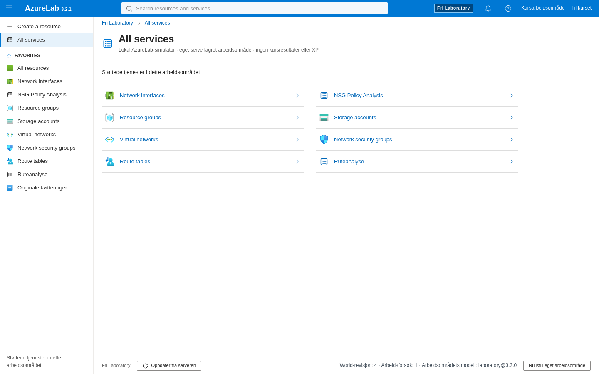
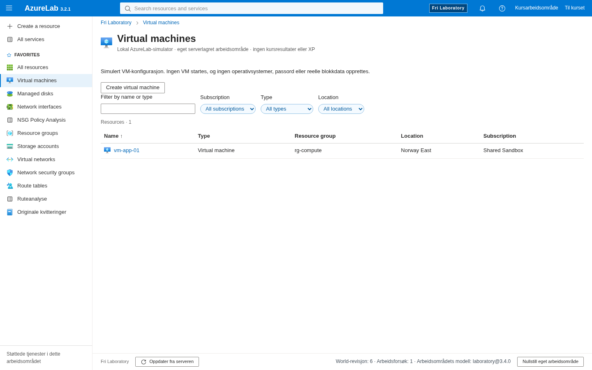
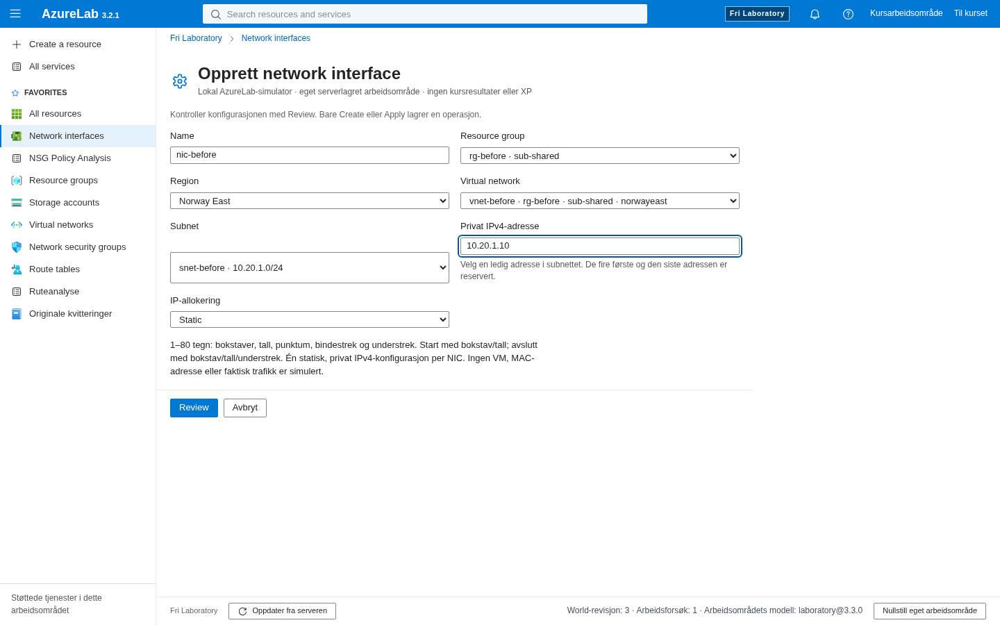
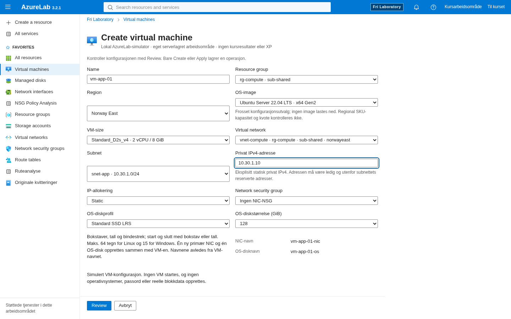
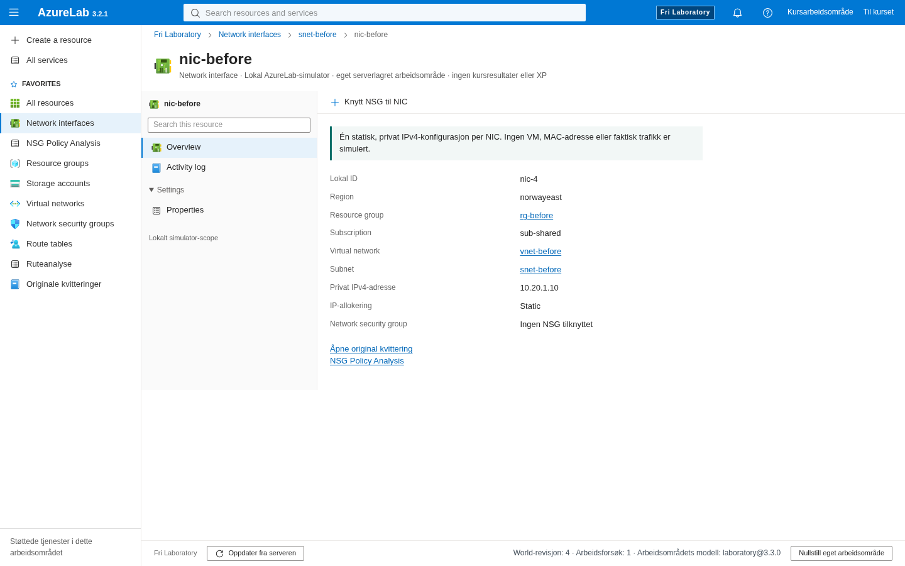
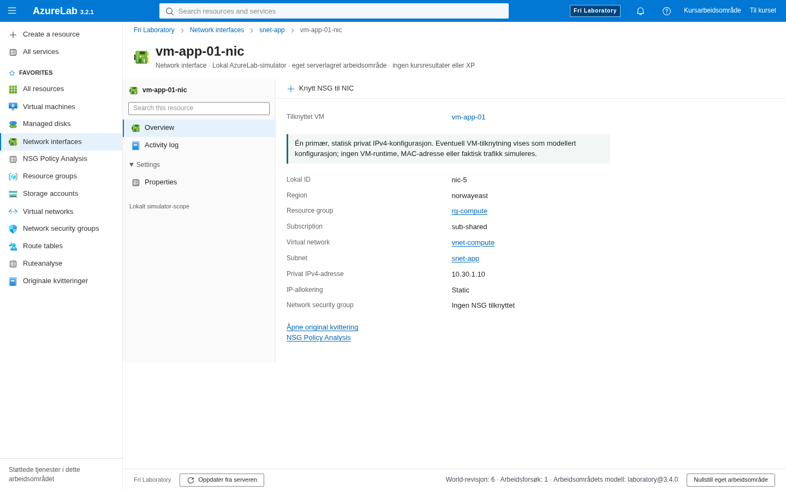
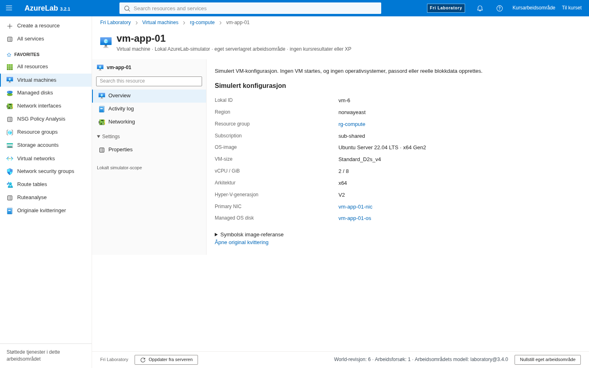
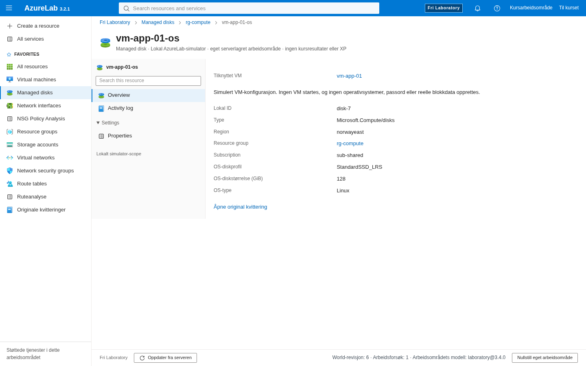

# PR66 visual and interaction review

Actual production builds, not mockups. The before capture uses an untouched detached `c9cf4f375e5b332b1f17a5ba31d021d093b1cb47` worktree and actual UI-created RG/VNet/subnet/NIC in its3.3 workspace. The after capture uses the new3.4 workspace and actual UI-created VM bundle. VM and managed disk screens did not exist in3.3; no fabricated “before VM” screen is supplied.

| Before3.3                                                                       | After3.4                                                                                  |
| ------------------------------------------------------------------------------- | ----------------------------------------------------------------------------------------- |
|     |                        |
|  |  |
|     |              |

New VM Overview and OS-disk inspection:

Critical author findings: the original NIC boundary said no VM was modeled.3.4 now distinguishes a modeled VM configuration from absent VM runtime/MAC/traffic;3.3 keeps original copy. Disk Properties now labels its storage profile correctly rather than reusing Storage Account redundancy wording. VM Properties links actual NIC/disk IDs; the NIC and disk link back to their owning VM. No power/boot/status controls or decorative management tabs were introduced.

Review/Create remains an ordinary scrollable form in short windows. Native tests measure Review's bounding box against the fixed footer, use keyboard focus, and inspect actual policy/disk Properties at1440×900,1024×768 and1024×500 with reduced motion and Axe. Final results and inspected images are recorded after execution in the verification record. A route/policy result does not verify VM runtime or application availability. Human novice/UX/screen-reader/learning validation is unperformed.

Final author native run:6/6,1.1min,0retry/flaky/skip. Personally inspected the actual before/after NIC/Create/Overview/disk frames and the final1024×500 Create, policy outcome and disk Properties. The Review/Cancel bar stays reachable; normal vertical scrolling exposes the longer form. Policy outcome displays actual scoped NIC identities, revision and the explicit no-traffic/no-VM-response boundary. Disk Properties uses its OS-disk storage profile and original receipt. The independently repeated original course navigation test and observed hydration correction are a separate scoped technical fix, not a course redesign. See [actual local verification](../reviews/evidence/pr66/verification.json).

Independent finding PR66-IFA-01 (MINOR): the first final `vm-os-disk.png` still showed VM Overview while the disk route committed. The author's initial per-image metadata mislabeled it. [That original frame is preserved](../reviews/evidence/pr66/audit-original/mislabeled-vm-os-disk.png). The new Linux test now asserts the exact disk title before capture. The affected real journey passed1/1 in11.9s without retry, and the replacement image was inspected: title `vm-app-01-os`, ID `disk-7`, type `Microsoft.Compute/disks`, StandardSSD_LRS128GiB, ownerVM and original receipt. No runtime or scoring rule changed. The separate final audit records the renewed independent check.
