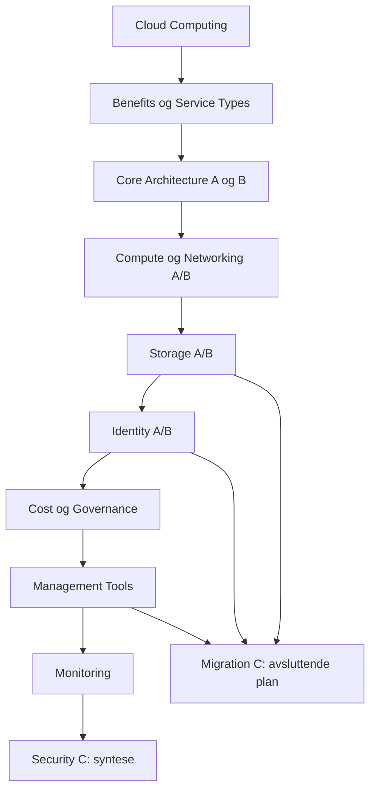

# AZ-900 — faktisk Learning Journey Map

**Revisjonsbase:** `4732f93dfcdd233dcb6d7acc2a4838ba7a292141`, 1. november 2026. [Hovedfunn](AZ900_END_TO_END_AUDIT.md) · [Tiltak og akseptanse](AZ900_REMEDIATION_PLAN.md) · [Alle kanoniske ruter, familier og målemetode](evidence/audit42.json).

## Faktisk navigasjon og inventar

`course-outline.ts` definerer tre stier. `course.tsx` definerer aktivitetsrekkefølge og modulovergang; `domain/course/model.ts` validerer også eldre/direkte ruter. Dette kartet beskriver den faktiske koden, ikke PR-utviklingsrekkefølgen.

1. **01 Cloud Concepts:** Computing (med Serverless) → Benefits → Service Types.
2. **02 Azure Architecture & Services:** Core A/B → Compute → Networking A/B → Storage A/B/**C Migration** → Identity A/B/**C Security**.
3. **03 Azure Management & Governance:** Cost → Governance → Tools → Monitoring → Hub.

19 pedagogiske deler deler 17 modulruter. Tabellen har 211 sekvensoppføringer fordi seks Serverless-aktiviteter også finnes inni Computing-raden; det gir **205 forskjellige standard-URL-er**. Parseren tillater **217 kanoniske topic-URL-er** totalt. Antall sier ingenting om gjennomføring eller mestring.

| Del / modulrute                                     | Aktivitets-ID-er i faktisk standardrekkefølge                                                                                                                                                                                                                                                                                                                                    | Teoriomfang¹ | Senere preset-guider / paired-scenarioer |
| --------------------------------------------------- | -------------------------------------------------------------------------------------------------------------------------------------------------------------------------------------------------------------------------------------------------------------------------------------------------------------------------------------------------------------------------------- | -----------: | ---------------------------------------: |
| Cloud Computing v2 · `/learn/computing`             | `intro-request` → `physical-server` → `virtualization` → `provisioning` → `capacity-basics` → `v2-capacity` → `v2-responsibility` → `v2-models` → `v2-placement` → `v2-metering` → `v2-pricing` → `serverless-concept` → `serverless-mechanism` → `serverless-hosting` → `serverless-explorer` → `serverless-assessment` → `serverless-summary` → `resource-bridge` → `transfer` |        1 217 |                                    0 / 0 |
| Serverless (innebygd) · `/learn/computing`          | `serverless-concept` → `serverless-mechanism` → `serverless-hosting` → `serverless-explorer` → `serverless-assessment` → `serverless-summary`                                                                                                                                                                                                                                    |        1 008 |                                    0 / 0 |
| Benefits · `/learn/benefits`                        | `availability` → `reliability` → `governance` → `management` → `sustainability` → `summary` → `transfer`                                                                                                                                                                                                                                                                         |        2 517 |                                    0 / 0 |
| Service Types v2 · `/learn/services`                | `overview` → `iaas` → `paas` → `saas` → `selection` → `practice` → `summary` → `transfer`                                                                                                                                                                                                                                                                                        |        2 655 |                                    0 / 0 |
| Core Architecture A · `/learn/architecture`         | `datacenters` → `regions` → `zones` → `pairs` → `sovereign` → `explorer` → `assessment` → `summary`                                                                                                                                                                                                                                                                              |        1 561 |                                    0 / 0 |
| Core Architecture B · `/learn/architecture`         | `organization` → `resources` → `groups` → `subscriptions` → `management` → `hierarchy` → `scope` → `management-assessment` → `core-summary`                                                                                                                                                                                                                                      |        1 456 |                                    0 / 0 |
| Compute & Hosting · `/learn/compute`                | `introduction` → `fundamentals` → `vm` → `dependencies` → `containers` → `functions` → `options` → `resilience` → `desktop` → `hosting` → `context` → `missions` → `assessment` → `summary`                                                                                                                                                                                      |        3 729 |                                   4 / 14 |
| Networking A · `/learn/networking`                  | `introduction` → `fundamentals` → `vnet` → `addressing` → `dependencies` → `peering` → `dns` → `explorer` → `missions` → `assessment` → `summary`                                                                                                                                                                                                                                |        2 734 |                                   4 / 12 |
| Networking B · `/learn/connectivity`                | `introduction` → `vpn` → `expressroute` → `endpoints` → `private-dns` → `hybrid` → `explorer` → `missions` → `assessment` → `summary`                                                                                                                                                                                                                                            |        2 232 |                                   4 / 12 |
| Storage A · `/learn/storage`                        | `introduction` → `blob` → `files` → `queues` → `tables` → `accounts` → `disks` → `studio` → `missions` → `assessment` → `summary`                                                                                                                                                                                                                                                |        2 714 |                                   3 / 12 |
| Storage B · `/learn/storage-resilience`             | `introduction` → `tiers` → `lifecycle` → `redundancy` → `recovery` → `boundaries` → `studio` → `missions` → `assessment` → `summary`                                                                                                                                                                                                                                             |        2 923 |                                   2 / 10 |
| Storage C / Migration · `/learn/migration`          | `introduction` → `methods` → `azcopy` → `explorer` → `file-sync` → `migrate` → `databox` → `validation` → `studio` → `missions` → `assessment` → `summary`                                                                                                                                                                                                                       |        2 839 |                                   3 / 10 |
| Identity A · `/learn/identity`                      | `introduction` → `directory` → `domain` → `authentication` → `sso` → `mfa` → `passwordless` → `external` → `studio` → `missions` → `assessment` → `summary`                                                                                                                                                                                                                      |        2 962 |                                   3 / 10 |
| Identity B / Access · `/learn/access-control`       | `introduction` → `rbac` → `scope` → `roles` → `planes` → `conditional` → `policies` → `testing` → `studio` → `missions` → `assessment` → `summary`                                                                                                                                                                                                                               |        2 714 |                                    2 / 8 |
| Identity C / Security · `/learn/security`           | `introduction` → `zero-trust` → `depth` → `encryption` → `defender` → `posture` → `protection` → `score` → `studio` → `missions` → `assessment` → `summary`                                                                                                                                                                                                                      |        3 070 |                                    3 / 8 |
| Cost Management · `/learn/cost`                     | `introduction` → `drivers` → `estimate` → `analysis` → `budgets` → `tags` → `optimization` → `assessment` → `summary`                                                                                                                                                                                                                                                            |        2 143 |                                   4 / 10 |
| Governance · `/learn/governance`                    | `introduction` → `purview` → `catalog` → `policy` → `assignments` → `compliance` → `locks` → `planes` → `trust` → `studio` → `missions` → `assessment` → `summary`                                                                                                                                                                                                               |        3 563 |                                    3 / 9 |
| Management & Deployment · `/learn/management-tools` | `introduction` → `portal` → `shell` → `cli` → `powershell` → `arm` → `iac` → `templates` → `bicep` → `changes` → `arc` → `copilot` → `studio` → `missions` → `assessment` → `summary`                                                                                                                                                                                            |        3 893 |                                   3 / 10 |
| Monitoring · `/learn/monitoring`                    | `introduction` → `advisor` → `health` → `monitor` → `signals` → `logs` → `alerts` → `insights` → `studio` → `missions` → `assessment` → `summary`                                                                                                                                                                                                                                |        3 241 |                                    3 / 8 |

¹ Omtrentlige ord/tokens over seksjonsobjekter inkludert titler, termer, eksempler og grenser. Sum **49 171**, ingen dobbeltelling av Serverless-tekst; Computing-radens rekkefølge inkluderer Serverless, men dens tekstobjekt gjør ikke det. Kontrolltekster, assessment-feedback, arbeidsflater, kilder og historiske alternativer er utenfor tellegrunnlaget. Ikke lesetid eller norm for hva studenten må lese. Null i guidekolonnen betyr ikke «ingen interaktiv undervisning»; eldre typer har andre kontrakter.

**Ekstra tilgjengelige aktiviteter:** Computing har eldre `capacity`, `responsibility`, `models`, `placement`, `metering`, `pricing`, `assessment`, `summary`, og direkte v2 `v2-assessment`, `v2-summary`. Benefits og Services har hver `assessment` utenfor footerens standardliste. Synlige lenker inne i undervisningen gir tilgang; dette er ikke bevis for at vurderingene er utilgjengelige. Eldre `version=1`, `activity=lab|debrief|mission`, valgte scenarioer og perspektiver beholdes. Retur til eldre lab bruker opprinnelig kurskontekst.

## Mekanismer, praktisk arbeid og evidence per del

| Del                     | Hva visualiseringen/praksisen faktisk tilfører                                       |
| ----------------------- | ------------------------------------------------------------------------------------ |
| Cloud Computing v2      | Fysisk server, virtualisering, provisjonering, kapasitet, ansvar og pris             |
| Serverless (innebygd)   | Request → instans/skalering, cold start, separat tilstand; tre guidede kontraster    |
| Benefits                | Tilgjengelighet, robusthet, styring og bærekraft; kontrollerte fordelmodeller        |
| Service Types v2        | IaaS/PaaS/SaaS-ansvar, kompatibilitet og eksisterende praktisk lab                   |
| Core Architecture A     | Region/soner/pairs og tre fysiske scenariokontraster                                 |
| Core Architecture B     | Faktisk scope-hierarki, scope-modell, tre administrative kontraster og gjenbrukt lab |
| Compute & Hosting       | Faktisk VM/disk/NIC-kjede; containere, Functions, kapasitet og hosting               |
| Networking A            | Adresse/CIDR, read-only VM-nettverk, peering og DNS-sti                              |
| Networking B            | Hybrid transport/kryptering og separat endpoint/DNS/tilgang                          |
| Storage A               | Workload-valg, account-kompatibilitet, objekt/fil/kø/entity-relasjoner               |
| Storage B               | Tier/lifecycle/Archive-faser og fysisk/synkron/asynkron replikering                  |
| Storage C / Migration   | Metodevalg, retningsbestemt manifest/sync og avhengig migreringsplan                 |
| Identity A              | Directory/legacy, sign-in-reise og eksterne identitetsgrenser                        |
| Identity B / Access     | Principal/rolle/scope-arv, to samtidige CA-policyer og separat autorisasjon          |
| Identity C / Security   | Zero Trust-kontrollbidrag, sju lag og syntetisk Defender-evidens                     |
| Cost Management         | Fiktive prisdrivere, estimat/avvik, forecast/budget og tags                          |
| Governance              | Metadata/ownership, Audit/Deny/locks; også ekte lokale Policy-receipts               |
| Management & Deployment | Verktøy→ARM→provider, parametere/referanser/dependencies, Arc; faktisk Portal-arbeid |
| Monitoring              | Kildevalg, helsetidslinje og syntetiske metrics/logs/traces/alarmer                  |

### Guide-/labforløp og avslutninger

41 preset-guider i de 13 senere modulene er tilgjengelige som følgende identiteter. Fullføring forutsetter lagrede observasjoner/kontraster og forklaring; relevant faktisk praksis krever i tillegg teknisk verifikasjon. Ikke åpning av en side.

| Modul                   | Preset-ID-er                              |
| ----------------------- | ----------------------------------------- |
| Compute & Hosting       | `vm`, `container`, `capacity`, `hosting`  |
| Networking A            | `inspect`, `address`, `peering`, `dns`    |
| Networking B            | `choose`, `diagnose`, `endpoint`, `dns`   |
| Storage A               | `design`, `accounts`, `delivery`          |
| Storage B               | `tiers`, `replication`                    |
| Storage C / Migration   | `method`, `sync`, `planning`              |
| Identity A              | `directory`, `journey`, `external`        |
| Identity B / Access     | `rbac`, `conditional`                     |
| Identity C / Security   | `trust`, `depth`, `defender`              |
| Cost Management         | `estimate`, `analysis`, `budgets`, `tags` |
| Governance              | `data`, `policy`, `locks`                 |
| Management & Deployment | `intent`, `change`, `arc`                 |
| Monitoring              | `evidence`, `health`, `telemetry`         |

Tidligere arbeid må beholdes som en egen taksonomi: Serverless-undersøkelser, Core As tre fysiske og Core Bs tre administrative kontraster, Foundations-/Benefits-/Service-øvelser, tre praktiske labtyper (`vm`, `paas`, `saas`), den eldre delte Web-platform-labben og fire selvstendige praktiske mission-typer (`diagnose`, `governance`, `infrastructure`, `platform`). Den samme Web-labben har flere inngangs-origin og skal ikke telles som flere nye operative simulatorer. Hver guidet lab har egen debrief/retur; praktiske mission-typer har endrede independent-moduser. Antall innganger, preset-guider, lagrede økter og scenarioer må ikke blandes.

Alle senere moduler har teori → arbeidsflate → guidede innganger → assessment → Summary, med Cost som innvever guidene i estimate/analysis/budgets/tags. Feedback vises etter levering med repetisjonslenke; tidligere feedback/Journal beskyttes mens independent er aktiv. Core A/B deler samlet resultatflate, men har separate lagrede resultater. Foundations v1/v2, Services v1/v2 og Cloud Transfer har forskjellige vurderingskontrakter. Summary viser besøkt/guidet/independent separat; ingen modulantall må omskrives til personlig mestring.

### Hele vurderingsbanken, ulike formatfamilier

| Bank               | Scenarioer | Modulspesifikke familier | Blindutvalg                       |
| ------------------ | ---------: | -----------------------: | --------------------------------- |
| compute            |         14 |                       14 | cp01, cp14                        |
| networking         |         12 |                        4 | nw01, nw12                        |
| connectivity       |         12 |                        4 | nc02, nc12                        |
| storage            |         12 |                        6 | sa02, sa12                        |
| storage-resilience |         10 |                        8 | rb03, rb10                        |
| migration          |         10 |                       10 | fm03, fm10                        |
| identity           |         10 |                        9 | if02, if10                        |
| access-control     |          8 |                        8 | ab10, ab09                        |
| security           |          8 |                        8 | sp01, sp08                        |
| cost               |         10 |                        5 | cm01, cm10                        |
| governance         |          9 |                        9 | gc01, gc09                        |
| management-tools   |         10 |                       10 | mt02, mt10                        |
| monitoring         |          8 |                        8 | md02, md08                        |
| transfer           |         19 |                        7 | campaign-pricing, two-valid-hosts |

152 scenarioer / 110 modul/familier. En familie kan ha flere varianter; flere første visninger i samme familie er ikke nye ueksponerte forsøk. Cloud Transfer gir 19 scenarioer fordelt på sju familier på tvers av Computing/Benefits/Services; de tre inngangene teller ikke som tre nye banker. Bankmetadata med lokale/offisielle mål-ID-er og alle familie-/variant-ID-er ligger i bevisfilen.

Åtte eldre skjemaer: Foundations v1 (8 kriterier), v2 (11), Serverless (7), Core A (10), Core B (8), Benefits (6), Services v2 (7), opprinnelige Services v1 (3). Sum 60 felt, hvorav tre numeriske. Dette er ikke 60 ekstra scenarioer med samme måleegenskaper som de 152 paroppgavene.

## Forkunnskapsgraf: introduksjon → anvendelse → fordypning → uassistert prøve

Grafen under er et faglig forslag bygget på faktisk manuskript og anvendelse; ingen nye gjennomføringssperrer.

| Konsept                                  | Introduksjon og første anvendelse                          | Nødvendige forkunnskaper                                     | Ny dybde / nyttig repetisjon                              | Hvor prøves det uten veiledning?                             |
| ---------------------------------------- | ---------------------------------------------------------- | ------------------------------------------------------------ | --------------------------------------------------------- | ------------------------------------------------------------ |
| Fysisk server → virtuell compute         | Computing physical-server/virtualization, kapasitet        | Request/applikasjon                                          | Compute VM/disk/hosting og faktisk bundle                 | Foundations v2, Compute; praktisk VM                         |
| Ansvarsdeling / IaaS/PaaS/SaaS           | Computing ansvar, deretter Service Types                   | Ressurs og provider/kunde                                    | Compute hosting; Identity- og sikkerhetsansvar            | Foundations/Services, Cloud Transfer, Compute                |
| Variabel last og forbrukspris            | Computing kapasitet/metering/pricing                       | Kapasitet versus etterspørsel                                | Benefits robusthet; Cost estimat/forecast                 | v2, Cloud Transfer, Cost                                     |
| Serverless                               | Computing etter pris før resource-bridge                   | Request, provisioning, ansvar og metering                    | Compute Functions/hosting, flere planforbehold            | Serverless-skjema og Compute                                 |
| Region, sone og regionpar                | Core A, fysisk Explorer                                    | Infrastruktur og tilgjengelighet                             | Compute resilience, Storage replikering, Service Health   | Core A, Compute, Resilience, Monitoring                      |
| Tenant, subscription, RG, ressurs        | Resource-bridge/Services-lab; systematisk Core B           | Provider/ressurs og lifecycle                                | Identity tenant, RBAC-scope, Policy, ARM                  | Core B, praktiske missions, Access/Tools                     |
| Nettadresse/subnet/route/DNS             | Networking A, adresse- og stieksempler                     | VM/NIC/VNet-relasjoner                                       | VPN/ExpressRoute og Private Endpoint/DNS i B              | Networking A/B                                               |
| Objekt/fil/kø/entity/account             | Storage A, Fjordverk-workload                              | Ressurs, data og nettverk/tilgang                            | Storage B tiers/replikering; Migration metoder            | Storage A, deretter B/C                                      |
| Tilgjengelighet versus backup            | Benefits/Core A; konkret Storage B                         | Sone/region og dataendring                                   | Replikeringsrisiko, failover, uavhengig recovery          | Benefits/Resilience; Security-kontrollbidrag                 |
| AuthN versus AuthZ                       | Tidlige ansvar-/endpoint-forbehold; systematisk Identity A | Tenant, applikasjon, data                                    | Access B og Security C                                    | Identity/Access/Security; eldre datascenarioer er avgrensede |
| Rolle og scope                           | Core Bs organisasjon → Access B                            | Tenant/hierarki og autentisering                             | DataActions, CA og ressursautorisasjon                    | Access B, ikke automatisk gjennom gammel Core-historikk      |
| Ressurskrav versus tillatelser           | Benefits faktisk Policy; Governance systematisk            | Scope, request og receipt                                    | Audit/Deny, locks og control/data plane                   | Benefits mission, Governance, Access                         |
| Deklarativ konfigurasjon og dependencies | Core ressursreferanser → Tools ARM/IaC                     | Scope, provider, RBAC/Policy/locks                           | Parameters/references/what-if og faktisk lokal inspeksjon | Tools                                                        |
| Konfigurasjon versus runtime             | Computing/Services-grenser → Monitoring                    | Ressurs, konfigurasjon og management-resultat                | Metric/log/trace/alert og manglende data                  | Monitoring; runtime bevises ikke av Portal-receipt           |
| Helhetlig sikkerhetsarkitektur           | Security C                                                 | Identity/Access, nettverk, Storage, Governance og Monitoring | Zero Trust, sju lag, posture versus alert                 | Security C, ikke nytt tidligere-part-resultat                |
| Flytting versus migrering                | Migration C                                                | Storage A/B, nettverk, datarettigheter og Tools              | Copy/sync, discovery/assessment/plan/validate             | Migration C                                                  |

**Bekreftede inversjoner LJ-02:** dagens Migration kommer før Identity/Access og Tools som den eksplisitt bygger på; dagens Security kommer før Governance og Monitoring som står i dens forkunnskapstekst. Dette er sterkere bevis enn utviklingsrekkefølgen i roadmapen. To muligheter: anbefal capstones senere på tvers av stier, eller behold stiplassering med tydelig «anbefales etter» og korte rettidige broer. Førstnevnte er anbefalt for en fullstendig nybegynner; eier velger før implementering.

Serverless har en rimelig tidlig plassering etter provisioning/pris. Dens hostingdetaljer kan være valgfri fordypning, mens Functions senere skal tilføre nytt hostingvalg fremfor samme definisjon. Cost kan fortsatt åpnes direkte tidlig; hele Cost-modulen er ikke en absolutt forutsetning for å forstå ett Storage-kostnadsforbehold.

## Repetisjonskart og forslag til variasjon

| Gjentakelse                                                       | Vurdering                                                                     | Konkret behandling                                                                                           |
| ----------------------------------------------------------------- | ----------------------------------------------------------------------------- | ------------------------------------------------------------------------------------------------------------ |
| Shared responsibility i Computing/Services/Compute/Identity       | Nyttig når kontrollnivå eller identitetsansvar endres                         | Kort recall-lenke; behold ny beslutning og relevante ansvarsgrenser                                          |
| Region/soner i Core/Compute/Storage/Monitoring                    | Mekanismen endres fra fysisk plassering til redundans og evidens              | Behold; bruk kart, replika og tidslinje ulikt                                                                |
| AuthN/AuthZ i endpoint/Storage/Identity/Access/Security           | Viktig invariant, men gjentatte fulle avsnitt kan bryte rytmen                | Én setning ved modellen og lenke til begrepsforklaring                                                       |
| PAYG ved usikker, ikke-avbrytbar last i Cloud Transfer/Cost       | Flere oppgaver nær samme beslutningsstruktur                                  | Behold læringssjekk; bruk ny evidens/avveining i reservert transfer                                          |
| Konsept-/runtime-/historikkforbehold i mange Studio-er og Summary | Ærlighet nødvendig, repetitiv innramming kan være tyngre enn selve mekanismen | Kort felles modellmerke; konkrete avvik alltid synlige                                                       |
| Prediksjon/run/kontrast/årsaksradio i 41 senere preset-guider     | Bevarer kausalitet, gir lite formatvariasjon alene                            | Bruk signalprioritering, kartinspeksjon, ordning av faser og før/etter-forklaring der mekanismen tilsier det |
| Hele åpne kildebanker i Summary                                   | Samme referanser gjentas i teori/Journal                                      | Sammenlagt felles kildeinngang; ingen sletting av claim-bindinger                                            |

Ingen helhetlig tidsnorm, optimal teorilengde eller målt transfer kan fastslås uten mennesker. Start med flyt og visuell prioritering, mål deretter før omfattende tekstkutt.

## Felles fremtidig standard for læringsflyt

| Tilstand                                 | Hva starter/observeres/fullføres?                                                 | Anbefalt primærhandling                              | Frivillig navigasjon og historikk                                                  |
| ---------------------------------------- | --------------------------------------------------------------------------------- | ---------------------------------------------------- | ---------------------------------------------------------------------------------- |
| Teori / første møte                      | Åpning er bare besøk                                                              | Relevant demonstrasjon eller Start undersøkelsen     | Direkte andre moduler tilgjengelige; ingen fullføringskreditt                      |
| Briefing, ikke startet                   | Eksplisitt Start; Cancel lagrer ingen oppgavekreditt                              | Start eller Avbryt                                   | Returner til samme modul/perspektiv                                                |
| Aktiv guide uten observasjon             | Studenten gjør prediksjon og støttet handling                                     | Fortsett undersøkelsen                               | Behold paused/resume; ingen kunstig global sperre                                  |
| Lagret observasjon, manglende kontrast   | Gyldig modellresultat eller verifisert faktisk receipt under opprinnelig kontrakt | Endre relevant premiss og sammenlign                 | Ingen kreditt fra klikk/tid eller syntetisk World-data                             |
| Gyldige kontraster, manglende forklaring | Gjenstående faglig årsaksvalg                                                     | Fullfør forklaringen                                 | Unngå at Neste skjuler dette uforvarende                                           |
| Validert guidet ferdig                   | Eksisterende kontrakt, passende debrief                                           | Se debrief → neste anbefalte oppdrag/anvendelse      | Gamle guided-records omtolkes ikke                                                 |
| Aktiv independent                        | Eksakt case/family/variant og delvis svar                                         | Fortsett denne vurderingen                           | Teaching/Journal/feedback krever varig hjelp før visning; ingen automatisk løsning |
| Levert independent                       | Immutable first; egen feedback/repetisjon                                         | Se feedback / velg nytt ueksponert problem / Summary | Senere retry oppgraderer ikke første resultat                                      |
| Lagring ukjent/konflikt                  | Ingen bekreftet observasjon                                                       | Kontroller/last relevant store                       | Ingen oppdiktet progresjon, ingen global reset som standard                        |

Standarden er en implementeringsspesifikasjon, ikke ny runtime i PR42. CourseNavigation kan videreutvikles med anbefalt kontekst fra eksisterende autoritative stores; ikke en ny kurs-/lagringsmotor. Felles ord, plassering og fokus må testes på tvers av både gamle laber og nye Studio-er.
